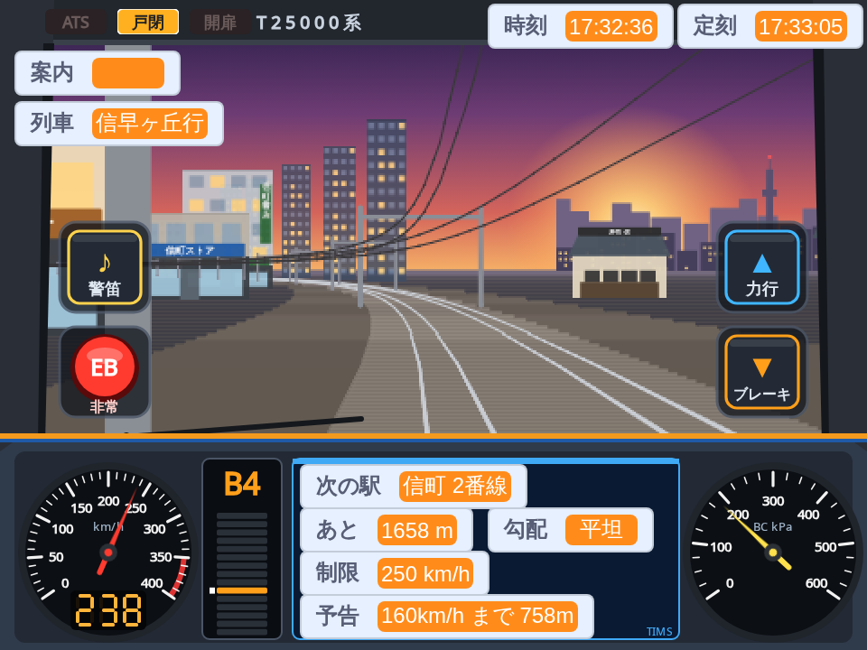
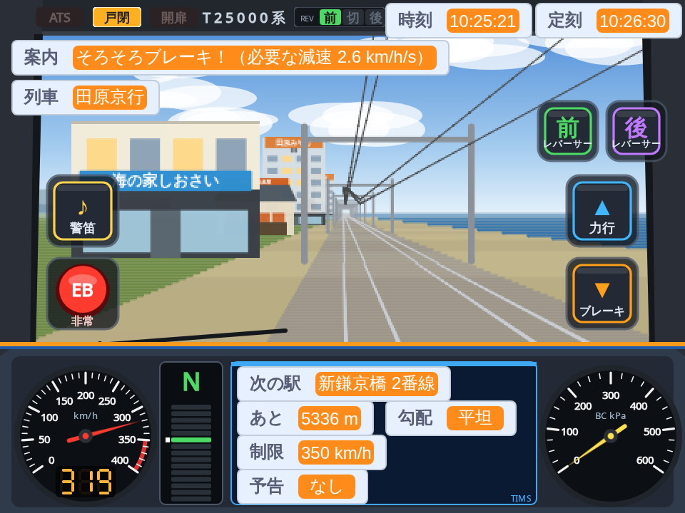
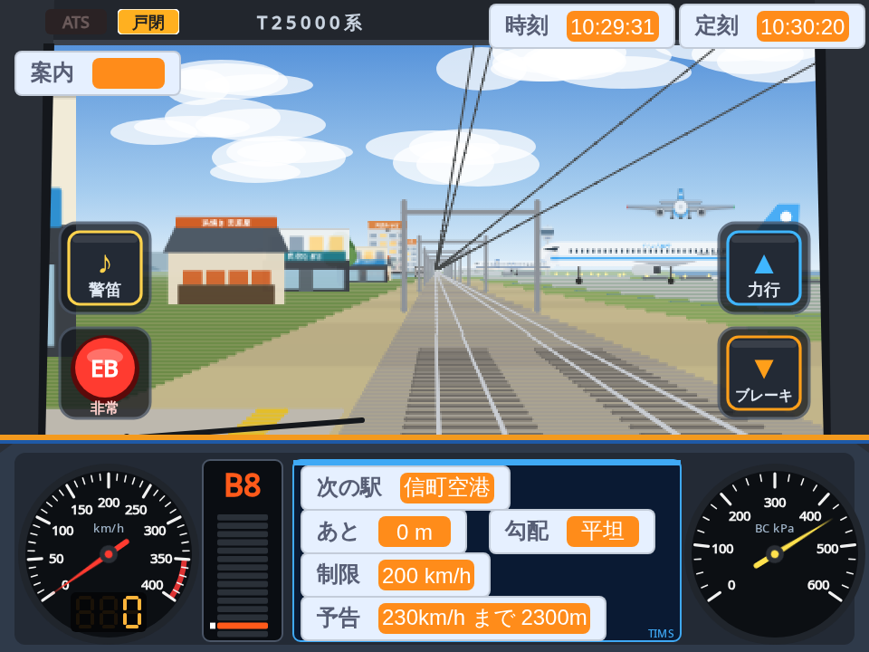
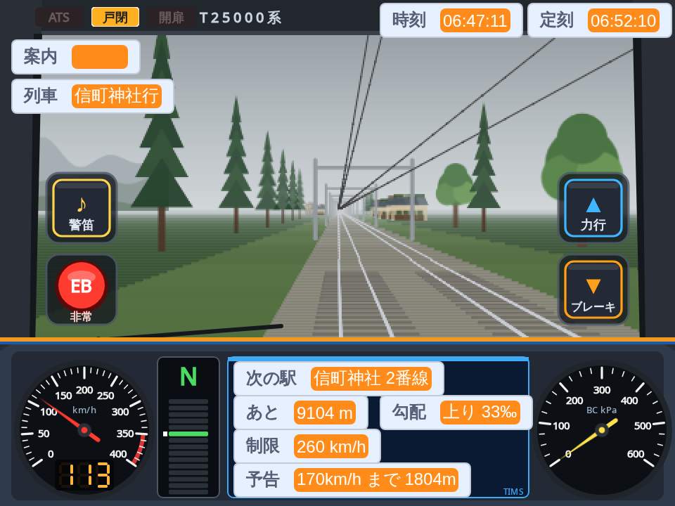
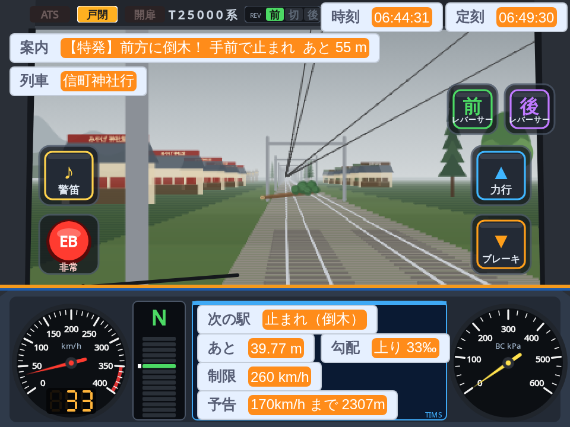

# 信町高速鉄道 3D運転士（Scratch）

最高 350km/h の T25000系を運転して、信町高速鉄道の3路線を時刻表どおりに走り、停止位置にピタッと止める大人向けの運転士ゲームです。
運転台から見た前の景色は、Scratch のペンで描く「疑似3D」です。
すべてのスプライトにコメントを付けてあるので、駅名・時刻表・電車の性能・沿線の店などを Scratch 上で改造できます。

- 駅ごとの**発車メロディ**（Clarinet_Express 様の作曲、許可を得て使用）
- **カーブ**で線路が曲がって見え、車輪がきしむ
- 田原海岸線の**信町空港**（ターミナル・管制塔・駐機中の飛行機・着陸や離陸する飛行機）
- ときどき起きる**アクシデント**（倒木・落石・シカ・踏切の車・強風・大雨・信号故障・モーター不調・非常通報）
- キーボードがなくても、スマホやタブレットの**タップ**で最初から最後まで遊べる



|  |  |  |
|---|---|---|
|  |  |  |
|  |  |  |

## 遊び方

### 開き方
- **Scratch**: [scratch.mit.edu](https://scratch.mit.edu/projects/editor/) で「ファイル → コンピューターから読み込む」から `train-driver-3d.sb3` を選ぶ。
- **TurboWarp（おすすめ）**: [turbowarp.org](https://turbowarp.org/) で同じように読み込む。素の Scratch より軽く、なめらかに動きます。

緑の旗を押すとタイトル画面になります。**Enter キーかクリック（タップ）でスタート**します。
スペースキーは非常ブレーキなので、スタートには使いません。

### 操作
キーボードでも、画面のボタン（スマホ・タブレットではタップ、パソコンではクリック）でも、最初から最後まで遊べます。

| キー | 画面のボタン | はたらき |
|---|---|---|
| Enter | 画面のどこかをタップ | タイトル画面・結果画面から進む |
| 数字キー | 番号のボタン（一覧の下） | 路線を選ぶ |
| ↑ または W | 右下の **▲力行** | ノッチを力行側へ 1 段（押しっぱなしで連続） |
| ↓ または S | 右下の **▼ブレーキ** | ノッチをブレーキ側へ 1 段（押しっぱなしで連続） |
| スペース | 左下の赤い **非常（EB）** | 非常ブレーキ（EB）。走行中に使うと減点 |
| H | 左下の **警笛** | 警笛 |

ノッチは **P5〜P1（力行）／ N ／ B1〜B8（ブレーキ）／ EB（非常）** のワンハンドル式です。


#### タップ操作（スマホ・タブレット）
- 運転中のボタンは、計器や TIMS・時刻の表示と重ならないように、窓の下の左右の端にあります。
- ▲力行・▼ブレーキは、押した瞬間に 1 段動き、押し続けると 0.5 秒後から 0.25 秒ごとに 1 段ずつ動きます（キーより少しゆっくりにして、動きすぎないようにしています）。指がボタンから外れると止まります。
- Scratch は指 1 本ぶん（マウス 1 つ）しか分からないので、2 つのボタンを同時には押せません。
- ボタンを出したくないときや、連続で動く速さを変えたいときは「設定」スプライトの「タップ操作（画面のボタン）」（画面のボタン・ボタン_連続になるまで・ボタン_連続の間隔）を変えます。
- スマホでは、Scratch や TurboWarp の全画面ボタンで大きくすると押しやすくなります。

### 音について
- ブラウザは、ページを一度クリックするかキーを押すまで音を出しません。
  - Scratch 公式では**クリック**が必要です。緑の旗をクリックすれば鳴ります。タイトル画面をクリックして始めても鳴ります。
  - TurboWarp ではキーを押しても鳴ります。
- 音が出ないときは、画面を一度クリックし、パソコンやブラウザのタブの音量も確かめてください。
- 音の出力先を変えたあとなどに鳴らない場合は、ページを再読み込みして `.sb3` を開き直してください。
- 音量は「設定」スプライトの「効果音の音量」「発車メロディの音量」「モーター音の音量」「走行音の音量」「きしみ音の音量」で変えられます。
- カーブでは、車輪がきしむ「キーー」という音がします。半径が小さいほど、速いほど大きく鳴り、直線では止まります（「きしみが鳴る半径」より急なカーブだけ）。

### 発車メロディ
駅を発車する前に、駅ごとに決めた発車メロディが流れます。

- **発車メロディ: Clarinet_Express 様**（信町高速鉄道のために制作、許可を得て使用）
  - 出典: Scratch「信町高速鉄道発車メロディー」 https://scratch.mit.edu/projects/1440158623/
  - 使っている曲: CLEX202・CLEX203・CLEX204
- **ご注意**: この 3 曲は作曲者の許可を得て使っている音源で、このリポジトリのほかの部分（プログラム・絵・合成した効果音）とは別の扱いです。**このゲーム以外の作品に流用したり、音源だけを取り出して配ったりしないでください。** 使いたいときは作曲者に直接許可をもらってください（`generator/sounds/melodies/README.md`）。

| 曲 | 流れる駅 |
|---|---|
| CLEX204（約 10.6 秒） | 新信町・高田・信町神社・信町空港 |
| CLEX202（約 8.9 秒） | 信町・旧信町城下町・神社正門・新鎌京橋・田原京（表にない駅もこの曲） |
| CLEX203（約 8.6 秒） | 二間六草・信早ヶ丘・六町橋西詰・紅葉滝 |

- 同じ路線でとなりの停車駅が同じ曲にならないように並べています。高田・信早ヶ丘のように 2 つの路線にある駅は、どちらの路線でも同じ曲です。
- **駅ごとの曲を変える**: 「発車メロディ」スプライトの「設定を読み込む」にある『駅 ○○ の発車メロディは △△』の曲名を書き換えます（ここを変えると駅ごとの発車メロディが変わる）。曲名は、そのスプライトの「音」タブにある音の名前です。
- 発車の流れ（定刻どおりのとき）: 到着 → 採点を 4.5 秒見せる → 発車の 15 秒前に発車メロディ → 曲が終わったら「ドアが閉まります」とドアチャイム → 発車時刻にドアが閉まって出発進行。
  - 停車時間は 25 秒（時刻表もこれに合わせて作っています）。遅れて着いたときは、曲を最後まで流してからドアを閉めるので、そのぶん発車が遅れます。
  - 鳴らし始める時刻は「設定」スプライトの「発車メロディの開始」（発車の何秒前か）で変えられます。

### ゲームの流れ
1. タイトルで Enter（またはタップ）を押し、路線を数字キーか番号のボタンで選ぶ
2. 始発駅で発車時刻を待つ（発車メロディ → ドアチャイム → 戸閉表示灯が点く）
3. ↑でブレーキを緩めて力行し、制限速度を守って次の停車駅へ走る
4. 停止位置に止まると採点され、時間になったら次の駅へ発車
5. 終点に着くと運転成績（合計・平均・ランク S〜D）が出る

### 採点（1駅 100点＋ピタ停車ボーナス 10点）
ゆるめの採点です。きびしさの数値はすべて「設定」スプライトの「採点のきびしさ」にまとまっていて、数を大きくするとやさしく、小さくするときびしくなります。

| 項目 | 配点 | 内容（かっこ内は設定の名前と初期値） |
|---|---|---|
| 停止位置 | 40 | ずれが 50cm 以内なら満点（停止位置_満点の範囲）。5m ずれると 0点（停止位置_0点の距離）。15cm 以内はピタ停車で＋10点（ピタ停車の範囲） |
| 時刻 | 20 | 定刻との差が ±5秒なら満点（定時の許容）。遅れは 5秒ごと、早着は 3秒ごとに 1点減 |
| 停車の衝動 | 20 | 止まる瞬間の減速度が 1.5km/h/s 以下で満点、5.0 で 0点。止まる直前にブレーキを緩めるのがコツ |
| 運転操作 | 20 | ATS警報 −3、ATS非常 −10、非常ブレーキ −5、再停車 −2、駅間停車 −3 |

- 停止位置の 3m より手前で止まると、もう一度進めて止まり直し（再停車）になります。
- 停止位置を 50m 以上行き過ぎると停車失敗（オーバーラン）です。その駅は運転操作の点だけになります。
- ランクは平均点で決まります: **S 96点以上 / A 85 / B 70 / C 45 / それより下は D**。

自動運転ボットで3路線を走らせたときの成績:
- ていねいな運転: A〜S（平均 90〜98点）
- 少し雑な運転（停止位置が数 m ずれる、ブレーキが遅い）: A〜B（84〜91点）
- オーバーランをくり返す運転: C（48〜57点）

### 大人向けのポイント
- 最高 350km/h。止まるまでに 4km 以上かかります。
  - TIMS の「あと」（停止位置までの距離）と「予告」（8km 先までの次の制限）を見て、早めにブレーキをかけます。
  - 間に合わなくなりそうになると、案内に「そろそろブレーキ！」と出ます。
- ブレーキは**遅れて効きます**（ブレーキシリンダー圧 BC が少しずつ上がる）。BC圧計で効き具合が見えます。
- 速くなるほど加速が弱くなります（定出力域・特性域）。坂・カーブ・走行抵抗もあります。
- 止まる直前はブレーキがよく効くので、そのままだと「ガクン」と止まって減点されます。
- 制限速度は**列車の最後尾が区間を抜けるまで**続きます（TIMS の「制限」）。
- **ATS**: 制限＋5km/h を超えるとベルが鳴り、制限＋12km/h を超えると非常ブレーキで止められます。
- ときどき**対向列車**（200〜320km/h）が右の線路を走ってきて、すれ違います（警笛・通過音つき）。
- 信町本線は速達運転で、通過駅を高速で通り抜けます（「○○ 通過」と案内）。

### アクシデント
運転中に、ときどきトラブルが起きます（1 回の運転で 0〜2 件。起きる場所と種類はでたらめ）。起きると警報が鳴り、案内と TIMS に知らせが出ます。

|  |  |
|---|---|
|  |  |

| 種類 | 起きること | うまく対応すると | だめだと |
|---|---|---|---|
| **線路の障害物**（倒木・落石・シカ・踏切で立ち往生した車） | 「【特発】前方に倒木！」と知らせ、TIMS が「止まれ（倒木）」とその手前までの距離になる。赤く点滅する特殊信号発光機（特発）と障害物が見えてくる | 手前で止まると **+10点**。取りのぞく作業（10 秒）のあと運転再開 | 当たると非常ブレーキで止められて **−15点**（運転操作から）。障害物はわきへ押しのけられる |
| **天気**（強風・大雨） | 少し先から速度規制（強風 160km/h・大雨 120km/h、5km）。制限標識が立ち、TIMS の予告にも出る。雨や風の線が見える | 規制区間を ATS が鳴らずに抜けると **+10点** | ATS が鳴ったら **−15点** |
| **信号故障** | 前の信号が赤のまま | 手前で止まると **+10点**。直って青になったら再開 | 越えると非常ブレーキで **−15点** |
| **モーター不調** | 加速の力が半分になる（次の停車駅で点検して直る） | 次の停車駅まで走ると **+5点** | ― |
| **非常通報** | 車内の非常ボタン。すぐ列車を止めて確認する | 時間内に止まると **+10点**。確認（10 秒）のあと再開 | 止まらないと非常ブレーキで **−15点** |

- 350km/h でも止まれるように、障害物や赤信号は「その速さからゆっくり（約 3.6km/h/s）止まれる距離＋600m」先に置きます（次の駅より先にはしません）。ブレーキの案内も、その手前に止まるように出ます。
- 障害物・赤信号・非常通報で止まったときは、非常ブレーキと駅間停車の減点はありません。当たっても残酷な場面にはならず、非常停止と減点だけです。
- アクシデントがあった区間の遅れは減点しません。遅れて着いた駅からあとの時刻表は、そのぶん遅らせます。
- 加点・減点は結果画面の成績に「【アクシデント】…」の行で出ます。加点があると平均が 100 点を超えることもあります。
- 起きやすさ（0 にすれば起きない）、種類ごとのオン・オフ、加点・減点、作業時間、規制の速度などは「設定」スプライトの「アクシデント」で変えられます。路線ごとに起きる種類は「路線データ」の『起きるアクシデント』です（信町本線: 踏切の車・信号故障・大雨・非常通報・モーター不調／神社線: 倒木・落石・シカ・大雨・モーター不調／田原海岸線: 強風・シカ・踏切の車・非常通報・モーター不調）。

### 画面の見方
- 左: 速度計（0〜400km/h、デジタル表示つき）　中央左: ノッチ表示　右: BC圧計
- 中央の TIMS: 次の停車駅・停止位置まで「あと」何 m（遠いと km、近づくと cm まで）・制限・勾配・制限の予告
- 上: 時刻・定刻（次の停車駅の到着時刻）、ATS表示灯・戸閉表示灯、案内

## 路線と車両

路線と駅は、路線図「信町高速鉄道仮路線図」に合わせています。
- 駅の順番は路線図のとおりです。
- 駅間距離は路線図の間隔を目安に、350km/h が出せるように長くしてあります。

| 路線 | 難易度・雰囲気 | 停車駅（**太字**）と通過駅 | 長さ・最高速度・所要時間の目安 |
|---|---|---|---|
| 信町本線 | 上級・夕方の街なか・速達 | **新信町** → 信釜 → **信町** → 三間 → **二間六草** → 信六 → 際記ヶ野間 → 信町公園 → **高田** → 中ヶ野宮 → **旧信町城下町** → 坂ヶ野 → **信早ヶ丘** | 61km・350km/h・約20分 |
| 神社線 | 中級・霧の山あい・33‰の上り坂とカーブ | **信早ヶ丘** → **神社正門** → **信町神社** | 13km・260km/h・約6分 |
| 田原海岸線 | 初級・昼の海沿い・見通しがよい | **高田** → **六町橋西詰** → **新鎌京橋** → **信町空港** → **紅葉滝** → **田原京** | 30km・350km/h・約13分 |

乗り換えと直通の案内は駅名標の帯に出ます。
- 高田: 田原海岸線のりかえ
- 信早ヶ丘: 神社線・多山横断 直通
- 二間六草: 草河原鉄道 直通
- 信釜: 草河原鉄道 支線

沿線には路線の雰囲気に合わせた店が並びます。
- 信町本線: 喫茶・書店・薬局・ラーメン・銀行・ホテル・家電・寿司・花屋・パン屋・歯科など
- 神社線: 門前そば・みやげ・茶屋・旅館
- 田原海岸線: 海の家・浜焼き・民宿・釣具・みやげ

### 信町空港
田原海岸線の信町空港駅の海側（右）に、埋め立ての空港があります。


- 駅の手前にターミナルビル（「信町空港」の看板）と案内看板、駅の先にエプロン・駐機中の飛行機・管制塔・格納庫・吹き流しがあり、線路と平行に誘導路と滑走路（白い中心線と誘導灯）が延びています。
- 航空会社は架空の「信町航空」（青とオレンジ）と「そらいろ航空」（空色）です。
- 空港に近づくと、1 機が電車を後ろから追い越して、前の方の滑走路に着陸してきます。そのあとも、ときどき（停車中も）飛行機が着陸したり、前の方から走ってきて頭の上へ離陸していったりします。
- 空港の場所は「路線データ」の『空港を置く』（ほかの路線にも置けます）、建物や駐機中の飛行機の並びは「景色」スプライトの『空港に置く』、飛行機の出やすさは「設定」スプライトの「空港と飛行機」で変えられます。

**車両 T25000系**（架空の高速電車）の性能:
- 8両編成
- 最高速度 350km/h
- 起動加速度 4.0km/h/s
- 常用最大減速度 5.4km/h/s、非常減速度 6.6km/h/s

## 改造ポイント

**Scratch の画面でしくみを読む解説ページ: [docs/scratch-guide.md](docs/scratch-guide.md)**

各スプライトの冒頭に「役割と改造ポイント」のコメント、主なブロックの右に説明のコメントがあります。


| やりたいこと | どこを変える |
|---|---|
| **駅名を変える** | 「路線データ」スプライトの『路線1 信町本線』などの定義の中の『駅を追加』ブロックの駅名。高田・信早ヶ丘のように2路線にある駅は両方を書き換える。駅名標の絵は「3D描画」スプライトの、駅名と同じ名前のコスチューム（名前と文字を変える。無ければ無地の駅名標になる） |
| 止まる駅・通過する駅 | 『駅を追加』の最後を「停車」か「通過」にする。通過を停車にしたら時刻も書く |
| 時刻表を変える | 『駅を追加』の時刻（hh:mm:ss、2けた）。始発駅は発車時刻、2駅目からは到着時刻 |
| 制限速度・カーブ・坂 | 路線の定義の中の『制限を追加』『カーブを追加』『勾配を追加』 |
| **沿線の店（看板）** | どの店を並べるかは、路線の定義の中の『沿線物を追加』（「店_」で始まる名前）。看板の店名そのものは「景色」スプライトのコスチューム「店_○○」の中の文字なので、コスチュームを開いて文字を書き換え、コスチューム名も「店_新しい店名」にして『沿線物を追加』の名前も合わせる。新しい店はコスチュームを複製して作る |
| 景色・色・霧 | 路線の定義の中の『景色』『地面の色』『外側の色』『沿線物を追加』 |
| 路線を増やす | 「路線データ」の冒頭コメントの手順（定義を複製 → 路線一覧に1行足す → 「路線を読み込む」に分岐を足す） |
| 電車の性能 | 「車両データ」スプライトの『T25000系』の定義の数字（加速・ブレーキ・遅れ・最高速度など） |
| 車両を増やす | 「車両データ」の冒頭コメントの手順。2両目を足すと車両選択画面が自動で出る。運転台の絵は「運転台」スプライトの車両名と同じ名前のコスチューム |
| **採点のきびしさ** | 「設定」スプライトの「採点のきびしさ」（ピタ停車の範囲・満点の範囲・定時の許容・減点・ランクの点数）。点数の付け方そのものは「採点」スプライトの『採点する』 |
| 音量 | 「設定」スプライトの「効果音の音量」「発車メロディの音量」「モーター音の音量」「走行音の音量」「きしみ音の音量」。きしみが鳴り始めるカーブは「きしみが鳴る半径」 |
| **カーブの曲がって見える強さ** | 「設定」スプライトの「見た目のカーブの強さ」（初期値 5 倍）と「見た目のカーブの最小半径」。画面の見た目だけが変わり、制限速度や走り方の計算は変わらない |
| **駅ごとの発車メロディ** | 「発車メロディ」スプライトの『駅 ○○ の発車メロディは △△』。鳴らし始める時刻は「設定」の「発車メロディの開始」、停車時間は「停車時間」 |
| 対向列車の出やすさ・速さ・色 | 「設定」スプライトの「対向列車_〜」と色のリスト |
| **アクシデントの起きやすさ・種類** | 「設定」スプライトの「アクシデント」（アクシデント_起きやすさ・種類ごとのオンオフ・加点・減点・作業時間・規制の速度など）。路線ごとの種類は「路線データ」の『起きるアクシデント』。障害物や信号機の絵は「アクシデント」スプライトのコスチューム |
| **空港の場所・建物の並び** | 空港の場所は「路線データ」の『空港を置く』（始め・終わり・右か左）。建物と駐機中の飛行機の並びは「景色」スプライトの『空港に置く』。滑走路の位置は「設定」の「滑走路の横」、地面の色は「色_空港の芝生」など |
| **飛行機の出やすさ** | 「設定」スプライトの「空港と飛行機」（飛行機_出現率・飛行機_抽選間隔・飛行機_見える範囲・飛行機_最初は着陸・飛行機_速さ）。航空会社は「景色」の「航空会社」のリストと「飛行機_会社名」のコスチューム |
| **タップ操作のボタン** | 出す・出さない、押し続けたときの速さは「設定」の「タップ操作（画面のボタン）」。置き場所は「タップ操作」スプライトの『ボタンを作る』 |
| ATS・ブレーキの案内 | 「設定」スプライトの ATS の余裕、ブレーキ案内の減速度 |
| 見え方・重さ | 「設定」スプライトの焦点距離・行の間隔・最大描画距離・枕木を描く距離・架線柱を描く距離など |

**重いとき**は「設定」スプライトで次のように軽くできます。
- 「行の間隔」を 3
- 「枕木を描く距離」を 0
- 「沿線物を描く距離」を 200
- 「最大描画距離」を 800

3D の中に置く絵（木・建物・店・標識・駅名標）は **20ピクセル＝1m、回転中心は根元** で描くと、正しい大きさで立ちます。

### しくみ（スプライト）
1 フレームごとに「ゲーム進行」が次の順でメッセージを送り、受け取ったスプライトがその順に仕事をします。

物理 → 判定 → 描画1_地面 → 描画2_景色 → 描画3_構造物 → 描画4_対向列車 → 描画4_アクシデント → 描画5_架線 → 表示

| スプライト | 役割 |
|---|---|
| 設定 / 路線データ / 車両データ | 改造用の数値とデータ |
| ゲーム進行 | タイトル → 路線選択 → 運転 → 結果の流れ、毎フレームの合図、TIMS の文字 |
| 運転 | キー入力・ノッチ・加速とブレーキ・ATS・制限速度・ブレーキの案内 |
| 採点 | 停車の判定・採点・ドア・発車・通過駅の案内 |
| 3D描画 | 地面（横線を何本も引く）・枕木・レール・ホーム・標識・駅名標・架線柱・架線 |
| 景色 | 遠くの山や街、線路わきの木・建物・店（スタンプ）。空港の建物と、着陸・離陸する飛行機 |
| 対向列車 | 対向列車の抽選・動き・描画 |
| 運転台・計器・ランプ・画面 | 手前に出る絵（ペンの絵はすべてのスプライトより奥に描かれる） |
| アクシデント | ときどき起きるトラブルの予定・進行・加点と減点、障害物・踏切・特発・信号機・雨や風の描画 |
| タップ操作 / 番号ボタン | 画面のボタン（運転中の ▲力行・▼ブレーキ・非常・警笛と、路線・車両を選ぶ番号）。いちばん手前に出る |
| 効果音 / 発車メロディ / モーター音 / 走行音 / きしみ音 | 音。Scratch の音量はスプライトごとなので5つに分けてある。モーター音・走行音・きしみ音の大きさを毎フレーム変えても、警笛やチャイム・発車メロディの音量は変わらない |

疑似3Dの計算:
- 前方 z m の地面は、地平線から「目の高さ × 焦点距離 ÷ z」ピクセル下に見えます。
- カーブは 10m ごとの曲率を2回足し合わせて、線路の横ずれを出しています。
- 本物の高速線のカーブ（半径 2000m 以上）は運転台からはほとんどまっすぐに見えるので、画面では「見た目のカーブの強さ」倍（初期値 5 倍）に強めて描いています。線路・枕木・架線・ホーム・沿線の景色・遠景がそろって曲がり、カーブの中では遠景が横に流れます。

## 開発者向け

`.sb3` は Python のジェネレータ（`generator/`）で作っています。Scratch 上で改造したものとは別に、ゲームを丸ごと作り直したいときに使います。

品質ゲートは、再生成した `.sb3` の project.json と全アセットがコミット済みの内容と一致すること、および乱数と時計を固定した自動運転で3路線が結果画面に到達することを確かめます。

```bash
python3 generator/build.py          # train-driver-3d.sb3 を作る（Python 3 と numpy）
python3 generator/timetable.py      # 時刻表と所要時間の目安を表示
npm install                         # 検証用ツール（scratch-vm・TurboWarp Packager・Playwright）
npx playwright install chromium
node tools/verify_vm.mjs            # scratch-vm で読み込み、自動運転ボットで3路線を最後まで走る
node tools/verify_vm.mjs --style careful        # 運転のうまさ: expert / careful / sloppy（--seed で変化）
node tools/verify_vm.mjs --route 2 --reckless   # 制限を無視して走り、ATS の動作を確かめる
node tools/verify_vm.mjs --accident 100         # アクシデントを毎回 2 件起こして走る（ボットは障害物の手前で止まる）
node tools/verify_vm.mjs --route 2 --plan 倒木@3000,大雨@11000   # 起きるアクシデントの種類と場所を決めて走る
node tools/verify_vm.mjs --route 3 --plan 動物@5000 --ignore-accidents   # アクシデントを無視して、当たったときの動きを確かめる
node tools/screenshot.mjs           # HTML 化してブラウザで撮影（docs/screenshots）＋フレームレート測定
node tools/audio_check.mjs          # HTML 化した版で、効果音が鳴るか・音量が正しいかを測る
node tools/audio_check_editor.mjs scratch     # Scratch 公式エディタで音が鳴るかを測る（ネット接続が必要）
node tools/audio_check_editor.mjs turbowarp   # TurboWarp エディタで同じく
node tools/editor_screenshot.mjs    # TurboWarp エディタでコードとコメントを撮影（ネット接続が必要）
node tools/tap_check.mjs            # キーボードを使わず、タップ（タッチ）だけで最初から結果画面まで遊べるかを確かめる
```

| ファイル | 内容 |
|---|---|
| `generator/sb3.py` | ブロックを Python で書くための小さな DSL と .sb3 書き出し |
| `generator/routes_data.py` | 路線・駅（停車/通過）・制限・カーブ・坂・沿線物・車両の元データ |
| `generator/timetable.py` | 同じ物理で理想運転の所要時間を出し、余裕を足して時刻表を作る |
| `generator/assets.py` | コスチューム（SVG。店の看板を含む）と効果音（WAV）の生成。発車メロディの読み込みと音量そろえ |
| `generator/sounds/melodies/` | 発車メロディの音源（Clarinet_Express 様の作曲。別の扱いなので、そこの README を読むこと） |
| `generator/sprites/*.py` | スプライトごとのスクリプト |

検証結果（このリポジトリの `.sb3`）:
- **scratch-vm**: 3路線とも、ボットで発車 → 全停車駅の停車・採点 → 結果画面まで進むことを確認。エラーと NaN はなし。
- **ボットの成績**: ていねい A〜S、少し雑 A〜B、オーバーランをくり返すと C。
- **350km/h**: 長い区間で 330〜350km/h まで出て、時刻表どおりに走れることを確認。
- **ATS**: 警報・非常ブレーキ・復帰が動くことを確認。
- **開始キー**: タイトルでスペースを押しても始まらず、Enter で始まることを確認。
- **発車の流れ**: 3路線の全停車駅で、発車の 15 秒前に駅ごとの発車メロディ → 3.2 秒前にドアチャイム → 1 秒前にドアが閉まる、の順に進むことを確認（`verify_vm.mjs` が毎回確かめる）。
- **アクシデント**: 起きやすさ 100%（毎回 2 件）でも 3路線ともボットが結果画面まで走れることを確認（ていねい・少し雑の運転）。9 種類それぞれを決めて起こし、手前で止まる・規制を守ると加点、無視して当たる・赤信号を越える・止まらないと非常停止と減点、遅れは減点されずに時刻表がずれることを確認。
- **タップ操作**（`tap_check.mjs`、Chromium のタッチ操作だけ）: タイトル → 番号ボタンで路線選択 → ▲力行・▼ブレーキのボタンだけで発車から次の駅に停車・採点 → 終点で結果画面 → タップでタイトル、まで通ることを確認。長押し 1.5 秒でノッチは 5 段（押した瞬間に 1 段、0.5 秒後から 0.25 秒ごと）、1 回のタップで 1 段だけ動く。非常・警笛のボタンも動く。
- **音**: HTML 化した版で、緑の旗をクリックしたあと次の音が実際に出力されることを測定。
  - 決定・発車メロディ（CLEX202〜204）・ドアチャイム・ドア・警笛・ATS ベル・すれ違い・採点などの効果音
  - モーター音・走行音・ジョイント音・きしみ音
  - 発車メロディの出力は約 −18dB で、ドアチャイム（約 −14.5dB）・警笛（約 −11dB）と釣り合う大きさ。鳴り終わってからドアチャイムに進む（鳴り始めから約 12 秒）。
  - きしみ音: 半径 2000m のカーブを 180km/h で走ると、2.6〜6kHz の大きさが直線より約 14dB 大きくなり、直線では音量 0 になる。
  - 効果音はいつも設定の音量で鳴り、モーター音・走行音・きしみ音の音量を変えても影響しないことを確認。
  - 以前の版では Scratch 公式エディタ・TurboWarp エディタでも同じことを測定（`audio_check_editor.mjs`、ネット接続が必要）。
- **.sb3 の大きさ**: 約 5.5MB（そのうち発車メロディの 3 曲が約 4.3MB。44.1kHz ステレオの WAV のまま）。project.json は約 1.2MB で、Scratch の上限（project.json 5MB、1 つの音 10MB）に収まる。
- **フレームレート**（Chromium・Apple M1）: TurboWarp のコンパイラで 1フレーム約 2.5ms、素の Scratch 相当のインタプリタで約 6ms。どちらも 30fps を維持。
  - 空港・アクシデント・カーブを足したあとの 1フレームの処理時間（Linux の Chromium、ソフトウェア描画）: コンパイラ約 2〜3ms、インタプリタ約 5〜7ms。

## 未対応・割り切った点
- 急なカーブでは、遠くの架線が大きく曲がって見えます。
- 坂の起伏は画面には描きません（勾配は加速・TIMS の表示だけに効きます）。
- 信号機による閉そく、ポイント（分岐器）の絵はありません。ATS は速度制限だけを見ます（本物の高速鉄道の ATC のような自動減速はしません）。
- 後ろには下がれません（停止位置の手前で止まったら進めて止まり直し）。
- 対向列車は駅に止まらず、決まった速さで走ってくるだけです。
- 看板の店名は絵（コスチューム）の中の文字なので、リストを書き換えるだけでは変わりません（コスチュームの文字を書き換えます）。
- 草河原鉄道・多山横断への直通運転は遊べる路線にしていません（駅名標の案内だけ）。
- 350km/h・高い加速度は、ゲームとして遊びやすいように実物より強めにしてあります。
- 車内放送の音声はありません。

## クレジット
- 発車メロディ: Clarinet_Express 様（信町高速鉄道のために制作、許可を得て使用）。出典: Scratch「信町高速鉄道発車メロディー」 https://scratch.mit.edu/projects/1440158623/ 。この音源は別の扱いです（上の「発車メロディ」のご注意を読んでください）。
- そのほかの絵と効果音は、ジェネレータでプログラムから作ったものです。
