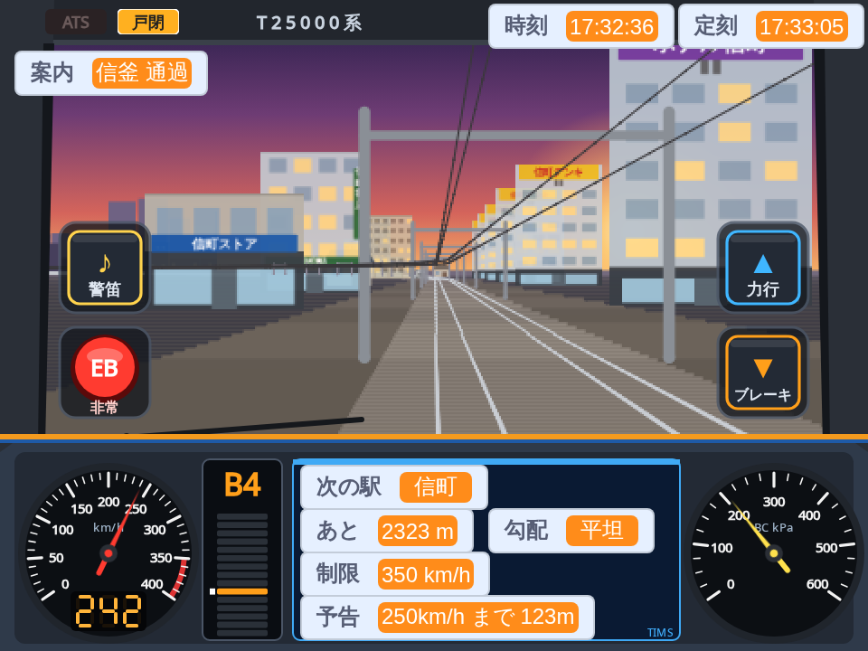

# 信町高速鉄道 3D運転士（Scratch）

最高 350km/h の T25000系を運転して、信町高速鉄道の3路線を時刻表どおりに走り、停止位置にピタッと止める大人向けの運転士ゲームです。
運転台から見た前の景色は、Scratch のペンで描く「疑似3D」です。
すべてのスプライトにコメントを付けてあるので、駅名・時刻表・電車の性能・沿線の店などを Scratch 上で改造できます。



|  |  |  |
|---|---|---|
|  |  |  |

## 遊び方

### 開き方
- **Scratch**: [scratch.mit.edu](https://scratch.mit.edu/projects/editor/) で「ファイル → コンピューターから読み込む」から `train-driver-3d.sb3` を選ぶ。
- **TurboWarp（おすすめ）**: [turbowarp.org](https://turbowarp.org/) で同じように読み込む。素の Scratch より軽く、なめらかに動きます。

緑の旗を押すとタイトル画面になります。**「スタート」ボタンのタップ（クリック）か Enter キーでスタート**します。
スペースキーは非常ブレーキなので、スタートには使いません。

### 操作
キーボードがなくても、スマホやタブレットの**タップ**（パソコンでは**クリック**）だけで、最初から最後まで遊べます。

| 画面のボタン | キー | はたらき |
|---|---|---|
| スタート（タイトルのどこをタップしても OK） | Enter | タイトル画面から進む |
| クレジット（タイトルの右上） | — | 発車メロディの作者などのクレジットを見る |
| 路線のボタン（1 信町本線・2 神社線・3 田原海岸線） | 数字キー | 路線を選ぶ |
| ▲ 力行（右上） | ↑ または W | ノッチを力行側へ 1 段 |
| ▼ ブレーキ（右下） | ↓ または S | ノッチをブレーキ側へ 1 段 |
| 非常 EB（左下） | スペース | 非常ブレーキ（EB）。走行中に使うと減点 |
| 警笛（左上） | H | 警笛 |
| タイトルにもどる（結果画面のどこをタップしても OK） | Enter | 結果画面からタイトルへ |

- 運転中のボタンは、窓の下の左右の角にあります（右手の親指で力行・ブレーキ、左手の親指で警笛・非常）。計器や TIMS の表示には重なりません。
- **1 回タップすると 1 段**だけ動きます。押し続けると 0.6 秒たってから 0.35 秒ごとに 1 段ずつ動きます（キーより遅くして、動きすぎないようにしてあります）。キーは押しっぱなしで 0.15 秒ごとに動きます。
- キーだけで遊ぶ人は、「設定」スプライトの「タッチボタンを出す」を 0 にすると運転中のボタンが消えます。

ノッチは **P5〜P1（力行）／ N ／ B1〜B8（ブレーキ）／ EB（非常）** のワンハンドル式です。

### 音について
- ブラウザは、ページを一度クリックするかキーを押すまで音を出しません。
  - Scratch 公式では**クリック（タップ）**が必要です。緑の旗をクリックすれば鳴ります。タイトル画面をタップして始めても鳴ります。
  - TurboWarp ではキーを押しても鳴ります。
- 音が出ないときは、画面を一度クリックし、パソコンやブラウザのタブの音量も確かめてください。
- 音量は「設定」スプライトの「効果音の音量」「発車メロディの音量」「モーター音の音量」「走行音の音量」で変えられます。

### ゲームの流れ
1. タイトルで「スタート」をタップ（または Enter）し、路線のボタン（または数字キー）で路線を選ぶ
2. 始発駅で発車時刻を待つ（発車メロディ → ドアチャイム → 戸閉表示灯が点く）。発車メロディは駅ごとに決まった曲が最後まで流れます
3. 「力行」ボタン（↑）でブレーキを緩めて力行し、制限速度を守って次の停車駅へ走る
4. 停止位置に止まると採点され、時間になったら次の駅へ発車
5. 終点に着くと運転成績（合計・平均・ランク S〜D）が出る

### 採点（1駅 100点＋ピタ停車ボーナス 10点）
ゆるめの採点です。きびしさの数値はすべて「設定」スプライトの「採点のきびしさ」にまとまっていて、数を大きくするとやさしく、小さくするときびしくなります。

| 項目 | 配点 | 内容（かっこ内は設定の名前と初期値） |
|---|---|---|
| 停止位置 | 40 | ずれが 50cm 以内なら満点（停止位置_満点の範囲）。5m ずれると 0点（停止位置_0点の距離）。15cm 以内はピタ停車で＋10点（ピタ停車の範囲） |
| 時刻 | 20 | 定刻との差が ±5秒なら満点（定時の許容）。遅れは 5秒ごと、早着は 3秒ごとに 1点減 |
| 停車の衝動 | 20 | 止まる瞬間の減速度が 1.5km/h/s 以下で満点、5.0 で 0点。止まる直前にブレーキを緩めるのがコツ |
| 運転操作 | 20 | ATS警報 −3、ATS非常 −10、非常ブレーキ −5、再停車 −2、駅間停車 −3 |

- 停止位置の 3m より手前で止まると、もう一度進めて止まり直し（再停車）になります。
- 停止位置を 50m 以上行き過ぎると停車失敗（オーバーラン）です。その駅は運転操作の点だけになります。
- ランクは平均点で決まります: **S 96点以上 / A 85 / B 70 / C 45 / それより下は D**。

自動運転ボットで3路線を走らせたときの成績:
- ていねいな運転: A〜S（平均 90〜98点）
- 少し雑な運転（停止位置が数 m ずれる、ブレーキが遅い）: A〜B（84〜91点）
- オーバーランをくり返す運転: C（48〜57点）

### 大人向けのポイント
- 最高 350km/h。止まるまでに 4km 以上かかります。
  - TIMS の「あと」（停止位置までの距離）と「予告」（8km 先までの次の制限）を見て、早めにブレーキをかけます。
  - 間に合わなくなりそうになると、案内に「そろそろブレーキ！」と出ます。
- ブレーキは**遅れて効きます**（ブレーキシリンダー圧 BC が少しずつ上がる）。BC圧計で効き具合が見えます。
- 速くなるほど加速が弱くなります（定出力域・特性域）。坂・カーブ・走行抵抗もあります。
- カーブの手前から奥の線路が左右に曲がって見え、カーブの中では景色が横に流れます。急なカーブを速く走ると、車輪が「キーーッ」ときしみます（神社線の急カーブではほぼずっと、ゆるいカーブではときどき）。
- 止まる直前はブレーキがよく効くので、そのままだと「ガクン」と止まって減点されます。
- 制限速度は**列車の最後尾が区間を抜けるまで**続きます（TIMS の「制限」）。
- **ATS**: 制限＋5km/h を超えるとベルが鳴り、制限＋12km/h を超えると非常ブレーキで止められます。
- ときどき**対向列車**（200〜320km/h）が右の線路を走ってきて、すれ違います（警笛・通過音つき）。
- 信町本線は速達運転で、通過駅を高速で通り抜けます（「○○ 通過」と案内）。
- ときどき**アクシデント**が起きます（下の「アクシデント」）。
- 田原海岸線の**信町空港**には、ターミナル・管制塔・格納庫・滑走路があります。空港に近づくと飛行機が着陸してきて、そのあともときどき離陸・着陸します（航空会社は架空の「信町エア」「うみかぜ航空」）。

### アクシデント（ときどきランダムに起きる）
1 回の運転で 0〜2 件くらい、次のようなトラブルがランダムに起きます。路線によって起きやすい種類が違います（神社線は倒木や動物、田原海岸線は強風、信町本線は踏切や信号故障など）。

| 系統 | 種類 | どうすればよいか |
|---|---|---|
| 線路の障害物 | 倒木・落石・動物（シカ）・踏切で立ち往生した車 | 知らせを受けたら、障害物の手前で止まる。止まると片づけ・確認のあと運転再開 |
| 天気や設備 | 強風・大雨 | しばらくの区間（6km）が速度規制（強風 160km/h・大雨 200km/h）。規制速度を守って走る |
| 〃 | 信号故障 | 赤信号のままの信号機の手前で止まる。しばらくすると黄色（注意）に変わる |
| 車両や車内 | モーター不調 | 次の駅まで力行の力が半分になる。慎重に次の駅まで走る |
| 〃 | 非常通報 | 車内で非常通報。すぐにブレーキをかけて、知らされた距離のうちに止まる |

- 起きると、案内・警報音（防護無線・非常通報のブザー）・運転台の「異常」表示灯の点滅で知らせます。障害物は線路わきの赤い光が点滅していて、遠くからでもわかります。大雨は窓の向こうが暗くなって雨が降り、強風は風のすじと葉っぱが飛びます。
- 350km/h でも止まれるように、止まれる距離よりも遠く（350km/h なら約 5km 先）から知らせます。止まる場所が次の駅にかかるときは、その駅のあとに延期します。
- うまく対応できたら**ボーナス +10**、ぶつかった・止まれなかった・規制速度を守れなかったら**減点 −10**（次の駅の得点に入ります）。
  - ぶつかっても大事故にはなりません。非常ブレーキで止まって点検し、運転を再開します（シカや踏切の車はぎりぎりで逃げます）。
  - アクシデントのあいだは、非常ブレーキを使っても減点しません。アクシデントで止まっても「駅間停車」の減点はありません。
  - アクシデントで遅れた時間は、次の駅の「時刻」の採点で差し引きます（遅れて着いて発車が遅れた分も、次の駅では差し引きます）。
- 起きやすさ（0 なら起きない）・最大件数・種類ごとの ON/OFF・点数・規制の速さは「設定」スプライトの「アクシデント」で変えられます。

### 画面の見方
- 左: 速度計（0〜400km/h、デジタル表示つき）　中央左: ノッチ表示　右: BC圧計
- 中央の TIMS: 次の停車駅・停止位置まで「あと」何 m（遠いと km、近づくと cm まで）・制限・勾配・制限の予告
- 上: 時刻・定刻（次の停車駅の到着時刻）、ATS表示灯・戸閉表示灯・異常表示灯（アクシデント）、案内

## 路線と車両

路線と駅は、路線図「信町高速鉄道仮路線図」に合わせています。
- 駅の順番は路線図のとおりです。
- 駅間距離は路線図の間隔を目安に、350km/h が出せるように長くしてあります。

| 路線 | 難易度・雰囲気 | 停車駅（**太字**）と通過駅 | 長さ・最高速度・所要時間の目安 |
|---|---|---|---|
| 信町本線 | 上級・夕方の街なか・速達 | **新信町** → 信釜 → **信町** → 三間 → **二間六草** → 信六 → 際記ヶ野間 → 信町公園 → **高田** → 中ヶ野宮 → **旧信町城下町** → 坂ヶ野 → **信早ヶ丘** | 61km・350km/h・約22分 |
| 神社線 | 中級・霧の山あい・33‰の上り坂とカーブ | **信早ヶ丘** → **神社正門** → **信町神社** | 13km・260km/h・約7分 |
| 田原海岸線 | 初級・昼の海沿い・見通しがよい | **高田** → **六町橋西詰** → **新鎌京橋** → **信町空港** → **紅葉滝** → **田原京** | 30km・350km/h・約16分 |

乗り換えと直通の案内は駅名標の帯に出ます。
- 高田: 田原海岸線のりかえ
- 信早ヶ丘: 神社線・多山横断 直通
- 二間六草: 草河原鉄道 直通
- 信釜: 草河原鉄道 支線

沿線には路線の雰囲気に合わせた店が並びます。
- 信町本線: 喫茶・書店・薬局・ラーメン・銀行・ホテル・家電・寿司・花屋・パン屋・歯科など
- 神社線: 門前そば・みやげ・茶屋・旅館
- 田原海岸線: 海の家・浜焼き・民宿・釣具・みやげ。信町空港の付近は空港の建物と駐機中の飛行機

### 発車メロディ（駅ごとの曲）
発車メロディは **Clarinet_Express 様** が信町高速鉄道のために作ってくださった 3 曲（CLEX202・CLEX203・CLEX204）です。
停車時間は 25 秒で、発車時刻の 14 秒前にメロディが始まり、曲が終わる → ドアチャイム → ドアが閉まる → 発車、と進みます。

| 曲 | 長さ | 発車する駅 |
|---|---|---|
| CLEX202 | 約8.9秒 | 新信町・高田（信町本線・田原海岸線）・神社正門・信町空港 |
| CLEX203 | 約8.6秒 | 信町・旧信町城下町・六町橋西詰・紅葉滝 |
| CLEX204 | 約10.6秒 | 二間六草・信早ヶ丘（神社線）・新鎌京橋 |

終点（信早ヶ丘〈信町本線〉・信町神社・田原京）にも曲を決めてありますが、終点からは発車しないので鳴りません。
どの駅でどの曲を鳴らすかは、「路線データ」スプライトの『駅を追加』の最後の欄（発車メロディ）で変えられます（「なし」にすると鳴らない）。

**車両 T25000系**（架空の高速電車）の性能:
- 8両編成
- 最高速度 350km/h
- 起動加速度 4.0km/h/s
- 常用最大減速度 5.4km/h/s、非常減速度 6.6km/h/s

## 改造ポイント

各スプライトの冒頭に「役割と改造ポイント」のコメント、主なブロックの右に説明のコメントがあります。


| やりたいこと | どこを変える |
|---|---|
| **駅名を変える** | 「路線データ」スプライトの『路線1 信町本線』などの定義の中の『駅を追加』ブロックの駅名。高田・信早ヶ丘のように2路線にある駅は両方を書き換える。駅名標の絵は「3D描画」スプライトの、駅名と同じ名前のコスチューム（名前と文字を変える。無ければ無地の駅名標になる） |
| 止まる駅・通過する駅 | 『駅を追加』の最後を「停車」か「通過」にする。通過を停車にしたら時刻も書く |
| 時刻表を変える | 『駅を追加』の時刻（hh:mm:ss、2けた）。始発駅は発車時刻、2駅目からは到着時刻 |
| 制限速度・カーブ・坂 | 路線の定義の中の『制限を追加』『カーブを追加』『勾配を追加』 |
| **画面のカーブの曲がり方** | 「設定」の「見た目のカーブの強さ」（初期値 8 倍。1 で本当の半径どおり）と「見た目のカーブの最小半径」。運転の計算（制限・曲線抵抗・きしみ音）は本当の半径のままなので、見た目だけが変わる |
| **カーブのきしみ音** | 「設定」の「きしみ音の音量」「きしみ_鳴り始める半径」（これより急なカーブで鳴る）「きしみ_いちばん鳴る半径」「きしみ_最低速度」。音そのものは「きしみ音」スプライト |
| **沿線の店（看板）** | どの店を並べるかは、路線の定義の中の『沿線物を追加』（「店_」で始まる名前）。看板の店名そのものは「景色」スプライトのコスチューム「店_○○」の中の文字なので、コスチュームを開いて文字を書き換え、コスチューム名も「店_新しい店名」にして『沿線物を追加』の名前も合わせる。新しい店はコスチュームを複製して作る |
| 景色・色・霧 | 路線の定義の中の『景色』『地面の色』『外側の色』『沿線物を追加』 |
| 路線を増やす | 「路線データ」の冒頭コメントの手順（定義を複製 → 路線一覧に1行足す → 「路線を読み込む」に分岐を足す） |
| 電車の性能 | 「車両データ」スプライトの『T25000系』の定義の数字（加速・ブレーキ・遅れ・最高速度など） |
| 車両を増やす | 「車両データ」の冒頭コメントの手順。2両目を足すと車両選択画面が自動で出る。運転台の絵は「運転台」スプライトの車両名と同じ名前のコスチューム |
| **採点のきびしさ** | 「設定」スプライトの「採点のきびしさ」（ピタ停車の範囲・満点の範囲・定時の許容・減点・ランクの点数）。点数の付け方そのものは「採点」スプライトの『採点する』 |
| **駅ごとの発車メロディ** | 「路線データ」スプライトの『駅を追加』の最後の欄（CLEX202 / CLEX203 / CLEX204 / なし）。曲そのものは「発車メロディ」スプライトの音。鳴らし始める時刻は「設定」の「発車メロディの前の秒」 |
| 音量 | 「設定」スプライトの「効果音の音量」「発車メロディの音量」「モーター音の音量」「走行音の音量」「きしみ音の音量」 |
| 対向列車の出やすさ・速さ・色 | 「設定」スプライトの「対向列車_〜」と色のリスト |
| **空港と飛行機** | 空港の区間と滑走路の位置は「路線データ」の田原海岸線の『空港』、建物と駐機中の飛行機は『目印を追加』（景色スプライトのコスチューム名・位置・横）。飛行機の出やすさは「設定」の「空港と飛行機」（出現率・抽選間隔・見える範囲・着陸を見せる距離・最大機数）、航空会社はリスト「航空会社の一覧」。地面の色は「色_エプロン」「色_滑走路」など |
| ATS・ブレーキの案内 | 「設定」スプライトの ATS の余裕、ブレーキ案内の減速度 |
| **アクシデント** | 起きやすさ・最大件数・種類ごとの ON/OFF（1/0）・ボーナスと減点・知らせる距離の余裕・待つ時間・規制の速さと長さ・モーター不調の力は「設定」の「アクシデント」。路線ごとの起きやすい種類は「路線データ」の『アクシデントの候補』（同じ名前を何回も書くと起きやすい）。障害物の絵は「アクシデント」スプライトのコスチューム |
| 見え方・重さ | 「設定」スプライトの焦点距離・行の間隔・最大描画距離・枕木を描く距離・架線柱を描く距離など |
| **タッチ操作のボタン** | 押し続けたときの速さは「設定」の「ボタン_連続の待ち」「ボタン_連続の間隔」、運転中に出すかは「タッチボタンを出す」。ボタンの場所・絵は「タッチボタン」スプライト（『ボタンを作る』の x・y とコスチューム）。路線を増やしたら「路線4」のコスチュームを足すとボタンの絵になる |

**重いとき**は「設定」スプライトで次のように軽くできます。
- 「行の間隔」を 3
- 「枕木を描く距離」を 0
- 「沿線物を描く距離」を 200
- 「最大描画距離」を 800

3D の中に置く絵（木・建物・店・標識・駅名標）は **20ピクセル＝1m、回転中心は根元** で描くと、正しい大きさで立ちます。

### しくみ（スプライト）
1 フレームごとに「ゲーム進行」が次の順でメッセージを送り、受け取ったスプライトがその順に仕事をします。

物理 → アクシデント → 判定 → 描画1_地面 → 描画2_景色 → 描画3_構造物 → 描画4_対向列車 → 描画5_架線 → 描画6_アクシデント → 表示

| スプライト | 役割 |
|---|---|
| 設定 / 路線データ / 車両データ | 改造用の数値とデータ |
| ゲーム進行 | タイトル → 路線選択 → 運転 → 結果の流れ、毎フレームの合図、TIMS の文字 |
| 運転 | キー入力・ボタン入力・ノッチ・加速とブレーキ・ATS・制限速度・ブレーキの案内 |
| アクシデント | アクシデントの予定・始める・進める（成功・失敗の判定）・障害物や信号機・雨や風を描く |
| 採点 | 停車の判定・採点・ドア・発車・通過駅の案内 |
| 3D描画 | 地面（横線を何本も引く）・空港のエプロンと滑走路・枕木・レール・ホーム・標識・駅名標・架線柱・架線 |
| 景色 | 遠くの山や街、線路わきの木・建物・店、空港の建物（目印）と飛行機（スタンプ。奥から順に描く） |
| 対向列車 | 対向列車の抽選・動き・描画 |
| 飛行機 | 信町空港の飛行機の抽選と動き（着陸・離陸）。絵は景色スプライトが描く |
| 運転台・計器・ランプ・画面 | 手前に出る絵（ペンの絵はすべてのスプライトより奥に描かれる） |
| タッチボタン | タップ（クリック）用のボタン。いちばん手前。押すと変数「押したボタン」「ボタンを押した回数」が変わり、運転・ゲーム進行がそれを読む |
| 効果音 / 発車メロディ / モーター音 / 走行音 / きしみ音 / 雨の音 | 音。Scratch の音量はスプライトごとなので分けてある。モーター音・走行音・きしみ音の大きさを毎フレーム変えても、警笛やチャイム・発車メロディの音量は変わらない |

疑似3Dの計算:
- 前方 z m の地面は、地平線から「目の高さ × 焦点距離 ÷ z」ピクセル下に見えます。
- カーブは 10m ごとの曲率を2回足し合わせて、線路の横ずれを出しています（OutRun 方式）。レール・枕木・道床・ホーム・架線・架線柱・標識・沿線の物・対向列車・飛行機は、みんなこの横ずれを使って描きます。
- 高速鉄道のカーブは半径 2000〜6000m と大きく、そのままだと画面ではほとんどまっすぐです。そこで画面に描くときだけ曲率を「見た目のカーブの強さ」倍（初期値 8）にしています（遠くの山や街が流れる速さも同じ）。
- 遠景の絵（幅 1920）は Scratch で置ける最大の幅（720 ピクセル）に縮めて貼り、足りない分はもう 1 枚貼って、カーブでいくら流れても画面の幅が埋まるようにしています。

## 開発者向け

`.sb3` は Python のジェネレータ（`generator/`）で作っています。Scratch 上で改造したものとは別に、ゲームを丸ごと作り直したいときに使います。

```bash
python3 generator/build.py          # train-driver-3d.sb3 を作る（Python 3 と numpy）
python3 generator/timetable.py      # 時刻表と所要時間の目安を表示
npm install                         # 検証用ツール（scratch-vm・TurboWarp Packager・Playwright）
npx playwright install chromium
node tools/verify_vm.mjs            # scratch-vm で読み込み、自動運転ボットで3路線を最後まで走る
node tools/verify_vm.mjs --style careful        # 運転のうまさ: expert / careful / sloppy（--seed で変化）
node tools/verify_vm.mjs --route 2 --reckless   # 制限を無視して走り、ATS の動作を確かめる
node tools/verify_vm.mjs --input tap            # キーを使わず、画面のボタンを押したことにして 3 路線を走る
node tools/verify_vm.mjs --acc-rate 100         # アクシデントが毎回 2 件起きるようにして走る
node tools/verify_vm.mjs --route 2 --acc 倒木:3000,落石:11300   # 起きるアクシデントと場所を決めて走る
node tools/verify_vm.mjs --route 2 --acc 倒木:3000 --ignore-acc  # 知らせを無視して、ぶつかったときの動きを確かめる
node tools/tap_check.mjs            # Chromium で本物のボタンをクリックだけして、発車から停車・採点、結果画面まで（--shots で撮影）
node tools/screenshot.mjs           # HTML 化してブラウザで撮影（docs/screenshots）＋フレームレート測定
node tools/audio_check.mjs          # HTML 化した版で、効果音が鳴るか・音量が正しいかを測る
node tools/audio_check_editor.mjs scratch     # Scratch 公式エディタで音が鳴るかを測る（ネット接続が必要）
node tools/audio_check_editor.mjs turbowarp   # TurboWarp エディタで同じく
node tools/editor_screenshot.mjs    # TurboWarp エディタでコードとコメントを撮影（ネット接続が必要）
```

| ファイル | 内容 |
|---|---|
| `generator/sb3.py` | ブロックを Python で書くための小さな DSL と .sb3 書き出し |
| `generator/routes_data.py` | 路線・駅（停車/通過）・制限・カーブ・坂・沿線物・車両の元データ |
| `generator/timetable.py` | 同じ物理で理想運転の所要時間を出し、余裕を足して時刻表を作る |
| `generator/assets.py` | コスチューム（SVG。店の看板を含む）と効果音（WAV）の生成。発車メロディの読み込み（MD5 で原本を確認し、3 曲の音の大きさをそろえる） |
| `generator/sounds/CLEX*.wav` | 発車メロディの原本（Clarinet_Express 様の作品。下の「クレジット」を参照） |
| `generator/sprites/*.py` | スプライトごとのスクリプト |

検証結果（このリポジトリの `.sb3`）:
- **scratch-vm**: 3路線とも、ボットで発車 → 全停車駅の停車・採点 → 結果画面まで進むことを確認。エラーと NaN はなし。
- **ボットの成績**: ていねい A〜S、少し雑 A〜B、オーバーランをくり返すと C。
- **350km/h**: 長い区間で 330〜350km/h まで出て、時刻表どおりに走れることを確認。
- **ATS**: 警報・非常ブレーキ・復帰が動くことを確認。
- **開始キー**: タイトルでスペースを押しても始まらず、Enter で始まることを確認。
- **タップ操作**: Chromium でキーを 1 回も使わず、画面のボタンのクリックだけで「クレジット → スタート → 路線選択 → 発車 → 次の駅に停車・採点 → 結果画面 → タイトル」まで通せることを確認（`tools/tap_check.mjs`）。力行ボタンを 2 秒押し続けると 5 段（キーは約 12 段）、警笛・非常ボタンも確認。scratch-vm でもボタン操作で 3 路線を最後まで走れることを確認（`--input tap`）。
- **音**: Scratch 公式エディタ・TurboWarp エディタ・HTML 化した版で、緑の旗をクリックしたあと次の音が実際に出力されることを測定。
  - 決定・ドアチャイム・ドア・警笛・ATS ベル・すれ違い・採点などの効果音
  - 発車メロディ（CLEX202・CLEX203）が「発車メロディ」スプライトから音量 85 で鳴り、出力の振幅（RMS 約 0.10、最大約 0.7）が出ていることを HTML 化した版で測定
  - きしみ音: 田原海岸線の半径 2000m のカーブを 170km/h で走ると「きしみ音」スプライトの音量が最大 33 まで上がり、出力の 3.15kHz 付近が約 −35dB（直線では音量 0・約 −55dB）になることを測定
  - モーター音・走行音・ジョイント音
  - 効果音はいつも音量 100%（設定の音量）で鳴り、モーター音の音量を変えても影響しないことを確認。
- **フレームレート**（Chromium・Apple M1）: TurboWarp のコンパイラで 1フレーム約 2.5ms、素の Scratch 相当のインタプリタで約 6ms。どちらも 30fps を維持。

## クレジット
- **発車メロディ: Clarinet_Express 様**（信町高速鉄道のために制作、許可を得て使用。出典 https://scratch.mit.edu/projects/1440158623/ ）
  - ゲームのタイトル画面・結果画面と、「発車メロディ」「路線データ」スプライトのコメントにも書いてあります。
  - **曲の権利は Clarinet_Express 様にあります。** このリポジトリのほかの部分とは権利が別です。このゲームの中で遊ぶ・改造するのはかまいませんが、曲（`generator/sounds/` の WAV や、.sb3 の中の音）を取り出して、ほかの作品に勝手に使ったり配ったりしないでください。
- それ以外の絵と音は、ジェネレータで描いた・合成したオリジナルです。

## 直したこと（カーブ）
- カーブでレールだけがまっすぐのまま描かれていた不具合を直しました。地面・道床は曲がっていたのに、レールが使う「行中心x」の表が空のままだったため、レールとホームの壁がいつも画面の真ん中に描かれていました（運転席の横位置 0.6m のずれもなくなりました）。

## 未対応・割り切った点
- 坂の起伏は画面には描きません（勾配は加速・TIMS の表示だけに効きます）。
- 信号機による閉そく、ポイント（分岐器）の絵はありません。ATS は速度制限だけを見ます（本物の高速鉄道の ATC のような自動減速はしません）。
- 後ろには下がれません（停止位置の手前で止まったら進めて止まり直し）。
- 対向列車は駅に止まらず、決まった速さで走ってくるだけです。
- 看板の店名は絵（コスチューム）の中の文字なので、リストを書き換えるだけでは変わりません（コスチュームの文字を書き換えます）。
- 草河原鉄道・多山横断への直通運転は遊べる路線にしていません（駅名標の案内だけ）。
- 350km/h・高い加速度は、ゲームとして遊びやすいように実物より強めにしてあります。
- 車内放送の音声はありません。
