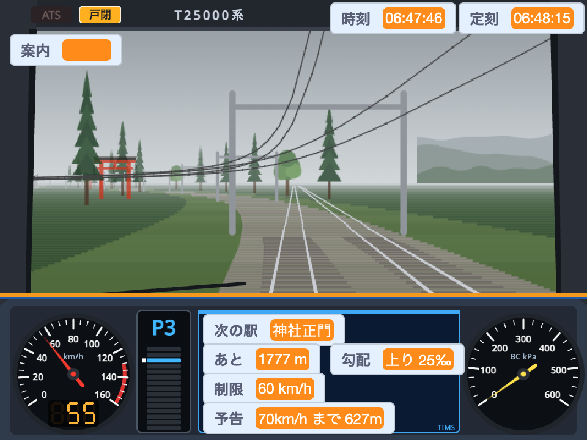
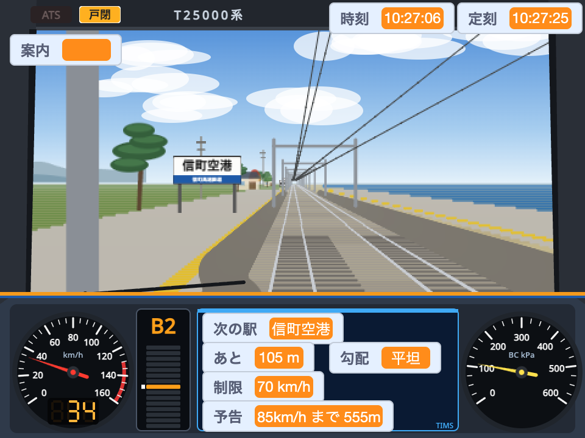
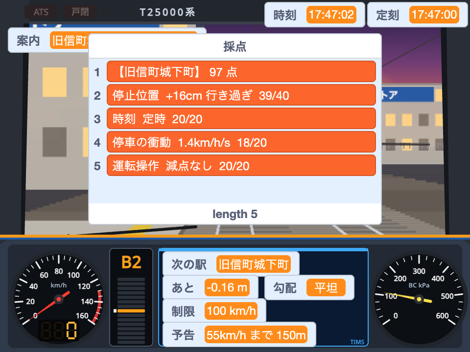

# 信町高速鉄道 3D運転士（Scratch）

T25000系を運転して、信町高速鉄道の3路線を時刻表どおりに走り、停止位置にピタッと止める大人向けの運転士ゲームです。
運転台から見た前の景色は、Scratch のペンで描く「疑似3D」です。
すべてのスプライトにコメントを付けてあるので、駅名・時刻表・電車の性能などを Scratch 上で改造できます。


|  |  |  |
|---|---|---|
|  |  |  |

## 遊び方

### 開き方
- **Scratch**: [scratch.mit.edu](https://scratch.mit.edu/projects/editor/) で「ファイル → コンピューターから読み込む」から `train-driver-3d.sb3` を選ぶ。
- **TurboWarp（おすすめ）**: [turbowarp.org](https://turbowarp.org/) で同じように読み込む。素の Scratch より軽く、なめらかに動きます。

緑の旗を押すとタイトル画面になります。

### 操作
| キー | はたらき |
|---|---|
| ↑ または W | ノッチを力行側へ 1 段（押しっぱなしで連続） |
| ↓ または S | ノッチをブレーキ側へ 1 段 |
| スペース | 非常ブレーキ（EB）。走行中に使うと減点 |
| H | 警笛 |
| 数字キー | メニューで路線を選ぶ |

ノッチは **P5〜P1（力行）／ N ／ B1〜B8（ブレーキ）／ EB（非常）** のワンハンドル式です。

### ゲームの流れ
1. タイトルでスペース → 路線を数字キーで選ぶ
2. 始発駅で発車時刻を待つ（発車メロディ → ドアチャイム → 戸閉表示灯が点く）
3. ↑でブレーキを緩めて力行し、制限速度を守って次の駅へ走る
4. 停止位置に止まると採点され、時間になったら次の駅へ発車
5. 終点に着くと運転成績（合計・平均・ランク S〜D）が出る

### 採点（1駅 100点＋ピタ停車ボーナス10点）
| 項目 | 配点 | 内容 |
|---|---|---|
| 停止位置 | 40 | 停止位置とのずれ（cm）。±10cm 以内で満点＋ピタ停車ボーナス、2m ずれると 0点 |
| 時刻 | 20 | 定刻（到着時刻）との差。±2秒は定時。遅れは2秒ごと、早着は1秒ごとに 1点減 |
| 停車の衝動 | 20 | 止まる瞬間の減速度。1.0km/h/s 以下で満点（止まる直前にブレーキを緩めるのがコツ） |
| 運転操作 | 20 | ATS警報 −5、ATS非常 −20、非常ブレーキ −10、再停車・駅間停車 −5 |

- 停止位置の 1m より手前で止まると、もう一度進めて止まり直し（再停車）になります。
- 停止位置を 15m 以上行き過ぎると、その駅は 0点（オーバーラン）です。

### 大人向けのポイント
- ブレーキは**遅れて効きます**（ブレーキシリンダー圧 BC が少しずつ上がる）。BC圧計で効き具合が見えます。
- 速くなるほど加速が弱くなります（定出力域・特性域）。坂・カーブ・走行抵抗もあります。
- 止まる直前はブレーキがよく効くので、そのままだと「ガクン」と止まって減点されます。
- 制限速度は**列車の最後尾が区間を抜けるまで**続きます（TIMS の「制限」）。
- **ATS**: 制限＋3km/h を超えるとベルが鳴り、制限＋10km/h を超えると非常ブレーキで止められます。
- ときどき**対向列車**が右の線路を走ってきて、すれ違います（警笛・通過音つき）。

### 画面の見方
- 左: 速度計（デジタル表示つき）　中央左: ノッチ表示　右: BC圧計
- 中央の TIMS: 次の駅・停止位置まで「あと」何 m（近づくと cm まで）・制限・勾配・制限の予告
- 上: 時刻・定刻（次の駅の到着時刻）、ATS表示灯・戸閉表示灯、案内

## 路線と車両

路線と駅は、路線図「信町高速鉄道仮路線図」に合わせています（駅間距離は路線図の間隔を目安にした値です）。

| 路線 | 難易度・雰囲気 | 駅 |
|---|---|---|
| 信町本線 | 上級・夕方の街なか・13駅、制限が多く駅間が短い | 新信町 → 信釜 → 信町 → 三間 → 二間六草 → 信六 → 際記ヶ野間 → 信町公園 → 高田 → 中ヶ野宮 → 旧信町城下町 → 坂ヶ野 → 信早ヶ丘 |
| 神社線 | 中級・霧の山あい・3駅、33‰の上り坂と急カーブ | 信早ヶ丘 → 神社正門 → 信町神社 |
| 田原海岸線 | 初級・昼の海沿い・6駅、見通しがよい | 高田 → 六町橋西詰 → 新鎌京橋 → 信町空港 → 紅葉滝 → 田原京 |

乗り換えと直通の案内は駅名標の帯に出ます。
- 高田: 田原海岸線のりかえ
- 信早ヶ丘: 神社線・多山横断 直通
- 二間六草: 草河原鉄道 直通
- 信釜: 草河原鉄道 支線

**車両 T25000系**（架空の通勤形電車）の性能:
- 8両編成
- 最高速度 120km/h
- 起動加速度 3.0km/h/s
- 常用最大減速度 4.2km/h/s、非常減速度 4.8km/h/s

## 改造ポイント

各スプライトの冒頭に「役割と改造ポイント」のコメント、主なブロックの右に説明のコメントがあります。


| やりたいこと | どこを変える |
|---|---|
| **駅名を変える** | 「路線データ」スプライトの『路線1 信町本線』などの定義の中の『駅を追加』ブロックの駅名。高田・信早ヶ丘のように2路線にある駅は両方を書き換える。駅名標の絵は「3D描画」スプライトの、駅名と同じ名前のコスチューム（名前と文字を変える。無ければ無地の駅名標になる） |
| 時刻表を変える | 同じく『駅を追加』の時刻（hh:mm:ss、2けた）。始発駅は発車時刻、2駅目からは到着時刻 |
| 制限速度・カーブ・坂 | 路線の定義の中の『制限を追加』『カーブを追加』『勾配を追加』 |
| 景色・色・霧 | 路線の定義の中の『景色』『地面の色』『外側の色』『沿線物を追加』 |
| 路線を増やす | 「路線データ」の冒頭コメントの手順（定義を複製 → 路線一覧に1行足す → 「路線を読み込む」に分岐を足す） |
| 電車の性能 | 「車両データ」スプライトの『T25000系』の定義の数字（加速・ブレーキ・遅れ・最高速度など） |
| 車両を増やす | 「車両データ」の冒頭コメントの手順。2両目を足すと車両選択画面が自動で出る。運転台の絵は「運転台」スプライトの車両名と同じ名前のコスチューム |
| 対向列車の出やすさ・速さ・色 | 「設定」スプライトの「対向列車_〜」と色のリスト |
| ATS・採点の厳しさ | 「設定」スプライトの ATS の余裕・ピタ停車の範囲など。点数の付け方は「採点」スプライトの『採点する』 |
| 見え方・重さ | 「設定」スプライトの焦点距離・行の間隔・最大描画距離・枕木を描く距離など |

**重いとき**は「設定」スプライトで次のように軽くできます。
- 「行の間隔」を 3
- 「枕木を描く距離」を 0
- 「沿線物を描く距離」を 200

3D の中に置く絵（木・建物・標識・駅名標）は **20ピクセル＝1m、回転中心は根元** で描くと、正しい大きさで立ちます。

### しくみ（スプライト）
1 フレームごとに「ゲーム進行」が次の順でメッセージを送り、受け取ったスプライトがその順に仕事をします。

物理 → 判定 → 描画1_地面 → 描画2_景色 → 描画3_構造物 → 描画4_対向列車 → 描画5_架線 → 表示

| スプライト | 役割 |
|---|---|
| 設定 / 路線データ / 車両データ | 改造用の数値とデータ |
| ゲーム進行 | タイトル → 路線選択 → 運転 → 結果の流れ、毎フレームの合図、TIMS の文字 |
| 運転 | キー入力・ノッチ・加速とブレーキ・ATS・制限速度 |
| 採点 | 停車の判定・採点・ドア・発車 |
| 3D描画 | 地面（横線を何本も引く）・枕木・レール・ホーム・標識・駅名標・架線柱・架線 |
| 景色 | 遠くの山や街、線路わきの木や建物（スタンプ） |
| 対向列車 | 対向列車の抽選・動き・描画 |
| 運転台・計器・ランプ・画面 | 手前に出る絵（ペンの絵はすべてのスプライトより奥に描かれる） |
| サウンド | 効果音（すべて合成したオリジナル） |

疑似3Dの計算:
- 前方 z m の地面は、地平線から「目の高さ × 焦点距離 ÷ z」ピクセル下に見えます。
- カーブは 10m ごとの曲率を2回足し合わせて、線路の横ずれを出しています。

## 開発者向け

`.sb3` は Python のジェネレータ（`generator/`）で作っています。Scratch 上で改造したものとは別に、ゲームを丸ごと作り直したいときに使います。

```bash
python3 generator/build.py          # train-driver-3d.sb3 を作る（Python 3 と numpy）
npm install                         # 検証用ツール（scratch-vm・TurboWarp Packager・Playwright）
npx playwright install chromium
node tools/verify_vm.mjs            # scratch-vm で読み込み、自動運転ボットで3路線を最後まで走る
node tools/verify_vm.mjs --route 2 --reckless   # 制限を無視して走り、ATS の動作を確かめる
node tools/screenshot.mjs           # HTML 化してブラウザで撮影（docs/screenshots）＋フレームレート測定
node tools/editor_screenshot.mjs    # TurboWarp エディタでコードとコメントを撮影（ネット接続が必要）
```

| ファイル | 内容 |
|---|---|
| `generator/sb3.py` | ブロックを Python で書くための小さな DSL と .sb3 書き出し |
| `generator/routes_data.py` | 路線・駅・制限・カーブ・坂・車両の元データ |
| `generator/timetable.py` | 同じ物理で理想運転の所要時間を出し、余裕を足して時刻表を作る |
| `generator/assets.py` | コスチューム（SVG）と効果音（WAV）の生成 |
| `generator/sprites/*.py` | スプライトごとのスクリプト |

検証結果（このリポジトリの `.sb3`）:
- **scratch-vm**: 3路線とも、自動運転ボットで発車 → 全駅の停車・採点 → 結果画面まで進むことを確認。エラーと NaN はなし。
- **ボットの成績**:
  - 信町本線 平均97点（S）
  - 神社線 91点（A）
  - 田原海岸線 88点（A）
- **ATS**: 警報・非常ブレーキ・復帰が動くことを確認。
- **対向列車**: 出現とすれ違いを確認。
- **フレームレート**（Chromium・Apple M1）: TurboWarp のコンパイラで 1フレーム約 2ms、素の Scratch 相当のインタプリタで約 5ms。どちらも 30fps を維持。

## 未対応・割り切った点
- 坂の起伏は画面には描きません（勾配は加速・TIMS の表示だけに効きます）。
- 信号機による閉そく、ポイント（分岐器）の絵はありません。ATS は速度制限だけを見ます。
- 後ろには下がれません（停止位置の手前で止まったら進めて止まり直し）。
- 対向列車は駅に止まらず、決まった速さで走ってくるだけです（ブレーキなどの計算はしていません）。
- 草河原鉄道・多山横断への直通運転は遊べる路線にしていません（駅名標の案内だけ）。
- 結果画面の成績リストは長い路線だとスクロールして見ます。
- 車内放送の音声はありません。
