# 信町高速鉄道 3D運転士（Scratch）

最高 350km/h の T25000系を運転して、信町高速鉄道の3路線と、2つの路線を直通する**エアポート特快**を時刻表どおりに走り、停止位置にピタッと止める大人向けの運転士ゲームです。
運転台から見た前の景色は、Scratch のペンで描く「疑似3D」です。
すべてのスプライトにコメントを付けてあるので、駅名・時刻表・電車の性能・沿線の店などを Scratch 上で改造できます。

- 駅ごとの**発車メロディ**（Clarinet_Express 様の作曲、許可を得て使用）
- **カーブ**で線路が曲がって見え、車輪がきしむ
- **高架**: 高田を出ると坂を上って街の上の高架を走り、坂を下りたところから海沿いの景色になる（田原海岸線とエアポート特快）
- 田原海岸線の**信町空港**（ターミナル・管制塔・駐機中の飛行機・着陸や離陸する飛行機）
- どの駅も**3番線まで**（2面3線）。駅の手前と先の分岐器で線路が分かれて合わさり、いつもは 2番線に着く
- **分岐器の「ガタン、ガタン」**: ポイントを通ると、車輪が 1 本ずつ「ガタン」と鳴って運転台がガクッと揺れる。曲がって 3番線に入るときは、もっと激しく横にも揺れる（揺れだけを切ることもできる）
- 全駅に**昇降式ロープホームドア**（成田空港駅のような、ロープが上下する柵）。停止位置に止まるとロープが上がってからドアが開く。ずれて止まると「停止位置修正」
- **レバーサー**（前・切・後）。行き過ぎたら「後」にして下がり、止まり直せる
- **エアポート特快 田原京行**（10両）: 信町本線から高田で田原海岸線に入り、信町空港・田原京へ。種別・両数・走る区間・停車駅は「路線データ」のブロックで決めていて、ほかの種別（快速・普通など）も足せる
- ときどき起きる**アクシデント**（倒木・落石・シカ・踏切の車・強風・大雨・信号故障・モーター不調・非常通報・**番線変更**）
- キーボードがなくても、スマホやタブレットの**タップ**で最初から最後まで遊べる


| 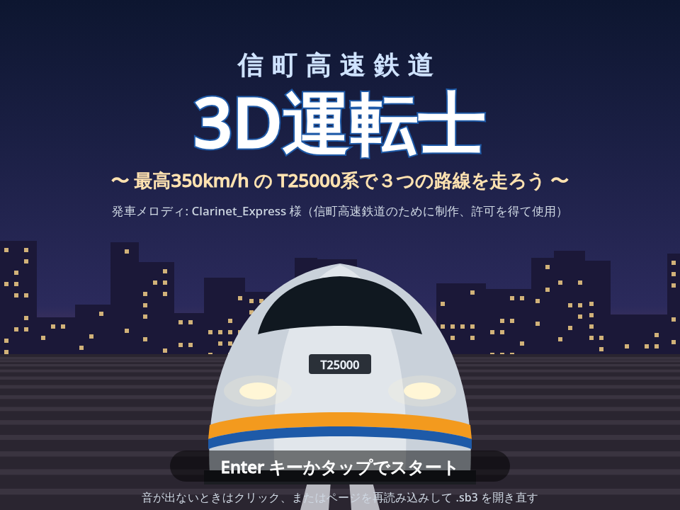 | 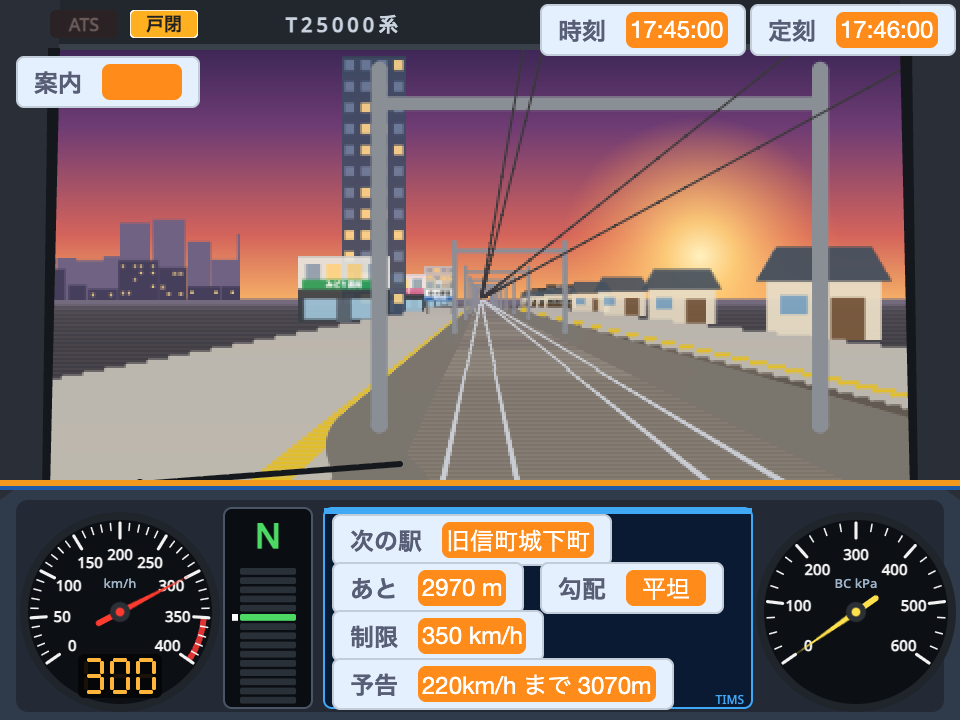 | 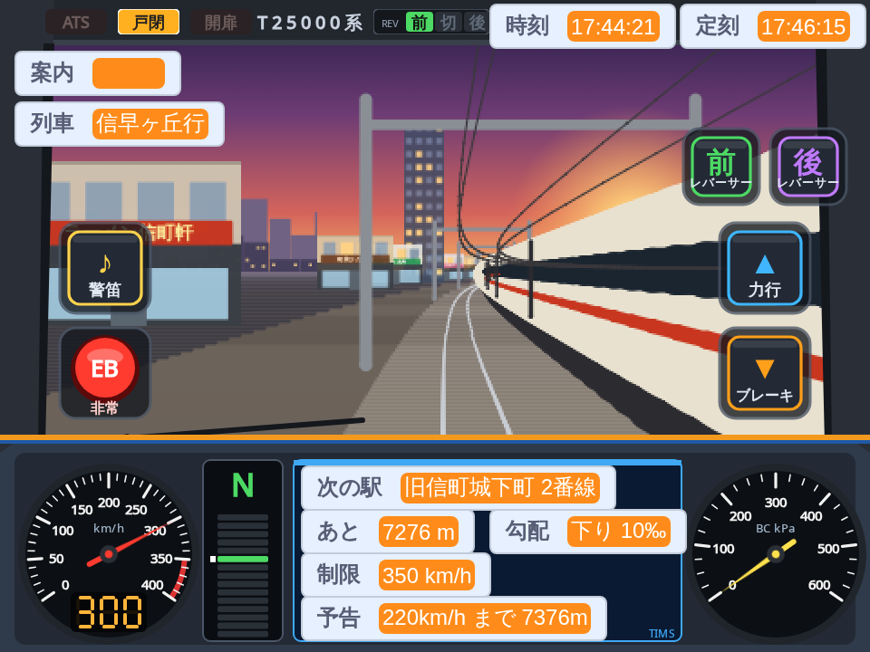 |
|---|---|---|
| 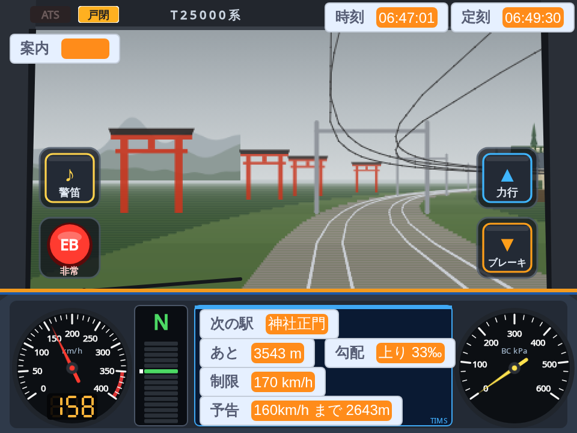 |  |  |
|  | 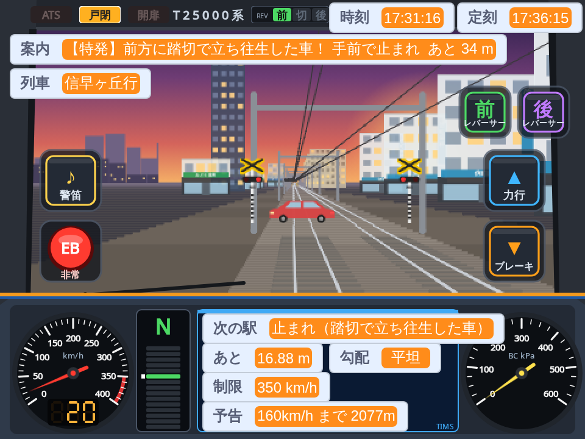 |  |
| 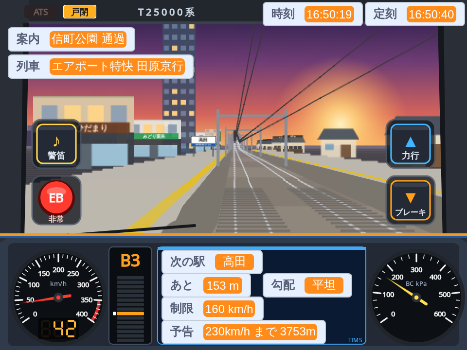 | 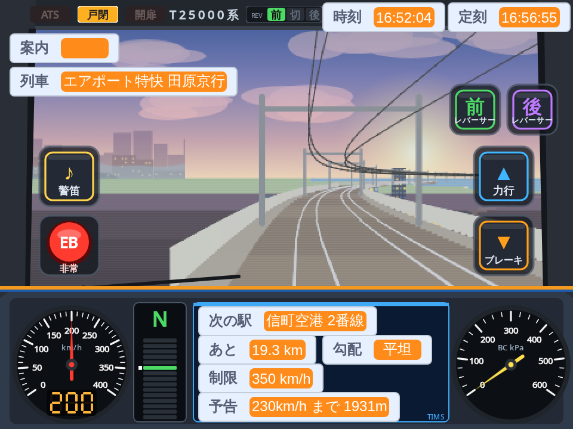 | 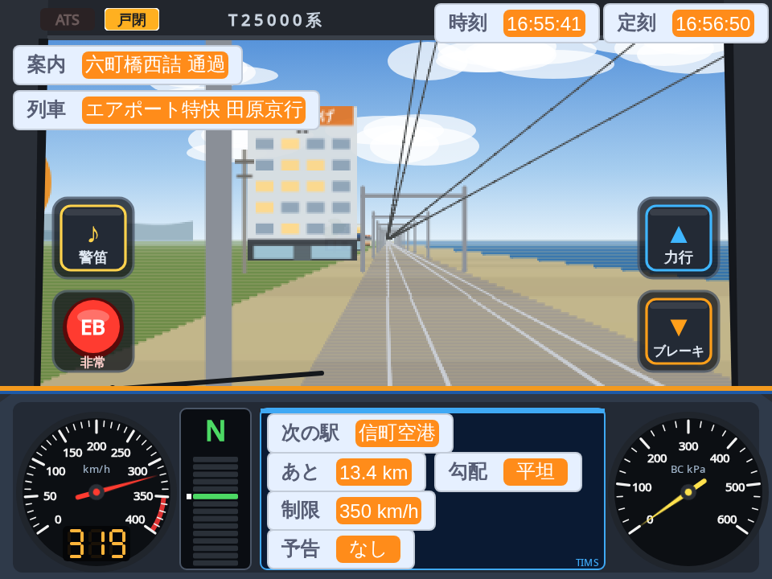 |
|  | 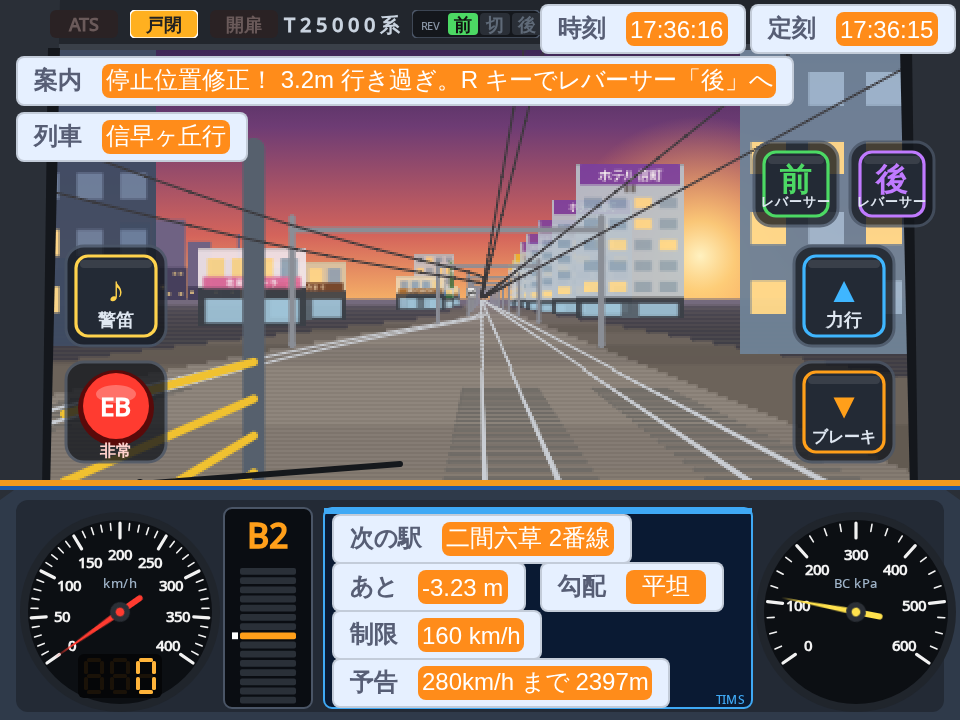 | 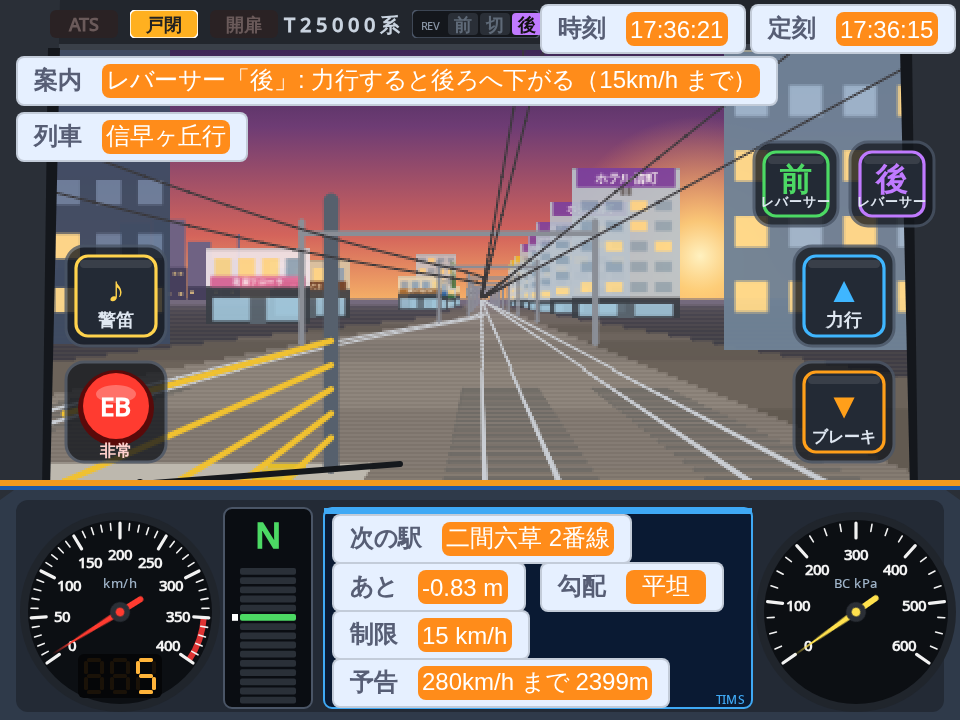 |

## 遊び方

### 開き方
- **Scratch**: [scratch.mit.edu](https://scratch.mit.edu/projects/editor/) で「ファイル → コンピューターから読み込む」から `train-driver-3d.sb3` を選ぶ。
- **TurboWarp（おすすめ）**: [turbowarp.org](https://turbowarp.org/) で同じように読み込む。素の Scratch より軽く、なめらかに動きます。

緑の旗を押すとタイトル画面になります。**Enter キーかクリック（タップ）でスタート**します。
スペースキーは非常ブレーキなので、スタートには使いません。

### 操作
キーボードでも、画面のボタン（スマホ・タブレットではタップ、パソコンではクリック）でも、最初から最後まで遊べます。

| キー | 画面のボタン | はたらき |
|---|---|---|
| Enter | 画面のどこかをタップ | タイトル画面・結果画面から進む |
| 数字キー | 番号のボタン（一覧の下） | 路線を選ぶ |
| ↑ または W | 右下の **▲力行** | ノッチを力行側へ 1 段（押しっぱなしで連続） |
| ↓ または S | 右下の **▼ブレーキ** | ノッチをブレーキ側へ 1 段（押しっぱなしで連続） |
| スペース | 左下の赤い **非常（EB）** | 非常ブレーキ（EB）。走行中に使うと減点 |
| H | 左下の **警笛** | 警笛 |
| F | 右上の **前**（レバーサー） | レバーサーを前側へ 1 段（後 → 切 → 前）。止まっているときだけ |
| R | 右上の **後**（レバーサー） | レバーサーを後側へ 1 段（前 → 切 → 後）。止まっているときだけ |

ノッチは **P5〜P1（力行）／ N ／ B1〜B8（ブレーキ）／ EB（非常）** のワンハンドル式です。

**レバーサー**は、電車が進む向きを決めるハンドルです。**前**で前へ、**後**で後ろへ進み、**切**では力行できません。最初から「前」になっているので、ふつうはさわらなくても走れます。いまの位置は、運転台の上の枠（車両名の右）に「前・切・後」のどれかが光って出ます。
- 「後」で力行すると、後ろへ下がります（画面は前を向いたまま、景色が後ろへ流れる）。後退は **15km/h まで**で、超えると ATS の非常ブレーキで止められます（「設定」の「後退の制限速度」）。
- 下がれるのは、いちばん前まで進んだ所から **60m まで**です（「後退できる距離」。前の駅まで戻ったりはできません）。
- 下がったあとは、レバーサーを「前」に戻してから発車します（戻していないと、発車のときに案内が出ます）。

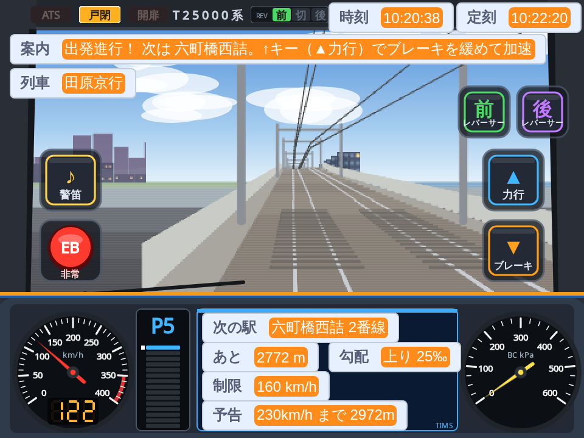

#### タップ操作（スマホ・タブレット）
- 運転中のボタンは、計器や TIMS・時刻の表示と重ならないように、窓の下の左右の端にあります。レバーサーの「前」「後」は、右の ▲力行 の上に並んでいます（少し小さいボタン）。
- ▲力行・▼ブレーキは、押した瞬間に 1 段動き、押し続けると 0.5 秒後から 0.25 秒ごとに 1 段ずつ動きます（キーより少しゆっくりにして、動きすぎないようにしています）。指がボタンから外れると止まります。
- Scratch は指 1 本ぶん（マウス 1 つ）しか分からないので、2 つのボタンを同時には押せません。
- ボタンを出したくないときや、連続で動く速さを変えたいときは「設定」スプライトの「タップ操作（画面のボタン）」（画面のボタン・ボタン_連続になるまで・ボタン_連続の間隔）を変えます。
- スマホでは、Scratch や TurboWarp の全画面ボタンで大きくすると押しやすくなります。

### 音について
- ブラウザは、ページを一度クリックするかキーを押すまで音を出しません。
  - Scratch 公式では**クリック**が必要です。緑の旗をクリックすれば鳴ります。タイトル画面をクリックして始めても鳴ります。
  - TurboWarp ではキーを押しても鳴ります。
- 音が出ないときは、画面を一度クリックし、パソコンやブラウザのタブの音量も確かめてください。
- 音の出力先を変えたあとなどに鳴らない場合は、ページを再読み込みして `.sb3` を開き直してください。
- 音量は「設定」スプライトの「効果音の音量」「発車メロディの音量」「モーター音の音量」「走行音の音量」「きしみ音の音量」「分岐器の音の音量」で変えられます。
- カーブでは、車輪がきしむ「キーー」という音がします。半径が小さいほど、速いほど大きく鳴り、直線では止まります（「きしみが鳴る半径」より急なカーブだけ）。
- 分岐器（ポイント）を通ると、車輪が「ガタン、ガタン」と鳴ります。レールのつなぎ目の「タタン」より重く大きい音です（[下の「分岐器の「ガタン」と運転台の揺れ」](#分岐器のガタンと運転台の揺れ)）。

### 発車メロディ
駅を発車する前に、駅ごとに決めた発車メロディが流れます。

- **発車メロディ: Clarinet_Express 様**（信町高速鉄道のために制作、許可を得て使用）
  - 出典: Scratch「信町高速鉄道発車メロディー」 https://scratch.mit.edu/projects/1440158623/
  - 使っている曲: CLEX202・CLEX203・CLEX204
- **ご注意**: この 3 曲は作曲者の許可を得て使っている音源で、このリポジトリのほかの部分（プログラム・絵・合成した効果音）とは別の扱いです。**このゲーム以外の作品に流用したり、音源だけを取り出して配ったりしないでください。** 使いたいときは作曲者に直接許可をもらってください（`generator/sounds/melodies/README.md`）。

| 曲 | 流れる駅 |
|---|---|
| CLEX204（約 10.6 秒） | 新信町・高田・信町神社・紅葉滝 |
| CLEX202（約 8.9 秒） | 信町・旧信町城下町・神社正門・新鎌京橋・田原京（表にない駅もこの曲） |
| CLEX203（約 8.6 秒） | 二間六草・信早ヶ丘・六町橋西詰・信町空港 |

- 3 路線とエアポート特快のどれでも、となりの停車駅が同じ曲にならないように並べています。高田・信早ヶ丘のように 2 つの路線にある駅は、どちらの路線でも同じ曲です。
  - 停車駅の順の曲: 信町本線 204→202→203→204→202→203、神社線 203→202→204、田原海岸線 204→203→202→203→204→202、エアポート特快 204→202→204→203→202（新信町・信町・高田・信町空港・田原京）。
  - エアポート特快で高田と信町空港が続けて CLEX204 にならないように、信町空港を CLEX203、紅葉滝を CLEX204 にしています。
- **駅ごとの曲を変える**: 「発車メロディ」スプライトの「設定を読み込む」にある『駅 ○○ の発車メロディは △△』の曲名を書き換えます（ここを変えると駅ごとの発車メロディが変わる）。曲名は、そのスプライトの「音」タブにある音の名前です。
- 発車の流れ（定刻どおりのとき）: 到着 → ホームドアのロープが上がる → ドアが開く → 採点を 4.5 秒見せる → 発車の 15 秒前に発車メロディ → 曲が終わったら「ドアが閉まります」とドアチャイム → ドアが閉まる → ロープが下がる → 発車時刻に出発進行。
  - ホームドアがあるときは、ロープが下がる時間（2.5 秒）のぶん早めにドアチャイムを鳴らします（発車の約 5.7 秒前。曲が長いときは曲が終わってすぐ）。ロープが下がりきるまでは力行できません。
  - 停車時間は 25 秒（時刻表もこれに合わせて作っています）。遅れて着いたときは、曲を最後まで流してからドアを閉めるので、そのぶん発車が遅れます。
  - 鳴らし始める時刻は「設定」スプライトの「発車メロディの開始」（発車の何秒前か）で変えられます。

### ゲームの流れ
1. タイトルで Enter（またはタップ）を押し、路線を数字キーか番号のボタンで選ぶ（4 はエアポート特快）
2. 始発駅で発車時刻を待つ（発車メロディ → ドアチャイム → 戸閉表示灯が点く → ホームドアのロープが下がる）
3. ↑でブレーキを緩めて力行し、制限速度を守って次の停車駅へ走る
4. 停止位置に止まると採点され、ロープが上がってドアが開く。時間になったら次の駅へ発車（ずれて止まったら止まり直す）
5. 終点に着くと運転成績（合計・平均・ランク S〜D）が出る

### 採点（1駅 100点＋ピタ停車ボーナス 10点）
ゆるめの採点です。きびしさの数値はすべて「設定」スプライトの「採点のきびしさ」にまとまっていて、数を大きくするとやさしく、小さくするときびしくなります。

| 項目 | 配点 | 内容（かっこ内は設定の名前と初期値） |
|---|---|---|
| 停止位置 | 40 | ずれが 50cm 以内なら満点（停止位置_満点の範囲）。5m ずれると 0点（停止位置_0点の距離）。15cm 以内はピタ停車で＋10点（ピタ停車の範囲） |
| 時刻 | 20 | 定刻との差が ±5秒なら満点（定時の許容）。遅れは 5秒ごと、早着は 3秒ごとに 1点減 |
| 停車の衝動 | 20 | 止まる瞬間の減速度が 1.5km/h/s 以下で満点、5.0 で 0点。止まる直前にブレーキを緩めるのがコツ |
| 運転操作 | 20 | ATS警報 −3、ATS非常 −10、非常ブレーキ −5、再停車（停止位置修正）−2、後退 −2、駅間停車 −3 |

- 停止位置から **±1m**（「ホームドア_許容範囲」）より大きくずれて止まると、ホームドアのロープもドアも開かず「停止位置修正」になります（再停車 −2）。手前なら少し進め、行き過ぎならレバーサーを「後」にして下がって止まり直します（後退 −2）。止まり直した位置で採点します（[下の「ホームドア」](#ホームドア昇降式ロープ柵と停止位置修正)）。
- 停止位置を 50m 以上行き過ぎると停車失敗（オーバーラン）です。その駅は運転操作の点だけになります。
- 「設定」の「ホームドア」を 0 にすると、前と同じ止まり方になります（3m より手前は止まり直し、行き過ぎはそのまま採点）。
- ランクは平均点で決まります: **S 96点以上 / A 85 / B 70 / C 45 / それより下は D**。

自動運転ボットで3路線とエアポート特快を走らせたときの成績（ホームドアあり。止まり直し・後退をふくむ）:
- 上手な運転: S
- ていねいな運転: A〜S（平均 91〜100点。ホームドアを入れる前は 96〜108点）
- 少し雑な運転（停止位置が数 m ずれる、ブレーキが遅い）: A〜B（平均 78〜91点。ホームドアを入れる前は B・70〜77点。ずれたら止まり直すので、停止位置の点はかえって上がる）
- わざと毎回 4m 行き過ぎて、後ろへ下がって止まり直す運転: A〜S（駅ごとに 89〜95点。再停車 −2・後退 −2 と、止まり直す時間のぶん）

### 大人向けのポイント
- 最高 350km/h。止まるまでに 4km 以上かかります。
  - TIMS の「あと」（停止位置までの距離）と「予告」（8km 先までの次の制限）を見て、早めにブレーキをかけます。
  - 間に合わなくなりそうになると、案内に「そろそろブレーキ！」と出ます。
- ブレーキは**遅れて効きます**（ブレーキシリンダー圧 BC が少しずつ上がる）。BC圧計で効き具合が見えます。
- 速くなるほど加速が弱くなります（定出力域・特性域）。坂・カーブ・走行抵抗もあります。
- 止まる直前はブレーキがよく効くので、そのままだと「ガクン」と止まって減点されます。
- 制限速度は**列車の最後尾が区間を抜けるまで**続きます（TIMS の「制限」）。
- **ATS**: 制限＋5km/h を超えるとベルが鳴り、制限＋12km/h を超えると非常ブレーキで止められます。
- ときどき**対向列車**（200〜320km/h）が右の線路を走ってきて、すれ違います（警笛・通過音つき）。
- 信町本線は速達運転で、通過駅を高速で通り抜けます（「○○ 通過」と案内）。

### 駅の 3番線
どの駅にも 1番線・2番線・3番線があります。運転士から見て左から **3番線（副本線・待避線）／島式ホーム／2番線（自分の本線）／1番線（対向列車の本線）／ホーム** の「2面3線」です。

| 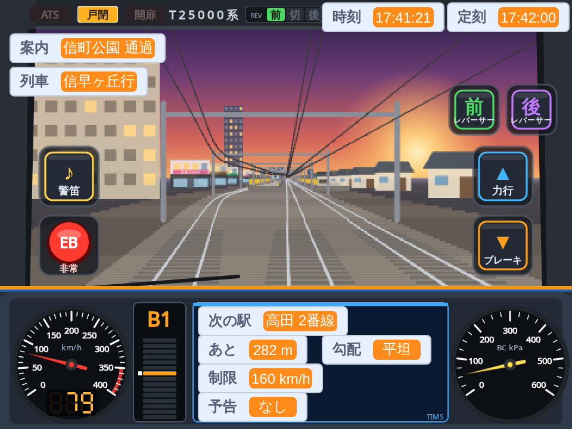 | 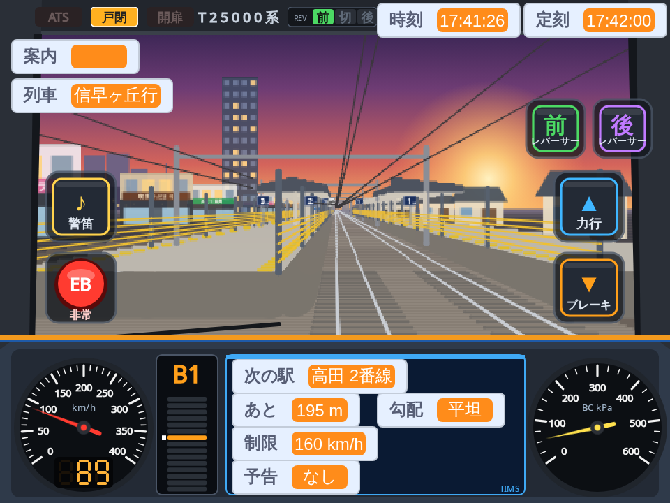 | 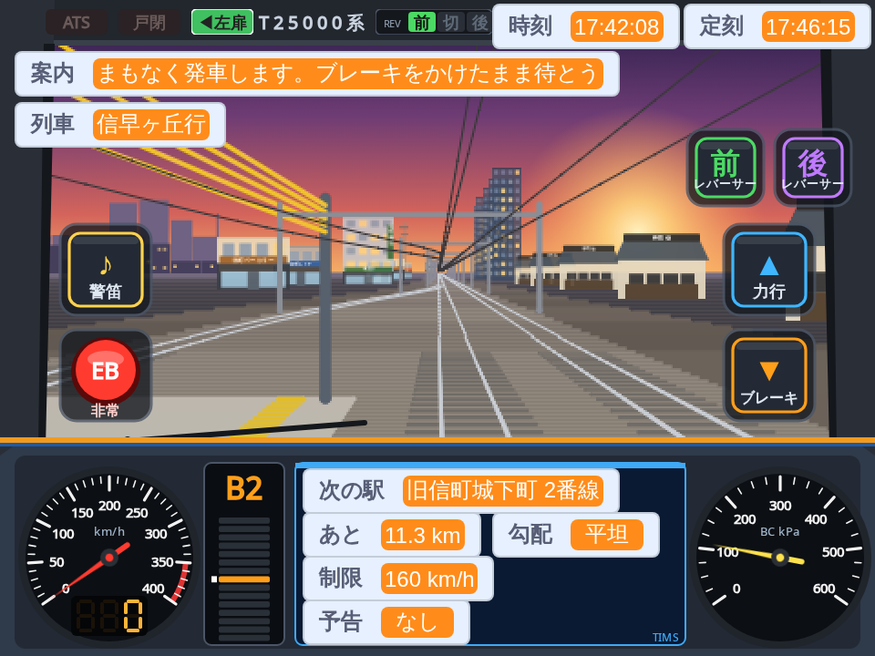 |
|---|---|---|

- いつもは **2番線**（自分の本線）に着きます。ホームは左の島式ホームで、左のドアが開きます。通過駅も 2番線をまっすぐ通ります。
- 駅の手前の分岐器（ポイント）で副本線（3番線）が左に分かれ、駅の先で本線に合わさります。分岐器は、線路が分かれはじめてから 120m で副本線の位置まで移ります。
- **3番線**に着くときは、分岐器で曲がるので **分岐の制限 45km/h** がかかります（駅の手前と先の分岐器）。制限標識が立ち、TIMS の予告と ATS の対象になります。ホームは右になるので、右のドアが開きます。
- 番線の表示（紺の板に「1」「2」「3」）がホームの前と後ろに立ち、駅名標は島式ホームのまん中に立ちます。
- 配線は「路線データ」の各路線の『配線のきまり 番線は (右) から数える いつもは (2) 番線 番線変更は (3) 番線』で決めます（全駅同じ）。駅ごとに変えるときは、その駅の『駅を追加』のあとに『駅の配線 (駅名) …』を足します。番線を左から数える（副本線が 1番線）、いつも副本線に着く、もできます。
- 分岐器の長さ・島式ホームの幅・分岐の制限速度は「設定」の「駅の配線（どの駅も 3番線まで）」で変えられます。

### 分岐器の「ガタン」と運転台の揺れ
駅の手前と先の分岐器（ポイント）を通ると、車輪がトングレールの先とクロッシング（レールが交わる所）のすき間をこえるたびに「ガタン」と鳴り、運転台がガクッと揺れます。いつもの 2番線をまっすぐ通るときも、番線変更で曲がって 3番線に入るときも鳴ります。

| 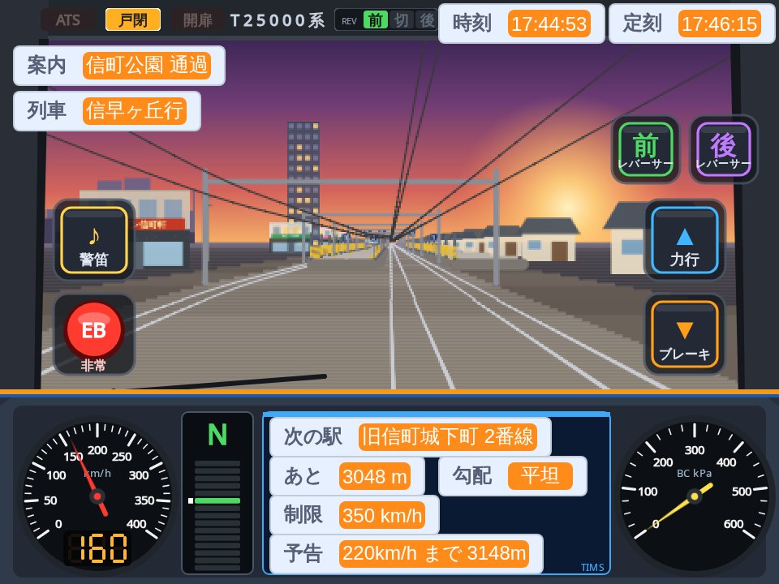 | 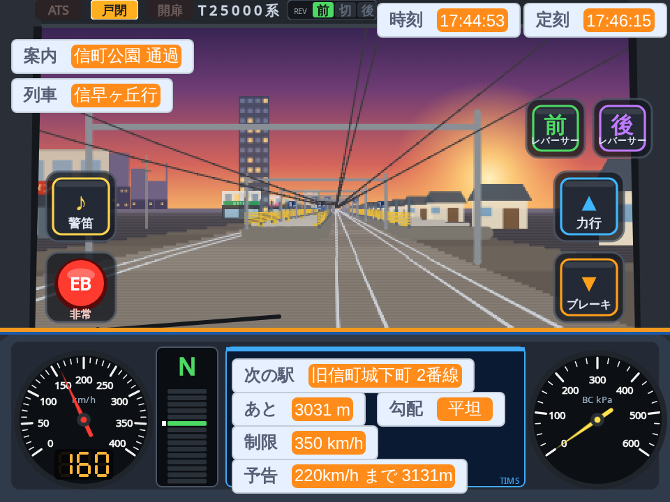 |
|---|---|
| 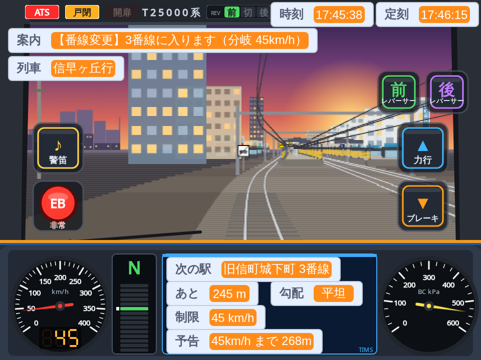 | 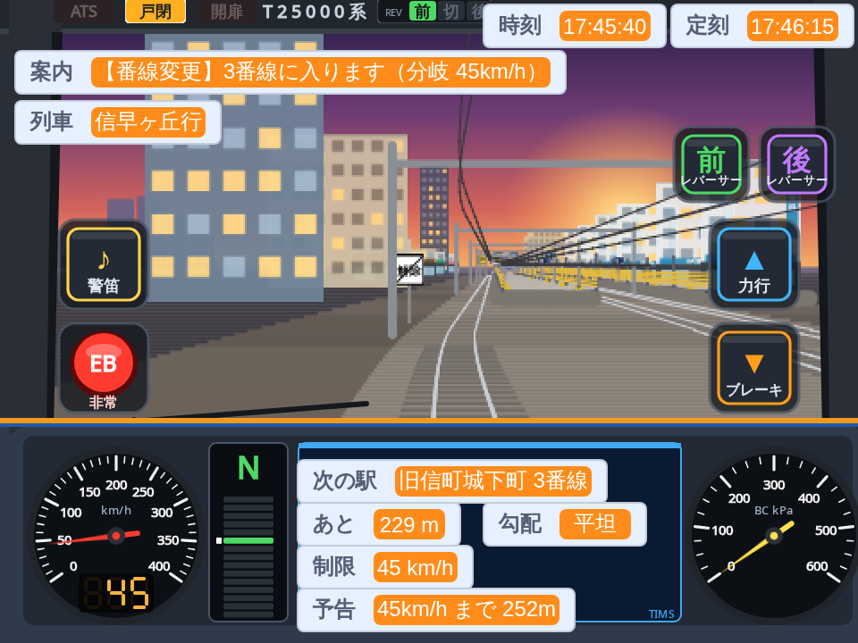 |

（左が揺れていない瞬間、右が揺れた瞬間。4 枚を並べて目安の線を引いた絵: `docs/screenshots/92-turnout-compare.png`）

- **何回鳴るか**: 車軸（1 両に台車 2 つ × 車軸 2 本 ＝ 4 本）1 本ごとに、すき間 2 か所で鳴ります。1 つの分岐器で 8両なら 64 回、10両（エアポート特快）なら 80 回。「ガ・タン（同じ台車の 2 本、2.5m）……ガ・タン、ガ・タン（車両のつなぎ目）……」というリズムで、速いほど間が短くなります（45km/h で平均 0.34 秒、100km/h で 0.17 秒、240km/h で 0.10 秒ごと）。1 フレームに 2 本こえたときは 1 回にまとめて鳴らします。
- **強さ**: 速いほど強く（120km/h 以上でいちばん強く、止まりそうなときは半分）、曲がって 3番線に入る・出るときは 1.8 倍で、もっと重い「曲がる」の音（車輪のつばが当たる「ギッ」入り）になります。
- **揺れ**: 運転台の窓わくと計器・ランプが、1 回ごとに上へガクッとずれて、すぐもどります（0.05 秒で半分）。まっすぐ 160km/h で 5 ピクセル、曲がる 45km/h で上に 6 ピクセル・横に 5 ピクセル、前の景色も反対向きに 5 ピクセルずれます。TIMS・案内・時刻の文字とタップ用のボタンは動かないので、揺れても読めて押せます。
- **設定**（「設定」スプライトの「分岐器の「ガタン」と運転台の揺れ」）: 分岐器の音（1＝鳴らす、0＝鳴らさない）・分岐器の音の音量（100）・**画面の揺れ（1＝揺れる、0＝揺れない。揺れが苦手な人は 0 に）**・揺れの強さ（5 ピクセル）・分岐で曲がるときの強さ（1.8 倍）・ガタンがいちばん強い速度（120km/h）・クロッシングの位置（分岐の長さの 0.7）・台車の位置（3.5m）・車軸の間隔（2.5m）。
- しくみは「分岐器の音」スプライト（[docs/scratch-guide.md の 3-14](docs/scratch-guide.md#3-14-分岐器のガタンと運転台の揺れのしくみ)）。

### ホームドア（昇降式ロープ柵）と停止位置修正
どの駅のホームにも、線路側の端に**昇降式ロープホームドア**があります。支柱が 10m おきに並び、そのあいだに横のロープが 5 本張ってあります。2番線・3番線（島式ホームの両側）と、1番線の右のホームのどれにもあります。

| 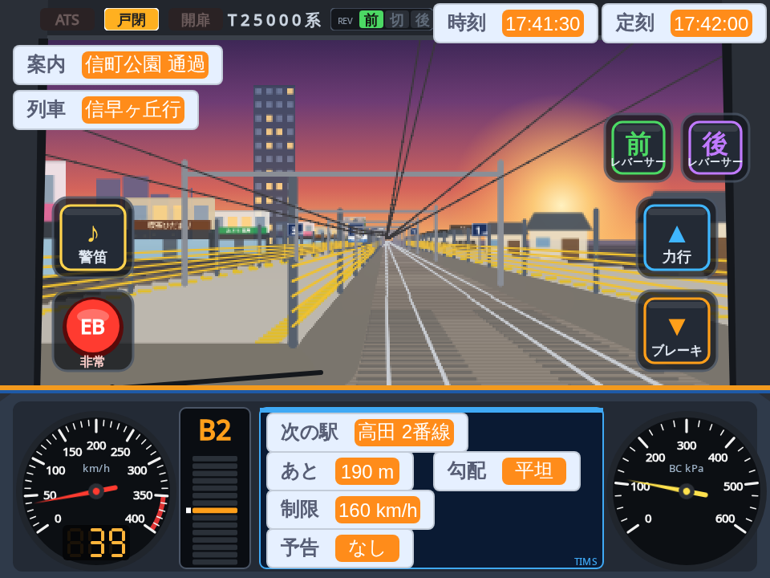 | 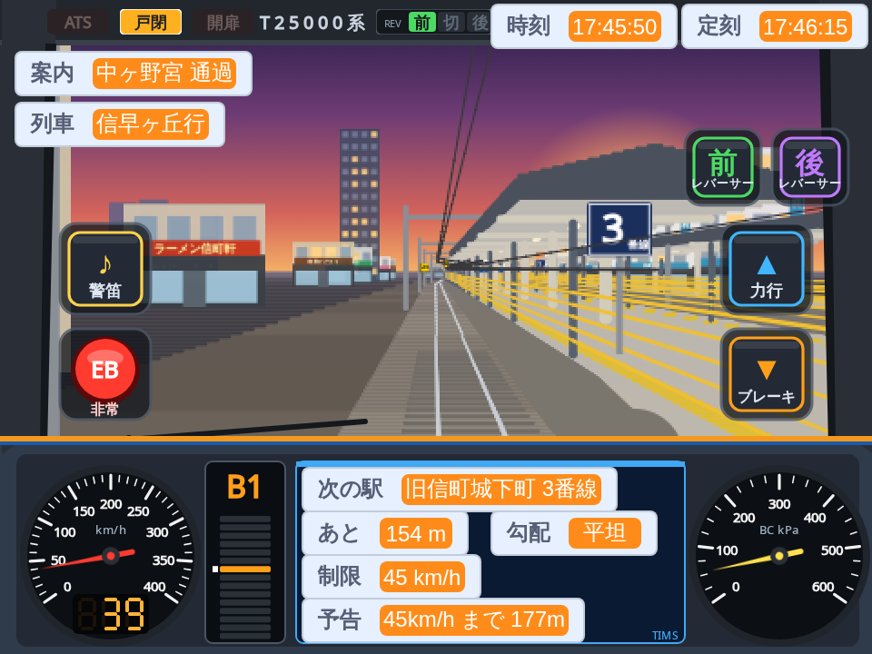 | 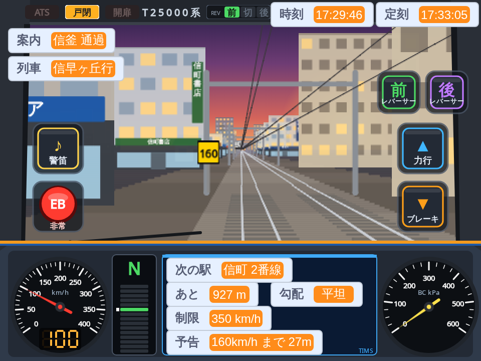 |
|---|---|---|
| 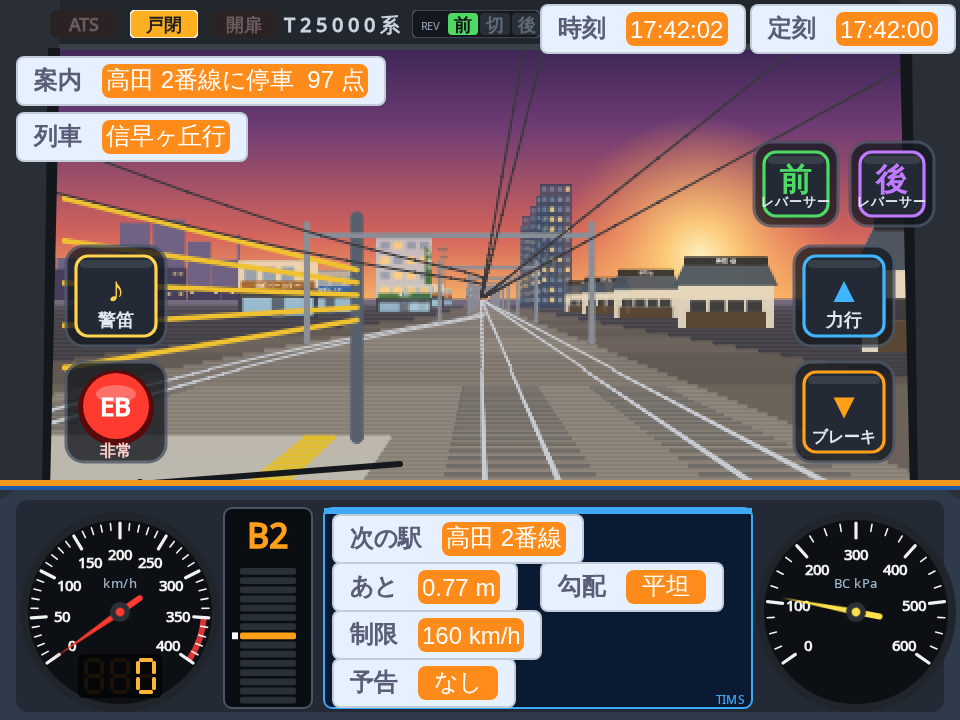 |  | 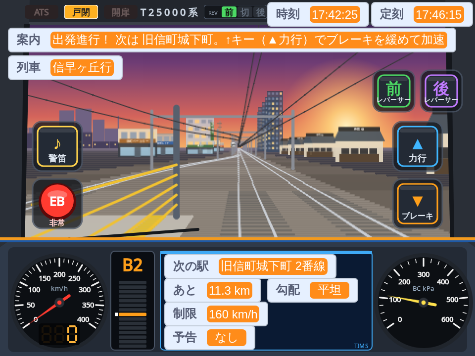 |
|  |  | |

- 停止位置から **±1m 以内**に止まると採点され、着いた線路の側のロープが **2.5 秒かけて上がって**から、ドアが開きます（ほかのホームのロープは下りたまま）。
- 発車するときは、ドアが閉まってからロープが 2.5 秒かけて下がり、下がりきると力行できます。
- ±1m より大きくずれると、ロープもドアも開かず、案内に「停止位置修正！」と出ます（再停車 −2）。
  - **手前**: そのまま少し進めて止まり直す。
  - **行き過ぎ**: R キー（「後」ボタン）を 2 回押してレバーサーを「後」にし、力行して後ろへ下がって止まる（後退 −2）。TIMS の「あと」は、行き過ぎるとマイナス（例「-3.8 m」）になります。止まったら、F キー（「前」ボタン）で「前」に戻しておきます。
- 止まり直すと時間がかかるので、そのぶん遅れて時刻の点も少し減ります。ぴったり止めるのがいちばんです。
- 「設定」の「ホームドア（昇降式ロープ柵）」で変えられます: ホームドア（1＝つける、0＝つけない）・ホームドア_許容範囲（1.0m）・ホームドア_動く時間（2.5 秒）・ロープ柵_支柱の間隔（10m）・ロープ柵_支柱の高さ（2.4m）・ロープ柵_ロープの本数（5）・ロープ柵_上がった高さ（2.0m）。描く距離は「ロープ柵を描く距離」（300m）、色は「色_ロープ柵の支柱」「色_ロープ」。

### アクシデント
運転中に、ときどきトラブルが起きます（1 回の運転で 0〜2 件と、番線変更 0〜1 件。起きる場所と種類はでたらめ）。起きると警報が鳴り、案内と TIMS に知らせが出ます。

|  |  |
|---|---|
|  | 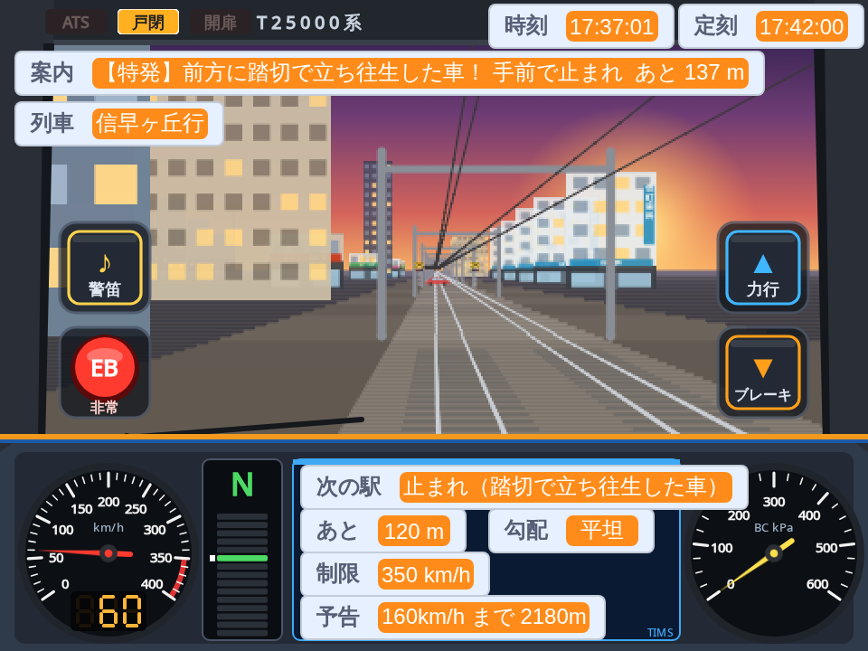 |

| 種類 | 起きること | うまく対応すると | だめだと |
|---|---|---|---|
| **線路の障害物**（倒木・落石・シカ・踏切で立ち往生した車） | 「【特発】前方に倒木！」と知らせ、TIMS が「止まれ（倒木）」とその手前までの距離になる。赤く点滅する特殊信号発光機（特発）と障害物が見えてくる | 手前で止まると **+10点**。取りのぞく作業（10 秒）のあと運転再開 | 当たると非常ブレーキで止められて **−15点**（運転操作から）。障害物はわきへ押しのけられる |
| **天気**（強風・大雨） | 少し先から速度規制（強風 160km/h・大雨 120km/h、5km）。制限標識が立ち、TIMS の予告にも出る。雨や風の線が見える | 規制区間を ATS が鳴らずに抜けると **+10点** | ATS が鳴ったら **−15点** |
| **信号故障** | 前の信号が赤のまま | 手前で止まると **+10点**。直って青になったら再開 | 越えると非常ブレーキで **−15点** |
| **モーター不調** | 加速の力が半分になる（次の停車駅で点検して直る） | 次の停車駅まで走ると **+5点** | ― |
| **非常通報** | 車内の非常ボタン。すぐ列車を止めて確認する | 時間内に止まると **+10点**。確認（10 秒）のあと再開 | 止まらないと非常ブレーキで **−15点** |
| **番線変更** | 「【番線変更】旧信町城下町は本日 3番線に到着します」と知らせ、次の停車駅で分岐器を曲がって 3番線に入る（分岐の制限 45km/h）。右のドアが開く | 分岐で ATS が鳴らずに止まると **+10点** | 分岐で ATS が鳴ったら **−15点** |

| 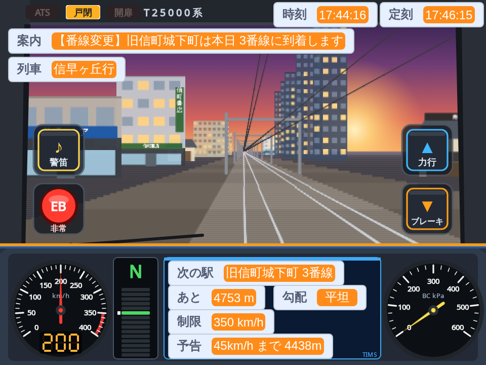 | 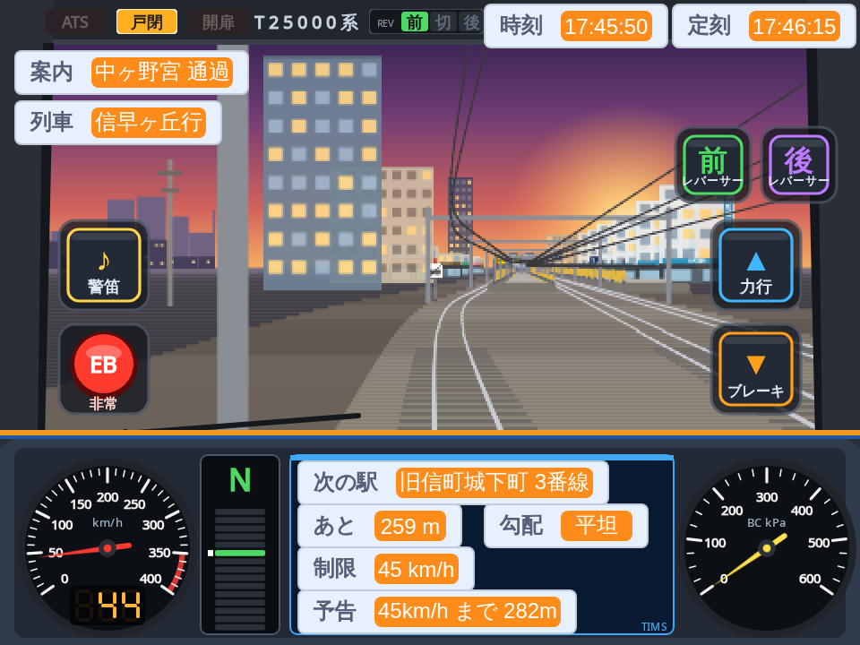 | 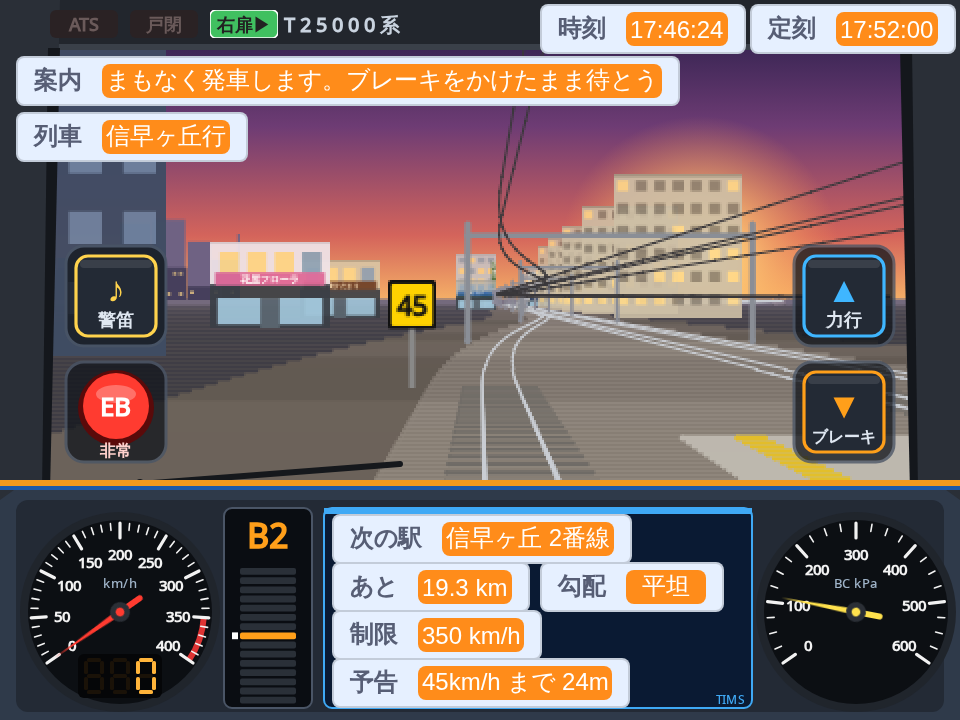 |
|---|---|---|

- 番線変更は、ほかのアクシデントとは別に、1 回の運転で「設定」の「番線変更_起きやすさ」（30%）の確率で 1 回起きます。「アクシデント_番線変更」を 0 にすると起きません。
- 350km/h で走っていても、分岐の制限まで ゆっくり（約 3.6km/h/s）落とせる距離＋600m より手前で知らせます（まにあわないときは、その次の停車駅にのばします）。分岐で遅れた時刻は減点しません。

- 踏切の車・倒木・落石・シカの障害物は地上だけに出ます。高架の上（坂もふくむ）に置くことになったときは、信号故障になります。
- 350km/h でも止まれるように、障害物や赤信号は「その速さからゆっくり（約 3.6km/h/s）止まれる距離＋600m」先に置きます（次の駅より先にはしません）。ブレーキの案内も、その手前に止まるように出ます。
- 障害物・赤信号・非常通報で止まったときは、非常ブレーキと駅間停車の減点はありません。当たっても残酷な場面にはならず、非常停止と減点だけです。
- アクシデントがあった区間の遅れは減点しません。遅れて着いた駅からあとの時刻表は、そのぶん遅らせます。
- 加点・減点は結果画面の成績に「【アクシデント】…」の行で出ます。加点があると平均が 100 点を超えることもあります。
- 起きやすさ（0 にすれば起きない）、種類ごとのオン・オフ、加点・減点、作業時間、規制の速度などは「設定」スプライトの「アクシデント」で変えられます。路線ごとに起きる種類は「路線データ」の『起きるアクシデント』です（信町本線: 踏切の車・信号故障・大雨・非常通報・モーター不調／神社線: 倒木・落石・シカ・大雨・モーター不調／田原海岸線: 強風・シカ・踏切の車・非常通報・モーター不調）。

### 画面の見方
- 左: 速度計（0〜400km/h、デジタル表示つき）　中央左: ノッチ表示　右: BC圧計
- 中央の TIMS: 次の停車駅と着く番線（例「高田 2番線」）・停止位置まで「あと」何 m（遠いと km、近づくと cm まで）・制限・勾配・制限の予告
- 上: 時刻・定刻（次の停車駅の到着時刻）、ATS表示灯・戸閉表示灯・開扉表示灯（ドアが開いている側。「◀左扉」「右扉▶」）、レバーサー（前・切・後のうち今の位置が光る）、案内
- 左上の「列車」: 種別と行き先（例「エアポート特快 田原京行」。種別のない路線は「信早ヶ丘行」のように行き先だけ）

## 路線と車両

路線と駅は、路線図「信町高速鉄道仮路線図」に合わせています。
- 駅の順番は路線図のとおりです。
- 駅間距離は路線図の間隔を目安に、350km/h が出せるように長くしてあります。

| 路線 | 難易度・雰囲気 | 停車駅（**太字**）と通過駅 | 長さ・最高速度・所要時間の目安 |
|---|---|---|---|
| 信町本線 | 上級・夕方の街なか・速達 | **新信町** → 信釜 → **信町** → 三間 → **二間六草** → 信六 → 際記ヶ野間 → 信町公園 → **高田** → 中ヶ野宮 → **旧信町城下町** → 坂ヶ野 → **信早ヶ丘** | 61km・350km/h・約20分 |
| 神社線 | 中級・霧の山あい・33‰の上り坂とカーブ | **信早ヶ丘** → **神社正門** → **信町神社** | 13km・260km/h・約6分 |
| 田原海岸線 | 初級・昼の海沿い・見通しがよい（高田を出ると高架） | **高田** → **六町橋西詰** → **新鎌京橋** → **信町空港** → **紅葉滝** → **田原京** | 30km・350km/h・約13分 |
| **エアポート特快**（4番・10両） | 上級・信町本線→田原海岸線 直通 | **新信町** → 信釜 → **信町** → 三間 → 二間六草 → 信六 → 際記ヶ野間 → 信町公園 → **高田** → 六町橋西詰 → 新鎌京橋 → **信町空港** → 紅葉滝 → **田原京** | 61km・350km/h・約21分 |

乗り換えと直通の案内は駅名標の帯に出ます。
- 高田: 田原海岸線のりかえ
- 信早ヶ丘: 神社線・多山横断 直通
- 二間六草: 草河原鉄道 直通
- 信釜: 草河原鉄道 支線

沿線には路線の雰囲気に合わせた店が並びます。
- 信町本線: 喫茶・書店・薬局・ラーメン・銀行・ホテル・家電・寿司・花屋・パン屋・歯科など
- 神社線: 門前そば・みやげ・茶屋・旅館
- 田原海岸線: 海の家・浜焼き・民宿・釣具・みやげ

### 種別とエアポート特快

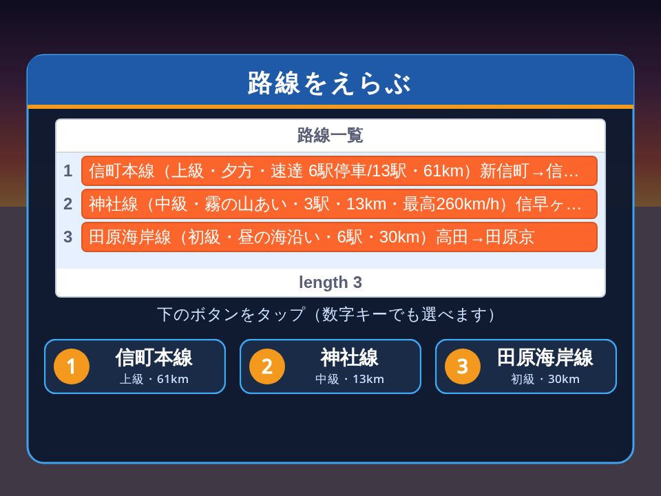

| 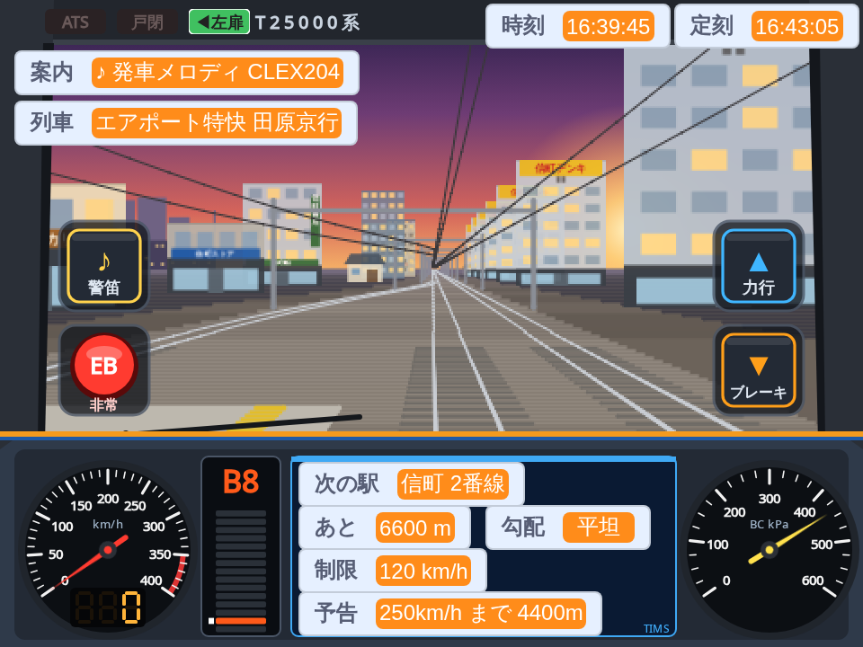 | 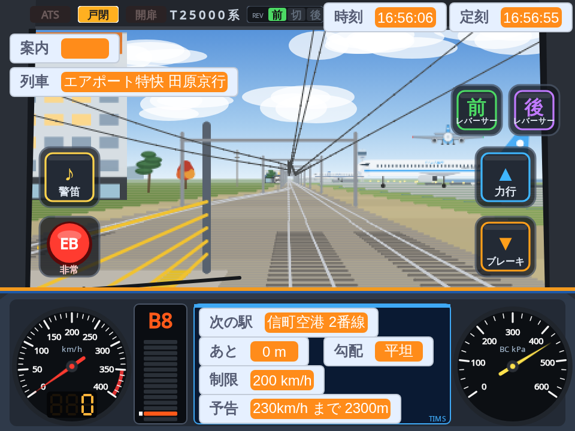 | 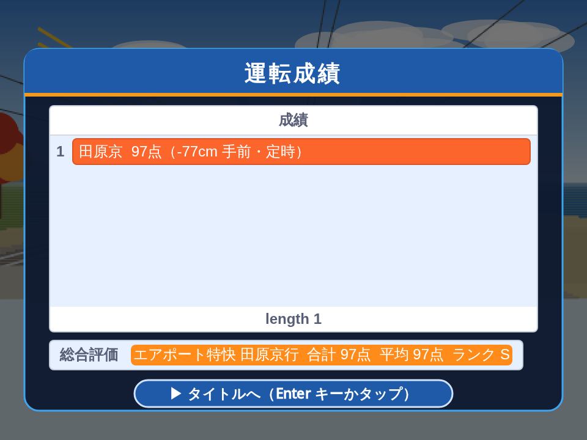 |
|---|---|---|

**種別**（列車の種類）は、名前と両数（編成の長さ）を「路線データ」スプライトの『種別を追加』で決めます。**運行**（路線選択に出る、種別つきの列車）は、種別・行き先・走る区間・停車駅（と時刻）をブロックで並べたものです。今あるのはエアポート特快だけです。

**エアポート特快 田原京行**（路線選択の 4 番）
- 10両編成（200m）。駅のホームは列車長＋20m（220m）に自動で長くなり、停止位置目標は「10」。
- 走る区間: 信町本線の新信町 → 高田、高田から田原海岸線に入って田原京まで（61km）。両方の路線の駅・制限・カーブ・坂・空港・アクシデントをそのままつないでいます。
- 停車駅: **新信町・信町・高田・信町空港・田原京**（空港へ急ぐ列車なので主な駅だけ）。ほかの 9 駅は「○○ 通過」と案内して通過します。
- 時刻表（16:40 発 → 17:00:50 着、約 21 分）: 新信町 16:40:00 発 → 信町 16:43:05 → 高田 16:50:40 → 信町空港 16:56:55 → 田原京 17:00:50。停車時間はほかの路線と同じ 25 秒です。
- 景色: 高田までは信町本線の夕方の街。高田を出ると高架に上がり（下の「高架」）、高架を降りたところ（高田から 2.3km）から田原海岸線の昼の海沿い（空・遠景・地面や海の色・沿線の店）になります。信町空港駅のそばには空港があり、飛行機が着陸・離陸します。
- 運転中は左上の「列車」に「エアポート特快 田原京行」と出ます。結果画面の名前も「エアポート特快 田原京行」です。

**ほかの種別を足すには**（例: 快速 信早ヶ丘行。資料の種別は 信町特急・信町特快・快速・通快・区快・準快速が 10両、普通が 6両）
1. 「路線データ」の「設定を読み込む」に『種別を追加 [快速] 両数 (10)』を 1 つ足す（同じ種別の列車を増やすだけなら不要）。
2. 「ブロック定義」の「ブロックを作る」で『運行5 快速』を作り（「画面を再描画せずに実行する」にチェック）、中身を作る。
   Scratch 3.0 では定義のブロックそのものは複製できないので、『運行4 エアポート特快』の定義のすぐ下の『運行を始める …』を右クリック →「複製」し（下につながったブロックが全部コピーされる）、『運行5 快速』の定義の下にくっつけて書き換える。
   - 『運行を始める 種別 [快速] 行き先 [信早ヶ丘]』
   - 『区間を足す 路線 (1) [新信町] から [信早ヶ丘] まで』（路線の番号と、その路線のどの駅からどの駅まで。2 つ以上並べると高田のような駅でつながる）
   - 『停車 [駅名] 時刻 [hh:mm:ss]』を止まる駅の数だけ（書いていない駅は通過。始発駅は発車時刻、ほかは到着時刻）
3. 「設定を読み込む」の路線一覧に説明を 1 行足し（5 番目に出る）、『路線を読む』に「もし 番号 = 5 なら 運行5 快速」を足す。
- 時刻は手で書きます。ジェネレータを使うときは `generator/routes_data.py` の `TRAIN_TYPES`・`SERVICES` に足すと、理想の運転から時刻表を計算して書き込みます（`python3 generator/timetable.py` で確認）。
- 区間は路線の向き（駅の並び）どおりにだけ走れます（逆向きの区間は作れません）。

### 高架（高田 → 信町空港の方）
田原海岸線とエアポート特快は、高田を出ると 25‰ の上り坂で高架に上がり、高田の街の上を走ってから、下り坂で地上に降ります。降りたところから海沿いの景色になります。

| 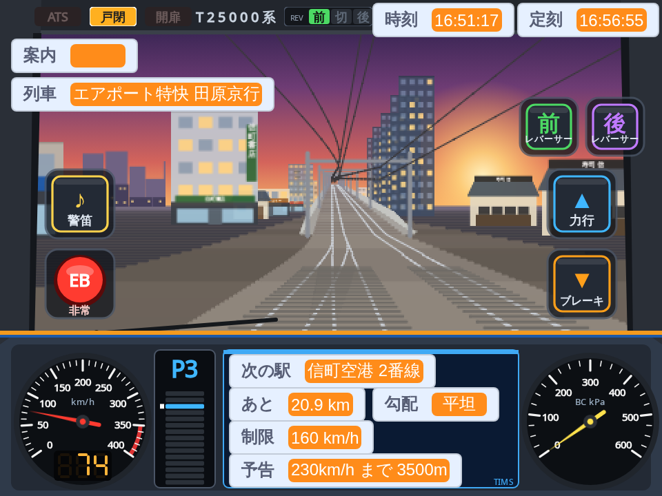 |  | 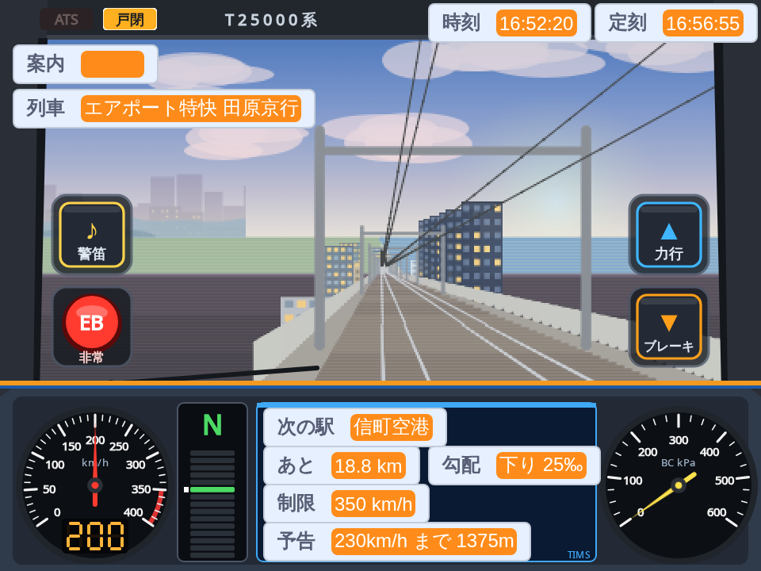 |
|---|---|---|
| 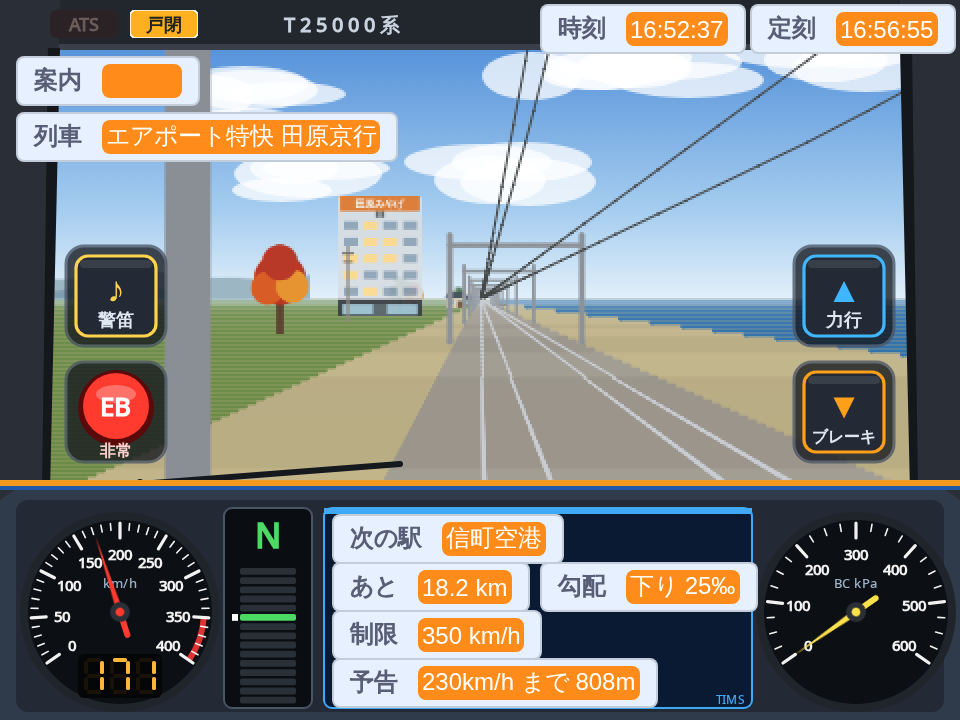 | 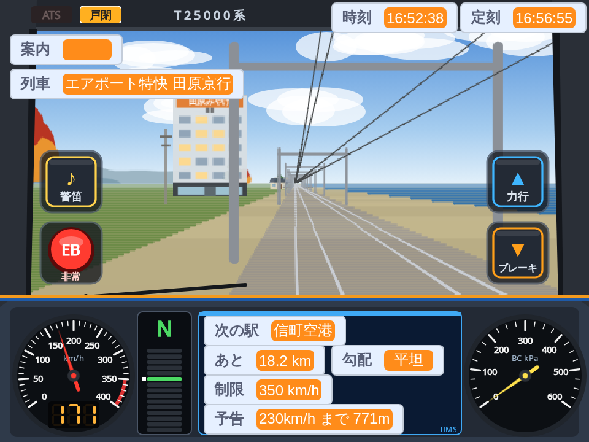 | 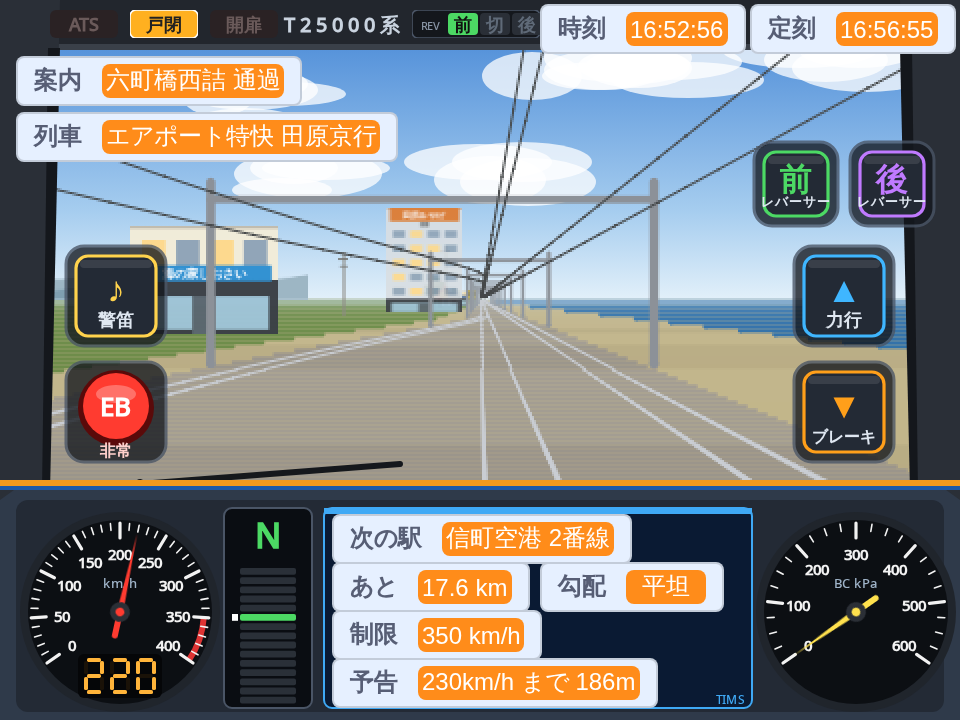 |

（上はエアポート特快。田原海岸線（10 時台の昼）の同じ場面は `docs/screenshots/56〜61-tahara-viaduct-*.png`。）

- 場所: 田原海岸線の 650m〜3300m（高田の停止位置から 150m 先〜2800m 先、長さ 2.65km）。高さ 15m、坂はそれぞれ 600m（上り 25‰・下り 25‰）。エアポート特快では 31150m〜33800m。
- 坂は勾配として物理の計算に入り、TIMS の勾配に「上り 25‰」「下り 25‰」と出ます（上り坂では加速が弱くなる）。
- 高架の上では、目が高くなるので地面や建物が下に見え、両側に側壁（コンクリートの壁）が立ちます。上り坂・下り坂は、前の線路が上がって・下がって見えます（坂の頂上の向こうの線路や架線柱はかくれます）。
- 本物の坂（20〜30‰）は運転台からはほとんど平らに見えるので、画面では高さと坂を「見た目の高さの強さ」倍（初期値 2 倍。高架は 30m の高さに見える）に強めて描いています（カーブと同じ考え方。走り方の計算は変わりません）。
- 景色の切り替え: 高架を降りるところ（3295m）より先は、近づく前から海沿いの景色（地面・海・沿線の店）で描かれ、手前は街のまま描かれます。だから、変わり目を通っても建物が急に消えたりしません。空と遠景は、変わり目の 2.5km 手前から少しずつ混ぜて変えます（エアポート特快では夕方 → 昼）。
- 高架の上（坂もふくむ）では、踏切の車・倒木・落石・シカの障害物は出ません（地上だけのもの）。高架の上に置くことになったときは、信号故障になります。
- 高架の場所・長さ・高さは「路線データ」の『高架を追加 (650) m から (3300) m まで 高さ (15) m 坂 (600) m』で変えられます（ほかの路線にも足せます）。高田のまわりの街の景色を使う所は『始めの景色 路線 (1) を (3300) m まで』です。

### 信町空港
田原海岸線の信町空港駅の海側（右）に、埋め立ての空港があります。


- 駅の手前にターミナルビル（「信町空港」の看板）と案内看板、駅の先にエプロン・駐機中の飛行機・管制塔・格納庫・吹き流しがあり、線路と平行に誘導路と滑走路（白い中心線と誘導灯）が延びています。
- 航空会社は架空の「信町航空」（青とオレンジ）と「そらいろ航空」（空色）です。
- 空港に近づくと、1 機が電車を後ろから追い越して、前の方の滑走路に着陸してきます。そのあとも、ときどき（停車中も）飛行機が着陸したり、前の方から走ってきて頭の上へ離陸していったりします。
- エアポート特快でも、田原海岸線の区間に入ると同じ空港が出ます。
- 空港の場所は「路線データ」の『空港を置く』（ほかの路線にも置けます）、建物や駐機中の飛行機の並びは「景色」スプライトの『空港に置く』、飛行機の出やすさは「設定」スプライトの「空港と飛行機」で変えられます。

**車両 T25000系**（架空の高速電車）の性能:
- 8両編成（種別に両数があるときはその両数。エアポート特快は 10両）
- 最高速度 350km/h
- 起動加速度 4.0km/h/s
- 常用最大減速度 5.4km/h/s、非常減速度 6.6km/h/s

## 改造ポイント

**Scratch の画面でしくみを読む解説ページ: [docs/scratch-guide.md](docs/scratch-guide.md)**

各スプライトの冒頭に「役割と改造ポイント」のコメント、主なブロックの右に説明のコメントがあります。

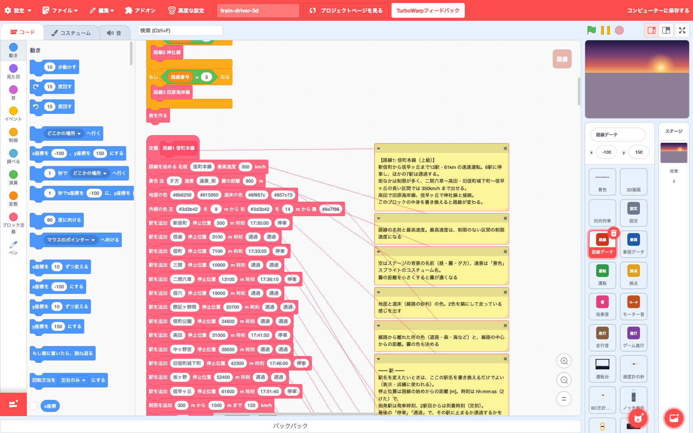

| やりたいこと | どこを変える |
|---|---|
| **駅名を変える** | 「路線データ」スプライトの『路線1 信町本線』などの定義の中の『駅を追加』ブロックの駅名。高田・信早ヶ丘のように2路線にある駅は両方を書き換える。駅名標の絵は「3D描画」スプライトの、駅名と同じ名前のコスチューム（名前と文字を変える。無ければ無地の駅名標になる） |
| 止まる駅・通過する駅 | 『駅を追加』の最後を「停車」か「通過」にする。通過を停車にしたら時刻も書く |
| 時刻表を変える | 『駅を追加』の時刻（hh:mm:ss、2けた）。始発駅は発車時刻、2駅目からは到着時刻 |
| 制限速度・カーブ・坂 | 路線の定義の中の『制限を追加』『カーブを追加』『勾配を追加』 |
| **高架の場所・長さ・高さ** | 路線の定義の中の『高架を追加 (始め) m から (終わり) m まで 高さ (　) m 坂 (　) m』（田原海岸線にある。ほかの路線にも足せる）。坂の勾配は自動で足される。見た目は「設定」の「高架（高い所を走る線路）」（見た目の高さの強さ・側壁の高さ・高架の端）と「色_高架」「色_側壁」 |
| **沿線の店（看板）** | どの店を並べるかは、路線の定義の中の『沿線物を追加』（「店_」で始まる名前）。看板の店名そのものは「景色」スプライトのコスチューム「店_○○」の中の文字なので、コスチュームを開いて文字を書き換え、コスチューム名も「店_新しい店名」にして『沿線物を追加』の名前も合わせる。新しい店はコスチュームを複製して作る |
| 景色・色・霧 | 路線の定義の中の『景色』『地面の色』『外側の色』『沿線物を追加』 |
| 路線を増やす | 「路線データ」の冒頭コメントの手順（「ブロックを作る」で新しい定義を作る → 『路線3 田原海岸線』の定義のすぐ下のブロックを右クリック →「複製」してくっつける → 路線一覧に1行足す → 『路線を読む』に分岐を足す）。定義のブロックそのものは複製できない |
| **種別を増やす**（快速・普通など） | 「路線データ」の「設定を読み込む」の『種別を追加 名前 両数』。両数が列車の長さ（1両 20m）と停止位置目標の数字になる |
| **種別つきの列車（運行）を増やす・変える** | 「路線データ」の『運行4 エアポート特快』のような定義。『運行を始める』（種別・行き先）・『区間を足す』（走る路線と駅）・『停車』（止まる駅と時刻）。増やす手順は上の「種別とエアポート特快」 |
| エアポート特快の停車駅 | 『運行4 エアポート特快』の『停車』ブロックを足す・消す（消した駅は通過）。止まる駅を変えたら、あとの駅の時刻も直す |
| 路線をつないだときの景色の切り替え | 次の景色になる場所は、つなぐ駅か、路線の定義の中の『始めの景色 路線 (　) を (　) m まで』の終わり（田原海岸線は高架を降りる 3300m）。そこから「路線データ」の「景色を切り替える手前」[m] 手前より先が次の景色。空と遠景を混ぜ始める所は「景色を混ぜる距離」 |
| 電車の性能 | 「車両データ」スプライトの『T25000系』の定義の数字（加速・ブレーキ・遅れ・最高速度など） |
| 車両を増やす | 「車両データ」の冒頭コメントの手順。2両目を足すと車両選択画面が自動で出る。運転台の絵は「運転台」スプライトの車両名と同じ名前のコスチューム |
| **採点のきびしさ** | 「設定」スプライトの「採点のきびしさ」（ピタ停車の範囲・満点の範囲・定時の許容・減点・ランクの点数）。点数の付け方そのものは「採点」スプライトの『採点する』 |
| 音量 | 「設定」スプライトの「効果音の音量」「発車メロディの音量」「モーター音の音量」「走行音の音量」「きしみ音の音量」「分岐器の音の音量」。きしみが鳴り始めるカーブは「きしみが鳴る半径」 |
| **分岐器の「ガタン」と揺れ** | 「設定」の「分岐器の「ガタン」と運転台の揺れ」（分岐器の音・画面の揺れのオンオフ、音量、揺れの強さ、曲がるときの強さ、車軸の場所）。いつ・何回鳴るかは「分岐器の音」スプライトの『分岐器を調べる』『車軸の数 (　)』、揺れ方は『揺れを動かす』 |
| **カーブの曲がって見える強さ** | 「設定」スプライトの「見た目のカーブの強さ」（初期値 5 倍）と「見た目のカーブの最小半径」。画面の見た目だけが変わり、制限速度や走り方の計算は変わらない |
| **駅ごとの発車メロディ** | 「発車メロディ」スプライトの『駅 ○○ の発車メロディは △△』。鳴らし始める時刻は「設定」の「発車メロディの開始」、停車時間は「停車時間」 |
| 対向列車の出やすさ・速さ・色 | 「設定」スプライトの「対向列車_〜」と色のリスト |
| **アクシデントの起きやすさ・種類** | 「設定」スプライトの「アクシデント」（アクシデント_起きやすさ・種類ごとのオンオフ・番線変更_起きやすさ・加点・減点・作業時間・規制の速度など）。路線ごとの種類は「路線データ」の『起きるアクシデント』。障害物や信号機の絵は「アクシデント」スプライトのコスチューム |
| **駅の配線（何番線に着くか）** | 「路線データ」の各路線の中の『配線のきまり』（全駅）と『駅の配線』（1 駅だけ）。分岐器の長さ・島式ホームの幅・分岐の制限速度は「設定」の「駅の配線」。番線の表示の絵は「3D描画」のコスチューム「番線1」〜「番線3」 |
| **空港の場所・建物の並び** | 空港の場所は「路線データ」の『空港を置く』（始め・終わり・右か左）。建物と駐機中の飛行機の並びは「景色」スプライトの『空港に置く』。滑走路の位置は「設定」の「滑走路の横」、地面の色は「色_空港の芝生」など |
| **飛行機の出やすさ** | 「設定」スプライトの「空港と飛行機」（飛行機_出現率・飛行機_抽選間隔・飛行機_見える範囲・飛行機_最初は着陸・飛行機_速さ）。航空会社は「景色」の「航空会社」のリストと「飛行機_会社名」のコスチューム |
| **タップ操作のボタン** | 出す・出さない、押し続けたときの速さは「設定」の「タップ操作（画面のボタン）」。置き場所は「タップ操作」スプライトの『ボタンを作る』 |
| **ホームドア（ロープ柵）** | つける・つけない、止まってよいずれ（許容範囲）、ロープの動く時間、支柱の間隔・高さ、ロープの本数は「設定」の「ホームドア（昇降式ロープ柵）」。止まり方の判定は「採点」の『駅の判定』、ロープの上げ下げは『ロープを上げる 駅 (　)』『ロープを下げる』、絵は「3D描画」の『ロープ柵を描く 端 (　) 外 (　) 上がり (　)』 |
| **レバーサー・後退** | キーは「運転」の『キー入力を読む』、切り替えは『レバーサーを動かす (　)』。後退の制限速度と後退できる距離は「設定」の「運転のルール」、後退の減点は「減点_後退」 |
| ATS・ブレーキの案内 | 「設定」スプライトの ATS の余裕、ブレーキ案内の減速度 |
| 見え方・重さ | 「設定」スプライトの焦点距離・行の間隔・最大描画距離・枕木を描く距離・架線柱を描く距離など |

**重いとき**は「設定」スプライトで次のように軽くできます。
- 「行の間隔」を 3
- 「枕木を描く距離」を 0
- 「沿線物を描く距離」を 200
- 「最大描画距離」を 800

3D の中に置く絵（木・建物・店・標識・駅名標）は **20ピクセル＝1m、回転中心は根元** で描くと、正しい大きさで立ちます。

### しくみ（スプライト）
1 フレームごとに「ゲーム進行」が次の順でメッセージを送り、受け取ったスプライトがその順に仕事をします。

物理 → 判定 → 描画1_地面 → 描画2_景色 → 描画3_構造物 → 描画4_対向列車 → 描画4_アクシデント → 描画5_架線 → 表示

| スプライト | 役割 |
|---|---|
| 設定 / 路線データ / 車両データ | 改造用の数値とデータ（路線データには種別と、種別つきの列車＝運行もある） |
| ゲーム進行 | タイトル → 路線選択 → 運転 → 結果の流れ、毎フレームの合図、TIMS の文字 |
| 運転 | キー入力・ノッチ・レバーサー・加速とブレーキ（後退もふくむ）・ATS・制限速度・ブレーキの案内 |
| 採点 | 停車の判定（停止位置修正）・採点・ホームドアのロープ・ドア・発車・通過駅の案内 |
| 3D描画 | 地面（横線を何本も引く）・枕木・レール・ホーム・ホームドア（ロープ柵）・標識・駅名標・番線の表示・架線柱・架線。駅の分岐器と副本線 |
| 景色 | 遠くの山や街、線路わきの木・建物・店（スタンプ）。空港の建物と、着陸・離陸する飛行機 |
| 対向列車 | 対向列車の抽選・動き・描画 |
| 運転台・計器・ランプ・画面 | 手前に出る絵（ペンの絵はすべてのスプライトより奥に描かれる）。ランプは ATS表示灯・戸閉表示灯・開扉表示灯、レバーサーの位置は「レバーサー表示」。分岐器では、運転台・計器・ランプが「揺れのx」「揺れのy」だけずれる |
| アクシデント | ときどき起きるトラブルの予定・進行・加点と減点、障害物・踏切・特発・信号機・雨や風の描画 |
| タップ操作 / 番号ボタン | 画面のボタン（運転中の ▲力行・▼ブレーキ・非常・警笛・レバーサーの前・後と、路線・車両を選ぶ番号）。いちばん手前に出る |
| 効果音 / 発車メロディ / モーター音 / 走行音 / きしみ音 / 分岐器の音 | 音。Scratch の音量はスプライトごとなので6つに分けてある。モーター音・走行音・きしみ音・分岐器の「ガタン」の大きさを変えても、警笛やチャイム・発車メロディの音量は変わらない。「分岐器の音」は、分岐器のすき間を車軸がこえたときの「ガタン」と、運転台の揺れ（変数「揺れのx」「揺れのy」「揺れの向き」）も決める（メッセージ「判定」のとき） |

疑似3Dの計算:
- 前方 z m の地面は、地平線から「目の高さ × 焦点距離 ÷ z」ピクセル下に見えます。
- カーブは 10m ごとの曲率を2回足し合わせて、線路の横ずれを出しています。
- 本物の高速線のカーブ（半径 2000m 以上）は運転台からはほとんどまっすぐに見えるので、画面では「見た目のカーブの強さ」倍（初期値 5 倍）に強めて描いています。線路・枕木・架線・ホーム・沿線の景色・遠景がそろって曲がり、カーブの中では遠景が横に流れます。
- 高架: 「路線データ」が 10m ごとの線路の高さ（リスト「高さ表」）を作ります。高架が見える所（変数「高架モード」が 1）では、目が「今の高さ」だけ高くなるので、同じ画面の行に見える地面は「(目の高さ＋今の高さ) ÷ 目の高さ」倍遠くなります。線路は、画面の行ごとに「何 m 先の線路が見えるか」をさがして描きます（坂の先は上がって・下がって見え、坂の頂上の向こうはかくれる）。高架モードのときは、線路と高架を建物のあと（描画3）に描いて、高架より下の建物をかくします。高架のない信町本線・神社線は、今までと同じ描き方です。
- 景色の切り替え: 変数「景色の境目」より先は次の景色、手前は前の景色（「前の〜」のリストや変数）で描きます。空は「空_昼」などのコスチュームを「景色の混ぜ具合」だけ重ねて、少しずつ変えます。
- 駅の配線: 「3D描画」の『配線を調べる』が近くの駅と分岐器の場所を見つけ、『副本線の横』が道のりごとの副本線の横の位置（なめらかな S 字。ホームの所で 10.2m 左）を出します。副本線のレールは、分かれはじめと合わさる所で本線のレールからつないで描くので、とぎれません。電車が副本線に入るときは、運転席の横の位置と向き（変数「自分の横」）だけ横ずれ表をずらすので、景色ぜんたいがそろって動きます。ホームは「ホームの表」（線路側の端・外側の端・どの線路のホームか）を見て描きます。ホームドアのロープ柵も、この表の線路側の端に沿って、ホームをぜんぶ描いたあとに描きます（『ロープ柵を描く』）。
- 分岐器の「ガタン」: 「分岐器の音」が毎フレーム、前のフレームの位置から今の位置までのあいだに、トングレールの先とクロッシングをこえた車軸の数を『車軸の数 (　)』で数えます（くり返しを使わないので軽い）。揺れは「運転台」と計器・ランプのスプライトをずらし、曲がるときは「揺れの向き」を電車の向き（「3D描画」の「自分の傾き」）に足して、前の景色を横にずらします。
- 後退: 変数「速度」はいつも 0 以上で、レバーサーが「後」のとき（変数「進む向き」が −1）は「位置」を減らす向きに進めます。坂の向きも逆になります。画面は前を向いたままなので、景色が後ろへ流れます。

## 開発者向け

`.sb3` は Python のジェネレータ（`generator/`）で作っています。Scratch 上で改造したものとは別に、ゲームを丸ごと作り直したいときに使います。

品質ゲートは、再生成した `.sb3` の project.json と全アセットがコミット済みの内容と一致すること、および乱数と時計を固定した自動運転で3路線とエアポート特快が結果画面に到達すること（ふつうの設定と、番線変更を起こした設定の 2 回）、神社線でどの停車駅もわざと行き過ぎて、レバーサー「後」で下がって止まり直し、ロープが上がって発車できること（`--overrun`）を確かめます（路線ごとに別のプロセスで並べて走るので、本数が増えても時間はあまり増えません）。
どの自動運転でも、通った分岐器ごとに、すべての車軸がトングレールの先とクロッシングで「ガタン」となること（車軸の数 × 2 回）、運転台が揺れること、分岐器の外では鳴らず揺れないこと、曲がって 3番線に入るときはまっすぐより強く横にも揺れることを確かめます。

```bash
python3 generator/build.py          # train-driver-3d.sb3 を作る（Python 3 と numpy）
python3 generator/timetable.py      # 時刻表と所要時間の目安を表示（エアポート特快も）
npm install                         # 検証用ツール（scratch-vm・TurboWarp Packager・Playwright）
npx playwright install chromium
node tools/verify_vm.mjs            # scratch-vm で読み込み、自動運転ボットで路線一覧のすべて（3路線とエアポート特快）を最後まで走る
node tools/verify_vm.mjs --route 4  # エアポート特快だけ（--jobs 1 で並べずに順番に走る）
node tools/verify_vm.mjs --style careful        # 運転のうまさ: expert / careful / sloppy（--seed で変化）
node tools/verify_vm.mjs --route 2 --reckless   # 制限を無視して走り、ATS の動作を確かめる
node tools/verify_vm.mjs --accident 100         # アクシデントを毎回 2 件起こして走る（ボットは障害物の手前で止まる）
node tools/verify_vm.mjs --route 2 --plan 倒木@3000,大雨@11000   # 起きるアクシデントの種類と場所を決めて走る
node tools/verify_vm.mjs --route 3 --plan 動物@5000 --ignore-accidents   # アクシデントを無視して、当たったときの動きを確かめる
node tools/verify_vm.mjs --track-change         # 番線変更を、2.6km より長い駅間のすべての停車駅で起こして走る
node tools/verify_vm.mjs --route 2 --track-change --reckless   # 分岐の制限を無視して、番線変更の減点を確かめる
node tools/verify_vm.mjs --overrun              # どの停車駅もわざと 4m 行き過ぎ → レバーサー「後」で下がって止まり直す（--overrun-m で行き過ぎる長さ）
node tools/verify_vm.mjs --no-platform-door     # ホームドアを 0 にして走る（前と同じ止まり方）
node tools/screenshot.mjs           # HTML 化してブラウザで撮影（docs/screenshots）＋フレームレート測定
node tools/screenshot.mjs --airport # 路線選択とエアポート特快の写真（02・40〜45）だけ撮る
node tools/screenshot.mjs --viaduct # 高田から先の高架の写真（50〜61）と、高架の上のフレームレートだけ
node tools/screenshot.mjs --tracks  # 駅の 3番線と番線変更の写真（70〜76）だけ
node tools/screenshot.mjs --ropes   # ホームドア・停止位置修正・後退・160km/h の標識の写真（80〜87）だけ
node tools/screenshot.mjs --turnout # 分岐器で運転台が揺れた瞬間と揺れていない瞬間（88〜91）と、並べた絵（92）だけ
node tools/audio_check.mjs          # HTML 化した版で、効果音が鳴るか・音量が正しいかを測る
node tools/turnout_check.mjs        # 分岐器の「ガタン」が分岐器でだけ鳴り、ジョイントより大きく、曲がるときのほうが強く、速いほど間が短いかを測る
node tools/audio_check_editor.mjs scratch     # Scratch 公式エディタで音が鳴るかを測る（ネット接続が必要）
node tools/audio_check_editor.mjs turbowarp   # TurboWarp エディタで同じく
node tools/editor_screenshot.mjs    # TurboWarp エディタでコードとコメントを撮影（ネット接続が必要）
node tools/tap_check.mjs            # キーボードを使わず、タップ（タッチ）だけで最初から結果画面まで遊べるかを確かめる（わざと行き過ぎて「後」ボタンで下がって止まり直すのもふくむ。--route 4 でエアポート特快）
```

| ファイル | 内容 |
|---|---|
| `generator/sb3.py` | ブロックを Python で書くための小さな DSL と .sb3 書き出し |
| `generator/routes_data.py` | 路線・駅（停車/通過）・制限・カーブ・坂・沿線物・車両・種別（`TRAIN_TYPES`）・運行（`SERVICES`）の元データ。`service_route()` は Scratch の『区間を足す』と同じ計算で区間をつなぐ |
| `generator/timetable.py` | 同じ物理で理想運転の所要時間を出し、余裕を足して時刻表を作る |
| `generator/assets.py` | コスチューム（SVG。店の看板を含む）と効果音（WAV）の生成。発車メロディの読み込みと音量そろえ |
| `generator/sounds/melodies/` | 発車メロディの音源（Clarinet_Express 様の作曲。別の扱いなので、そこの README を読むこと） |
| `generator/sprites/*.py` | スプライトごとのスクリプト |

検証結果（このリポジトリの `.sb3`）:
- **scratch-vm**: 3路線とエアポート特快のどれも、ボットで発車 → 全停車駅の停車・採点 → 結果画面まで進むことを確認。エラーと NaN はなし。
- **エアポート特快**（`verify_vm.mjs --route 4`）: 10両・ホーム 220m、表示「エアポート特快 田原京行」、高架を降りる所（33795m）を過ぎたところで空の背景が夕方 → 昼に変わり、その直前に空が混ぜ終わっている（急に変わらない）、信町空港で空港が出る、を毎回確かめる。ボットの成績は ていねい（careful）A（平均 95点、3駅で定時・高田は 7秒早着）、上手（expert）S（4〜18秒早着）、少し雑（sloppy）B。今の 3 路線は、読み込んだ駅・制限・カーブ・景色などのデータが前の版とまったく同じことを確認。
- **ボットの成績**（ホームドアあり）: 上手 S、ていねい A〜S、少し雑 A〜B。毎回わざと行き過ぎて下がって止まり直しても A〜S。
- **高架**（田原海岸線とエアポート特快）: 線路が高くなり（見た目 30m）、TIMS の勾配に「上り」「下り」が出ることを毎回確かめる。ていねい（careful）の成績は高架を入れる前と同じくらい（エアポート特快 S・田原海岸線 A。田原海岸線は前から 12〜18 秒早着）。高架の上に障害物が置かれそうになると信号故障になることを確認（`--route 3 --plan 踏切の車@700`）。
- **信町本線・神社線の見た目**: 高架を入れる前の版と、同じ場所（10 場面）の画面がピクセルまで同じことを確認。
- **350km/h**: 長い区間で 330〜350km/h まで出て、時刻表どおりに走れることを確認。
- **ATS**: 警報・非常ブレーキ・復帰が動くことを確認。
- **ホームドアとレバーサー**（`verify_vm.mjs` が毎回確かめる）: どの停車駅でも、ロープが上がりきってからドアが開き、ロープが下がりきってから発車する（「運転中」のあいだロープはいつも下りている）。許容範囲（±1m）の外で止まったときはロープが上がらない。後退できる距離より下がらない。`--overrun` では、3路線とエアポート特快のすべての停車駅で、4m 行き過ぎ →「停止位置修正」→ R キーでレバーサー「後」→ 後ろへ下がって許容範囲に止まり直す → 採点・ロープが上がる → F キーで「前」に戻して発車、まで通ることを確認（品質ゲートでは神社線）。
- **開始キー**: タイトルでスペースを押しても始まらず、Enter で始まることを確認。
- **発車の流れ**: 3路線の全停車駅で、発車の 15 秒前に駅ごとの発車メロディ → ドアチャイム（ホームドアがあるので約 5.7 秒前。曲が長いときは曲のあと）→ ドアが閉まる → ロープが下がる、の順に進むことを確認。3路線とエアポート特快のどれでも、となりの停車駅（終点もふくむ）が同じ曲にならず、発車のとき表どおりの曲が鳴ることも確認（`verify_vm.mjs` が毎回確かめる）。
- **アクシデント**: 起きやすさ 100%（毎回 2 件）でも 3路線ともボットが結果画面まで走れることを確認（ていねい・少し雑の運転）。9 種類それぞれを決めて起こし、手前で止まる・規制を守ると加点、無視して当たる・赤信号を越える・止まらないと非常停止と減点、遅れは減点されずに時刻表がずれることを確認。
- **タップ操作**（`tap_check.mjs`、Chromium のタッチ操作だけ）: タイトル → 番号ボタンで路線選択 → ▲力行・▼ブレーキのボタンだけで発車から次の駅に停車・採点 → 終点で結果画面 → タップでタイトル、まで通ることを確認。長押し 1.5 秒でノッチは 5 段（押した瞬間に 1 段、0.5 秒後から 0.25 秒ごと）、1 回のタップで 1 段だけ動く。非常・警笛のボタンも動く。レバーサーの「後」「前」ボタンで 1 段ずつ切り替わり、次の駅をわざと 4m 行き過ぎて「停止位置修正」→「後」ボタン 2 回 → ▲力行・▼ブレーキで後ろへ下がって止まり直し → 採点・ロープが上がってドアが開く → 「前」ボタン 2 回、までタップだけで通ることを確認。
- **音**: HTML 化した版で、緑の旗をクリックしたあと次の音が実際に出力されることを測定。
  - 決定・発車メロディ（CLEX202〜204）・ドアチャイム・ドア・警笛・ATS ベル・すれ違い・採点などの効果音
  - モーター音・走行音・ジョイント音・きしみ音
  - 発車メロディの出力は約 −18dB で、ドアチャイム（約 −14.5dB）・警笛（約 −11dB）と釣り合う大きさ。鳴り終わってからドアチャイムに進む（鳴り始めから約 12 秒）。
  - きしみ音: 半径 2000m のカーブを 180km/h で走ると、2.6〜6kHz の大きさが直線より約 14dB 大きくなり、直線では音量 0 になる。
  - 効果音はいつも設定の音量で鳴り、モーター音・走行音・きしみ音の音量を変えても影響しないことを確認。
  - 以前の版では Scratch 公式エディタ・TurboWarp エディタでも同じことを測定（`audio_check_editor.mjs`、ネット接続が必要）。
- **駅の 3番線と番線変更**（`verify_vm.mjs --track-change`）: 3路線とエアポート特快で、2.6km より長い駅間のすべての停車駅（信町本線 5駅・エアポート特快 4駅など）を 3番線に変えて、案内 → 分岐の制限 45km/h → 3番線に停車 → 右のドアが開く → 加点、まで進み、結果画面まで走ることを確認。ふだんの走行では、どの停車駅でも 2番線に着いて左のドアが開き、電車が本線の上にいることを毎回確かめる。分岐の制限を無視すると（`--reckless`）ATS が鳴って減点されることも確認。『配線のきまり』を「左から数える・いつも副本線（1番線）」にしたときと、1 駅だけ『駅の配線』で変えたときも、着く番線・ドアの側・分岐の制限が正しいことを確認。
- **分岐器の「ガタン」と揺れ**（`verify_vm.mjs` が毎回確かめる・`turnout_check.mjs` で音を測る・`screenshot.mjs --turnout` で写真）:
  - 自動運転（3路線とエアポート特快・番線変更あり/なし・`--overrun`）で、通った分岐器ごとに車軸 64 回（10両は 80 回）こえて鳴り、運転台が揺れることを確認。分岐器の外では一度も鳴らず、揺れも 0。まっすぐ通るときの揺れは上下 4〜5 ピクセル（速いほど大きい）、曲がって 3番線に入る・出るときは上下 5〜6 ピクセル・左右 4〜5 ピクセル・前の景色も 4〜5 ピクセルずれる。
  - 音（HTML 化した版の出力を測定。効果音・モーター音・きしみ音は 0 にして測る）: 分岐器のない直線では「ガタン」は 0 回（ジョイントだけ）。100km/h でまっすぐ通ると、「ガタン」の出力はジョイントの「タタン」より約 13dB 大きい。45km/h で曲がって 3番線に入ると、まっすぐ（45km/h）より約 6dB 大きく、音も「ガタン_曲がる1」〜「ガタン_曲がる3」になる。鳴る間かくの平均は 45km/h で 0.34 秒、100km/h で 0.17 秒、240km/h で 0.10 秒（速いほど短い）。
  - 写真で、揺れた瞬間も速度計・ノッチ・TIMS・案内の文字が読めること、タップ用のボタンが動かないことを確認（88〜92）。`tap_check.mjs` もそのまま通る。
  - フレームレート（Linux の Chromium、ソフトウェア描画。足す前の版と続けて測った。高田の手前は分岐器を通る）: 高田の手前でコンパイラ 2.3ms → 2.4ms・インタプリタ 8.0ms → 8.2ms、高架の上でコンパイラ 2.4ms → 2.1ms・インタプリタ 7.3ms → 7.8ms（1 フレームの処理。画面のフレームレートは 13.7fps・13.1fps のまま）。
  - 採点と物理は変わらない: 乱数を「プロジェクトを読み込んだあと」に戻して前の版と比べると、1 フレームごとの位置・時計・乱数の使い方まで同じ（scratch-vm は、プロジェクトを読み込むときにプロジェクトの大きさに応じて乱数を使うので、ふつうの `verify_vm.mjs` では、ブロックを足すとアクシデントの起き方が変わる）。
- **駅の 3番線を足したあとのフレームレート**（Linux の Chromium、ソフトウェア描画。高田の手前）: 1フレームの処理がコンパイラ約 2.1ms → 2.7ms、インタプリタ約 6.2ms → 7.6ms（高架の上は変わらず約 2.9ms・9.0ms）。画面のフレームレートは 18.3 → 17.1fps（この環境では画面の描画が遅いため）。30fps の 1 フレーム（33ms）に十分収まる。
- **ホームドア（ロープ柵）を足したあとのフレームレート**（同じ測り方。足す前の版も同じ環境で測り直した）: 高田の手前（ホームと柵が見える）で、1フレームの処理がコンパイラ約 2.3ms → 2.4ms、インタプリタ約 6.6ms → 8.1ms。高架の上はコンパイラ約 2.5ms → 2.2ms、インタプリタ約 7.6ms → 8.4ms。画面のフレームレートは 16.0 → 13.4fps（この環境では画面の描画が遅いため。柵の線のぶん）。30fps の 1 フレーム（33ms）に収まる。重いときは「設定」の「ロープ柵を描く距離」を小さくする。
- **.sb3 の大きさ**: 約 5.7MB（分岐器の「ガタン」の 6 つの音は合わせて約 130KB。そのうち発車メロディの 3 曲が約 4.3MB。44.1kHz ステレオの WAV のまま）。project.json は約 2.0MB で、Scratch の上限（project.json 5MB、1 つの音 10MB）に収まる。
- **フレームレート**（Chromium・Apple M1）: TurboWarp のコンパイラで 1フレーム約 2.5ms、素の Scratch 相当のインタプリタで約 6ms。どちらも 30fps を維持。
  - 空港・アクシデント・カーブを足したあとの 1フレームの処理時間（Linux の Chromium、ソフトウェア描画）: コンパイラ約 2〜3ms、インタプリタ約 5〜7ms。
  - 高架の上（田原海岸線のカーブの高架）: コンパイラ約 2.5〜2.7ms、インタプリタ約 8〜10ms（同じ環境で、信町本線の高田の手前はコンパイラ約 1.8ms・インタプリタ約 8ms。Linux の Chromium、ソフトウェア描画）。30fps の 1 フレーム（33ms）に十分収まる。

## 未対応・割り切った点
- 急なカーブでは、遠くの架線が大きく曲がって見えます。
- 坂の起伏は、高架の坂だけ画面に描きます。『勾配を追加』の坂（信町本線・神社線の坂など）は描きません（加速・TIMS の表示だけに効きます）。
- 高架の高さと坂は、見やすいように本物の 2 倍に描いています（「見た目の高さの強さ」）。高架の柱（橋脚）は描きません（運転台からは見えないため）。駅は高架の上には置けません（ホームは地上の高さで描きます）。
- 高架の上でカーブしているとき、高架より背の高い建物が、奥の高架の後ろにかくれて見えることがあります（建物を先に描き、高架をあとから描くため）。
- 信号機による閉そくはありません。ATS は速度制限だけを見ます（本物の高速鉄道の ATC のような自動減速はしません）。
- 駅の分岐器は、なめらかな S 字の線路として描いています（トングレールやクロッシングの形、転てつ機は描きません）。対向列車の本線（1番線）には着けません（渡り線はありません）。
- 3番線（副本線）は、自分の本線の左だけにあります（配線の形は全駅同じで、変えられるのは番線の数え方と、いつも・番線変更で着く番線）。対向列車は駅でも 1番線をまっすぐ走るだけです。
- 駅と駅がとても近い（だいたい 1.7km より近い）と、先の駅の副本線が描かれないことがあります（近くの駅を 1 つだけ調べて描くため）。高架の上には駅を置けません。
- 2番線から見ると、3番線は島式ホームにかくれてあまり見えません（ホームの高さのため。分岐器の所ではよく見えます）。
- 分岐器の揺れは、運転台（窓わく・計器・ランプ）を動かして表しています。前の景色は上下には動きません（曲がるときに左右だけずれます）。運転台は上にはねるだけで、下へは 3 ピクセルまでしか下がりません（運転台の下に、景色をかいていない所が見えないように）。
- 分岐器の「ガタン」は 1 フレーム（約 30 分の 1 秒）に 1 回までです。速いとき（200km/h 以上）は 2 本の車軸が同じフレームにこえることが多く、64 本のうち 40 回くらいにまとめて鳴ります。トングレールとクロッシングで同じ音を使います（揺れの強さだけ変えています）。
- 分岐器は、どの速さで通っても「ガタン」と鳴ります（本物の高速鉄道の、すき間のないノーズ可動クロッシングの分岐器ではありません）。対向列車が分岐器を通る音はありません。
- 制限標識のコスチュームは 15〜350km/h の 5 きざみです。5 で割り切れない速さの制限を書くと、標識は「停」の絵になります。
- 後退できるのは 15km/h まで・60m までです（行き過ぎた駅で止まり直すため）。後退中も画面は前を向いたままで、後ろの景色は見えません。
- ホームドアのロープは、止まった駅の、着いた線路の側だけが上がります。乗り降りする人やドアの絵はありません。ロープは支柱のあいだをまっすぐ張って描きます（たるみはありません）。
- 対向列車は駅に止まらず、決まった速さで走ってくるだけです。
- 看板の店名は絵（コスチューム）の中の文字なので、リストを書き換えるだけでは変わりません（コスチュームの文字を書き換えます）。
- 草河原鉄道・多山横断への直通運転は遊べる路線にしていません（駅名標の案内だけ）。
- 350km/h・高い加速度は、ゲームとして遊びやすいように実物より強めにしてあります。
- 車内放送の音声はありません。
- 種別はエアポート特快だけです（ほかの種別は足し方だけ用意）。今の 3 路線には種別がなく、表示は行き先だけです。
- 種別つきの列車（運行）の区間は、路線の向きどおりにだけつなげます（逆向き＝上りの区間は作れません）。時刻は自動では計算しないので、停車駅を変えたら時刻も手で直します（ジェネレータを使えば計算できます）。
- エアポート特快は、高架の上で空が夕方から昼に変わります（それぞれの路線の雰囲気のまま。時計は 16 時台）。田原海岸線（10 時台）の高架のまわりは、空は昼のまま、地面と建物だけ高田の街（信町本線の景色）にしています。

## クレジット
- 発車メロディ: Clarinet_Express 様（信町高速鉄道のために制作、許可を得て使用）。出典: Scratch「信町高速鉄道発車メロディー」 https://scratch.mit.edu/projects/1440158623/ 。この音源は別の扱いです（上の「発車メロディ」のご注意を読んでください）。
- そのほかの絵と効果音は、ジェネレータでプログラムから作ったものです。
