# Scratch で読む「信町高速鉄道 3D運転士」のしくみ

このページは、`train-driver-3d.sb3` を **Scratch のエディターで開いて、自分で直したり改造したりする** ための案内です。
「どのスプライトの、どのブロックを見れば、どう動いているかがわかるか」を中心に書いています。

- ここに出てくる名前（スプライト・変数・リスト・メッセージ・定義）は、すべて Scratch の画面にそのまま出てくる名前です。
- 画面の写真は、Scratch 3.0 のエディター（日本語）で、このゲームを開いて撮ったものです。

> **改造する前に、かならず控え（コピー）を取ろう。**
> Scratch の「ファイル」→「コンピューターに保存する」で、今の `.sb3` を別の名前（たとえば `train-driver-3d-もと.sb3`）で保存しておきます。
> こわれても、控えを「ファイル」→「コンピューターから読み込む」で開けば、すぐに元にもどせます。

## もくじ

1. [Scratch の画面の見方](#1-scratch-の画面の見方)
2. [スプライトの役わりとつながり（図）](#2-スプライトの役わりとつながり)
3. [緑の旗から結果まで（動く順番）](#3-緑の旗から結果まで動く順番)
4. [大事なブロックと「どこを見るか」](#4-大事なブロックとどこを見るか)
5. [改造してみよう（例）](#5-改造してみよう例)
6. [うまく動かないとき](#6-うまく動かないとき)
7. [さくいん（メッセージ・変数・リスト・定義）](#7-さくいん)

### このページの書き方

| 書き方 | 意味 | 例 |
|---|---|---|
| 「○○」スプライト | スプライトの名前 | 「採点」スプライト |
| 『○○』 | 定義（自分で作ったブロック）の名前 | 『採点する』 |
| メッセージ「○○」 | メッセージの名前 | メッセージ「物理」 |
| 変数「○○」・リスト「○○」 | 変数やリストの名前 | 変数「速度」、リスト「駅名」 |
| **見る場所:** | Scratch でその仕組みが書いてある場所 | **見る場所:** 「採点」スプライトの『採点する』 |

『○○ (　) …』のように (　) があるのは、数字や文字を入れる「あな」のあるブロックです。

---

## 1. Scratch の画面の見方

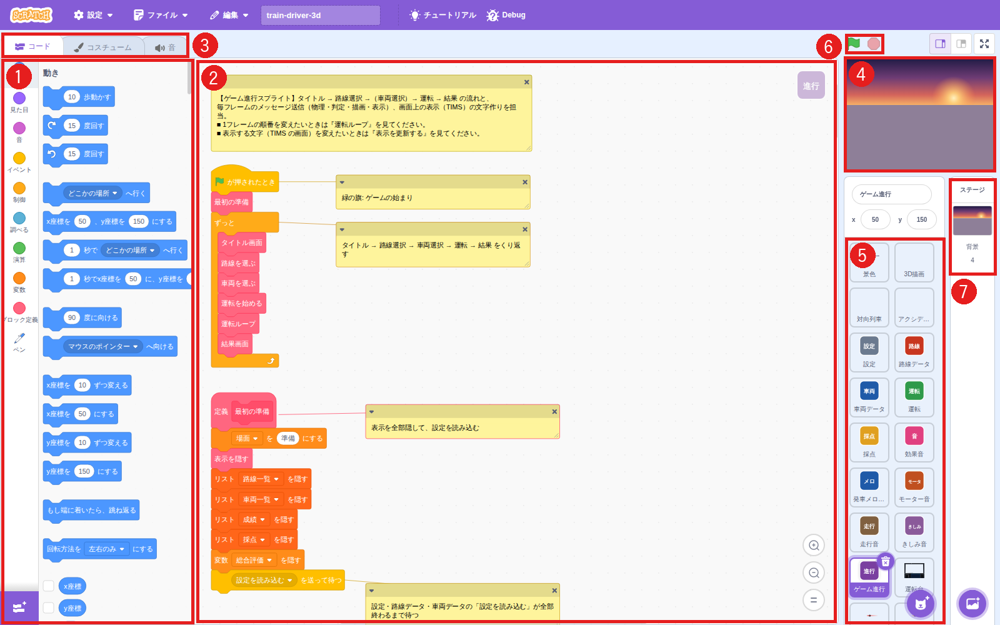

| 番号 | 名前 | ここでわかること |
|---|---|---|
| 1 | ブロックパレット | 使えるブロックの一覧。左の丸いボタン（動き・見た目・音・イベント・制御・調べる・演算・変数・ブロック定義・ペン）で種類を切りかえる |
| 2 | コードエリア | 選んだスプライトのプログラム。黄色い紙はコメント（説明のメモ） |
| 3 | タブ（コード・コスチューム・音） | 「コスチューム」は絵、「音」は音の一覧。名前もここで変えられる |
| 4 | ステージ | ゲームの画面 |
| 5 | スプライトリスト | このゲームの 25 こ のスプライト。クリックすると、そのスプライトのコードが 2 に出る |
| 6 | 緑の旗・止める | 緑の旗でゲームが始まる。赤い丸で止まる |
| 7 | ステージ（背景） | 背景「夕方」「昼」「霧」「黒」がある。このゲームでは、ステージにはプログラムが入っていない（全体の説明のコメントだけ） |

### 1-1. スプライト

スプライトは、**劇に出る役者** のようなものです。役者は一人ずつ、自分の台本（コード）を持っています。

このゲームのスプライトは 25 こ あります。
ほとんどのスプライトは、ステージに **自分のすがたを見せません**。
かわりに、ペンで線を引いたり、絵をスタンプしたりして、前の景色をかいています。
運転台・計器・ボタンなど、手前に出るものだけが、すがたを見せるスプライトです。

スプライトリストには、次の順番でならんでいます（上の段の左から右へ）。

景色 → 3D描画 → 対向列車 → アクシデント → 設定 → 路線データ → 車両データ → 運転 → 採点 → 効果音 → 発車メロディ → モーター音 → 走行音 → きしみ音 → ゲーム進行 → 運転台 → 速度計の針 → BC圧計の針 → ノッチ表示 → 速度の数字 → ATS表示灯 → 戸閉表示灯 → 画面 → タップ操作 → 番号ボタン

> 名前が長いと、リストでは「アクシデ…」「発車メロ…」のように切れて見えます。クリックすると、上の名前のらんに全部出ます。

### 1-2. ブロック

ブロックは、台本の **一つ一つの命令** です。上から順に実行されます。

- **ぼうしの形のブロック**（「緑の旗が押されたとき」「○○を受け取ったとき」「定義」など）から、スクリプト（ブロックのかたまり）が始まります。
  どのスクリプトがいつ動くかは、**まずぼうしのブロックを見る** とわかります。
  （「緑の旗が押されたとき」は、ブロックの上では緑の旗のマークと「が押されたとき」の文字で出ます。）
- 色で種類がわかります。黄色は「イベント」、明るいオレンジは「制御」、こいオレンジは「変数」、ピンクは「ブロック定義」、緑は「演算」です。

### 1-3. 変数とリスト

**変数** は、**名前を書いた箱** です。箱の中には数字や文字を 1 つ入れられます。
たとえば変数「速度」には、今の電車の速さ（km/h）が入っています。

**リスト** は、**番号つきの、ならんだ箱** です。
たとえばリスト「駅名」には、1 番に始発駅、2 番に次の駅…と、駅の名前が順番に入っています。

変数とリストには 2 つの種類があります。

| 種類 | 意味 | このゲームでは |
|---|---|---|
| すべてのスプライト用 | どのスプライトからも見たり変えたりできる | 変数 174 こ・リスト 31 こ。スプライトどうしで数字を受けわたすのに使う |
| このスプライトのみ | そのスプライトの中だけで使う | 変数 217 こ・リスト 51 こ。「_i」「_a」のように「_」で始まるものは、計算のとちゅうのメモ |

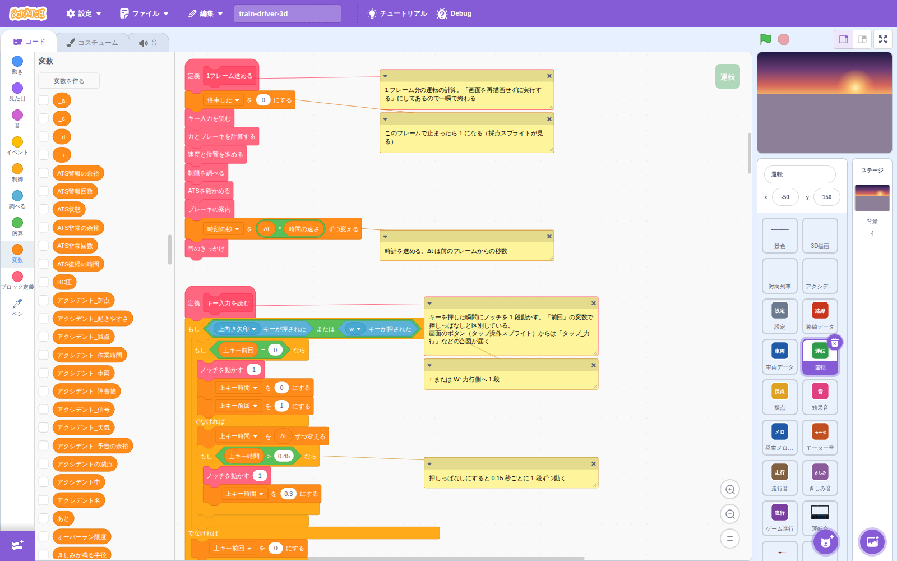

> **ポイント:** ブロックパレットの「変数」で、名前の左の **チェックボックス** を入れると、ステージにその変数の今の値が出ます。
> 動かしながら値が見られるので、不具合を調べるときにとても役に立ちます（[6 章](#6-うまく動かないとき)）。
> 「このスプライトのみ」の変数は、ステージに「採点: 残り」のように、スプライト名つきで出ます。

### 1-4. メッセージ

メッセージは、**校内放送** のようなものです。

- 「○○を送る」ブロック … 放送する。送ったスプライトは、そのまま次のブロックへ進む。
- 「○○を送って待つ」ブロック … 放送して、**聞いた全員の仕事が終わるまで待つ**。
- 「○○を受け取ったとき」ブロック … その放送を聞いたら、下のブロックを動かす。

1 つのメッセージを、たくさんのスプライトが聞くこともあります。
たとえばメッセージ「表示」は、計器やランプ、音など 10 こ のスプライトが受け取ります。
このゲームのメッセージは 43 こ です。だれが送って、だれが受け取るかは [7-1 メッセージのさくいん](#7-1-メッセージのさくいん) にまとめました。

### 1-5. 定義（ブロック定義）

ブロックパレットの「ブロック定義」の「ブロックを作る」で、**自分だけのブロック** が作れます。
作ったブロックの中身は、ピンクのぼうし **「定義」** の下に書きます。

たとえるなら、**料理の手順に名前をつけたもの** です。
「カレーを作る」と言えば、中の手順（切る・いためる・にる）が全部動く、という感じです。

- このページでは、定義の名前を『採点する』のように『』でかこみます。
- 定義は **そのスプライトの中だけ** で使えます。
  たとえば『位置を計算 前に (　) m 横 (　) m 高さ (　) m』は、「3D描画」「景色」「対向列車」「アクシデント」の 4 つのスプライトに、同じ名前で別々にあります。1 つを直しても、ほかの 3 つは変わりません。
- このゲームの定義は 125 こ（名前の種類は 120）です。全部は [7-5 定義のさくいん](#7-5-定義のさくいん) にあります。
- 「定義」のブロックを右クリック →「編集」で、名前や「画面を再描画せずに実行する」のチェックが見られます。
  このチェックが入っていると、中身が一瞬で全部動きます。このゲームではほとんどの定義にチェックが入っています。
  入っていないのは、「待つ」ブロックを使う『最初の準備』『タイトル画面』『路線を選ぶ』『車両を選ぶ』『運転を始める』『運転ループ』『結果画面』（「ゲーム進行」スプライト）と、『発車する (　)』（「採点」スプライト）だけです。
  **「待つ」を使う定義を新しく作るときは、このチェックを入れないでください。** 入れると、待っているあいだ画面が止まってしまいます。

### 1-6. コメント

コードエリアの黄色い紙が **コメント** です。このゲームには 697 まい あります。

- どのスプライトも、いちばん上に「【○○スプライト】」で始まるコメントがあります。そのスプライトの役わりと、改造するときに見る所が書いてあります。
- ブロックの右のコメントは、線でつながったブロックの説明です。
- ステージにも、ゲーム全体のしくみをまとめたコメントがあります（ステージをクリックすると見られます）。

### 1-7. さがし方のコツ

- **コードエリアを右クリック →「きれいにする」** … スクリプトがたてに一列にならびます。重なって見えにくいときに使います（動きは変わりません）。
- **コードエリアの右下の「＋」「−」「＝」** … 大きくする・小さくする・元の大きさ。
- **スクロール** … マウスのホイールやトラックパッドで、上下左右に動かせます。スクリプトは右や下に長くのびていることがあります。
- **変数やリストの名前をたしかめる** … ブロックパレットの「変数」に、全部の名前がならんでいます。
- **定義がどこで使われているか** … 定義の名前は、そのスプライトのコードエリアの中だけをさがせば見つかります。
- **メッセージをだれが受け取るか** … Scratch には「さがす」ボタンがないので、このページの [7-1](#7-1-メッセージのさくいん) を見て、受け取るスプライトを開き、黄色い「○○を受け取ったとき」をさがします。
  （TurboWarp で開くと、コードエリアの上の「検索」でブロックをさがせます。）

---

## 2. スプライトの役わりとつながり

### 2-1. 全体の図

25 このスプライトを、仕事ごとに 7 つのグループに分けると、こうなります。
矢印の上の文字は、送るメッセージ（または受けわたす変数）です。

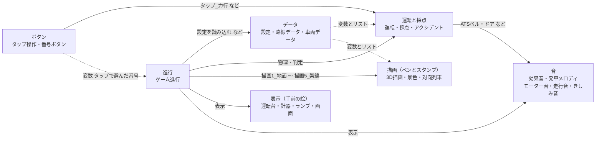

- 「計器」は 速度計の針・BC圧計の針・ノッチ表示・速度の数字、「ランプ」は ATS表示灯・戸閉表示灯 です。
- 点線の矢印は、メッセージではなく **変数やリストで数字をわたしている** ことを表します。

### 2-2. スプライトの一覧

| グループ | スプライト | よみかた | 役わり | 最初に見る所 |
|---|---|---|---|---|
| 進行 | ゲーム進行 | げーむしんこう | タイトル → 路線選択 → 運転 → 結果 の順番。毎フレーム、ほかのスプライトにメッセージを送る。TIMS の文字を作る | 「緑の旗が押されたとき」と『運転ループ』 |
| データ | 設定 | せってい | ゲーム全体の数字（見え方・採点のきびしさ・音量・対向列車・アクシデントなど） | 11 この「設定を読み込むを受け取ったとき」 |
| データ | 路線データ | ろせんでーた | 3 つの路線の駅・時刻表・制限速度・カーブ・坂・景色・店・空港 | 『路線1 信町本線』『路線2 神社線』『路線3 田原海岸線』 |
| データ | 車両データ | しゃりょうでーた | 電車の性能（加速・ブレーキ・最高速度など） | 『T25000系』 |
| 運転と採点 | 運転 | うんてん | キー入力・ノッチ・加速とブレーキ・速度と位置・制限速度・ATS・ブレーキの案内 | 『1フレーム進める』 |
| 運転と採点 | 採点 | さいてん | 駅に止まったかの判定・採点・ドア・発車・通過駅の案内 | 『駅の判定』『採点する』『発車する (　)』 |
| 運転と採点 | アクシデント | あくしでんと | ときどき起きるトラブル（障害物・天気・信号故障・車両）と、その絵 | 『アクシデントを進める』 |
| 描画 | 3D描画 | すりーでぃーびょうが | 地面・枕木・レール・ホーム・駅名標・標識・架線柱・架線 | 『地面を描く』『構造物を描く』 |
| 描画 | 景色 | けしき | 遠くの山や街・線路わきの木や建物や店・空港・飛行機 | 『景色を描く』 |
| 描画 | 対向列車 | たいこうれっしゃ | となりの線路を走ってくる電車 | 『対向列車を動かす』『対向列車を描く』 |
| 表示 | 運転台 | うんてんだい | 窓わくと計器盤の絵 | 「運転画面を表示を受け取ったとき」 |
| 表示 | 速度計の針 | そくどけいのはり | 速度計の針（0〜400km/h） | 「表示を受け取ったとき」 |
| 表示 | BC圧計の針 | びーしーあつけいのはり | ブレーキの強さの針 | 「表示を受け取ったとき」 |
| 表示 | ノッチ表示 | のっちひょうじ | P5〜N〜B8・EB の表示。コスチュームの名前がノッチの名前 | 「表示を受け取ったとき」 |
| 表示 | 速度の数字 | そくどのすうじ | 速度のデジタル数字（クローン 3 こ で百・十・一の位） | 「クローンされたとき」 |
| 表示 | ATS表示灯 | えーてぃーえすひょうじとう | ATS が働いているとき赤く光る | 「表示を受け取ったとき」 |
| 表示 | 戸閉表示灯 | とじめひょうじとう | ドアが全部しまると光る | 「表示を受け取ったとき」 |
| 表示 | 画面 | がめん | タイトル・路線パネル・車両パネル・結果パネルの絵 | 「タイトルを表示を受け取ったとき」など |
| ボタン | タップ操作 | たっぷそうさ | 運転中の ▲力行・▼ブレーキ・非常・警笛 のボタン（クローン） | 「このスプライトが押されたとき」 |
| ボタン | 番号ボタン | ばんごうぼたん | 路線・車両を選ぶ番号のボタン（クローン） | 「このスプライトが押されたとき」 |
| 音 | 効果音 | こうかおん | 警笛・ドアチャイム・ATS ベルなど 13 この音 | 「○○を受け取ったとき」がならんでいる |
| 音 | 発車メロディ | はっしゃめろでぃ | 駅ごとの発車メロディ（CLEX202・CLEX203・CLEX204） | 「設定を読み込むを受け取ったとき」 |
| 音 | モーター音 | もーたーおん | モーターの音。速さで高さが変わる | 「表示を受け取ったとき」 |
| 音 | 走行音 | そうこうおん | 「ゴー」という音と「タタン」 | 「表示を受け取ったとき」「ジョイントを受け取ったとき」 |
| 音 | きしみ音 | きしみおん | カーブで車輪がきしむ「キーー」 | 「表示を受け取ったとき」 |

> Scratch では、音の大きさ（音量）がスプライトごとに決まります。
> だから音のスプライトを 5 つに分けて、モーター音の大きさを変えても、警笛や発車メロディの大きさが変わらないようにしています。

### 2-3. くわしい図: 準備のメッセージ

運転を始めるまでに「ゲーム進行」が送るメッセージです。どれも **「送って待つ」** なので、受け取った全員の仕事が終わってから次へ進みます。

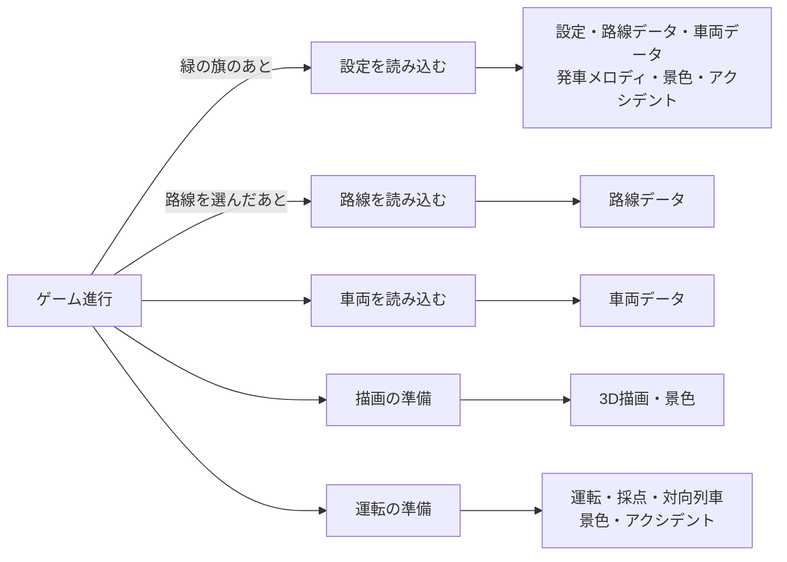

### 2-4. くわしい図: 1 フレームの順番

運転中は、「ゲーム進行」の『運転ループ』が、1 フレーム（画面が 1 回かわる間）ごとに、次の順番でメッセージを送ります。
**先に送ったメッセージの仕事が先に動く** ので、遠くの物から順にかけます（あとからかいた物が手前に重なる）。

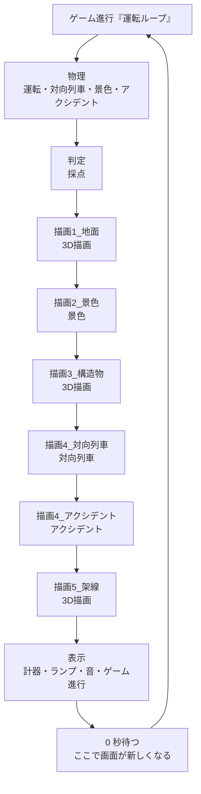

（四角の 1 行目がメッセージ、2 行目が受け取るスプライト）

### 2-5. くわしい図: 画面とボタン

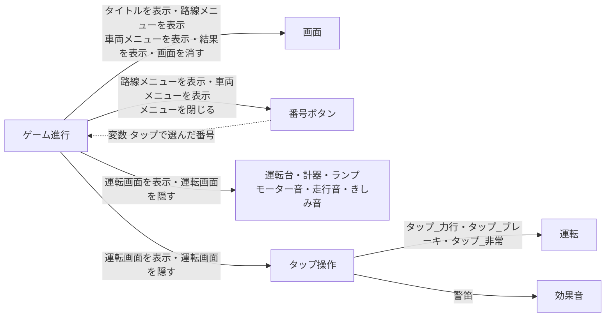

### 2-6. くわしい図: 音

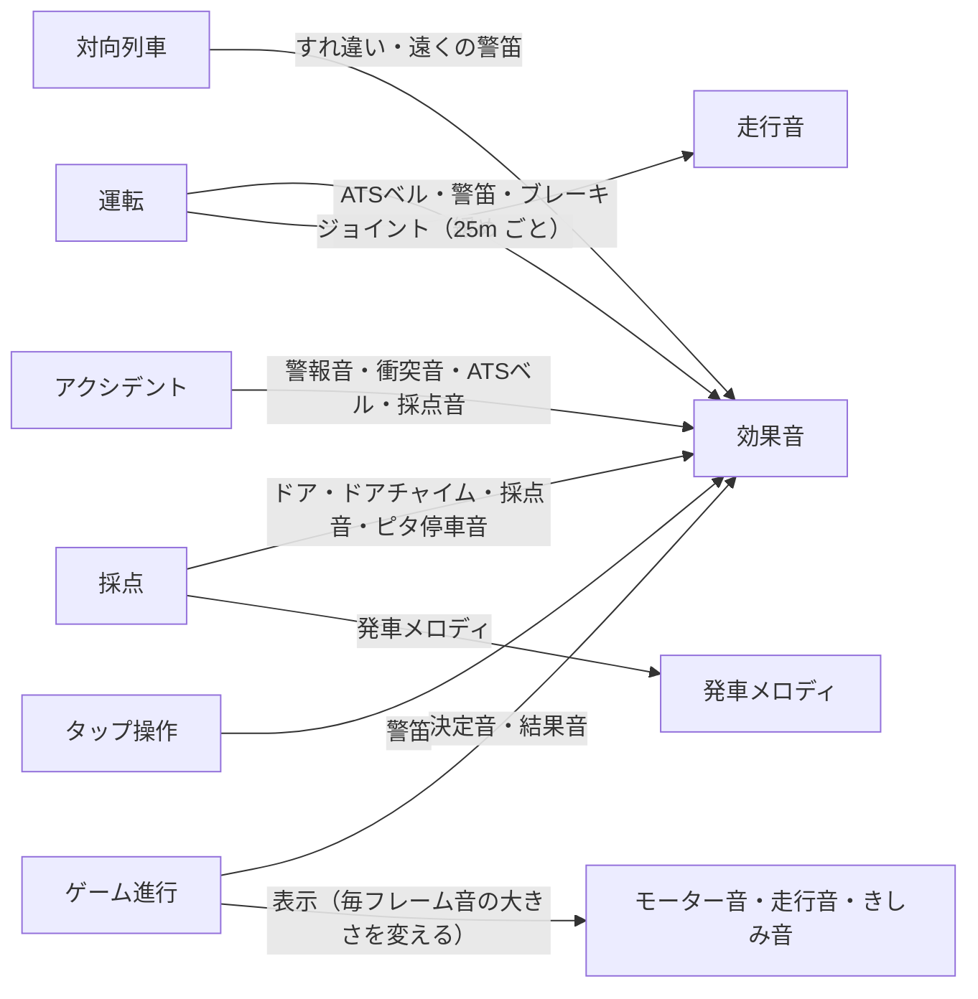

---

## 3. 緑の旗から結果まで（動く順番）

### 3-1. 全体の流れ

ゲーム全体の順番は、「ゲーム進行」スプライトの **「緑の旗が押されたとき」** のスクリプトにあります（[1 章の写真](#1-scratch-の画面の見方) の、コードエリアの左上）。

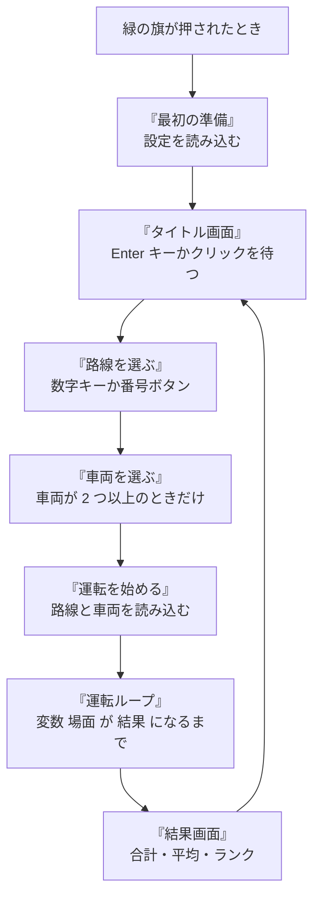

**見る場所:** 「ゲーム進行」スプライトの「緑の旗が押されたとき」→「ずっと」の中の 6 この定義。
それぞれの定義の中身は、同じスプライトの下のほうにあります。

#### 変数「場面」で、今どこにいるかがわかる

変数「場面」には、今のゲームの場面が文字で入っています。ほかのスプライトは、この文字を見て仕事をするかどうかを決めます。

| 場面 の文字 | いつ | 入れるスプライト |
|---|---|---|
| 準備 | 緑の旗のすぐあと・運転を始める準備中 | ゲーム進行 |
| タイトル | タイトル画面 | ゲーム進行 |
| 路線選択 | 路線を選ぶ画面 | ゲーム進行 |
| 車両選択 | 車両を選ぶ画面 | ゲーム進行 |
| 停車中 | 駅に止まっている（発車を待っている） | 採点 |
| 運転中 | ドアがしまって走っている | 採点 |
| 結果 | 終点に着いた（『運転ループ』が終わる） | 採点 |

> **注意:** 「運転中」などの文字は、いろいろなスプライトの「もし (場面) = (運転中) なら」で使われています。1 か所だけ変えると動かなくなるので、**この文字は変えないでください。**

### 3-2. 準備（『最初の準備』）

1. 変数「場面」を「準備」にして、TIMS の表示やリストをかくす。
2. メッセージ「設定を読み込む」を **送って待つ**。
   - 「設定」スプライトが、たくさんの変数に数字を入れる（11 このスクリプトに分かれている）。
   - 「路線データ」がリスト「路線一覧」、「車両データ」がリスト「車両一覧」を作る（メニューに出る文字）。
   - 「発車メロディ」が駅ごとの曲の表を作る。「景色」が空港の建物のならびを、「アクシデント」がトラブルの種類の表を作る。

> **大事:** 「設定」スプライトの数字を書きかえたら、**緑の旗をもう一度おす** と効きます。「設定を読み込む」は緑の旗のときだけ動くからです。

### 3-3. タイトルと路線選び（『タイトル画面』『路線を選ぶ』）

- 『タイトル画面』: メッセージ「タイトルを表示」を送ると、「画面」スプライトがタイトルの絵を出します。Enter キーかクリック（タップ）を待ちます。スペースキーは非常ブレーキなので、ここでは使いません。
- 『路線を選ぶ』: メッセージ「路線メニューを表示」を送ると、「画面」が路線パネルを、「番号ボタン」が番号のボタンを出します。リスト「路線一覧」もステージに出ます。
  - 数字キーをおすと、その番号が変数「路線番号」に入ります。
  - 番号ボタンをタップすると、「番号ボタン」が変数「タップで選んだ番号」に番号を入れ、「ゲーム進行」がそれを変数「路線番号」にうつします。
- 『車両を選ぶ』: リスト「車両一覧」が 2 こ 以上のときだけ、同じように選ぶ画面が出ます。今は「T25000系」だけなので、選ばずに 1 番になります。

### 3-4. 運転の準備（『運転を始める』）

『運転を始める』の中は、上から順に次のように動きます。

1. メッセージ「画面を消す」→ パネルを消す。
2. メッセージ「路線を読み込む」（待つ）→ 「路線データ」が『運行をリセット』のあと、『路線を読む (路線番号)』で『路線1 信町本線』『路線2 神社線』『路線3 田原海岸線』『運行4 エアポート特快』のどれかを動かし、駅・制限・カーブなどをリストに入れる。『運行の仕上げ』で行き先の表示（変数「列車」）などを決め、最後に『表を作る』で、10m ごとのカーブと坂の表（リスト「曲率表」「勾配表」）を作る。
   - 『運行4 エアポート特快』は、『区間を足す』で信町本線（新信町〜高田）と田原海岸線（高田〜田原京）をつなぎ、『停車』で止まる駅と時刻を決める。高田に着くところで『景色の切り替えを調べる』が田原海岸線の景色に切り替える。
3. メッセージ「車両を読み込む」（待つ）→ 「車両データ」が『T25000系』を動かし、性能の変数に数字を入れる。種別に両数があるとき（エアポート特快は 10両）は「編成両数」をその両数にし、「駅のホームの長さ」（列車長＋20m 以上）を決める。
4. 背景を、変数「空」の名前（夕方・昼・霧）にする。
5. メッセージ「描画の準備」（待つ）→ 「3D描画」が地面の行や色の表を作る。
6. リスト「成績」を空にして、変数「合計点」「採点した駅数」を 0 にする。
7. メッセージ「運転の準備」（待つ）→ 「運転」が電車を始発駅に止めた状態にする（『運転の準備をする』）。「アクシデント」がこの運転で起きるトラブルの場所と種類を決める。
8. メッセージ「運転画面を表示」→ 運転台・計器・ランプ・ボタンが出て、音が鳴り始める。
9. メッセージ「始発駅を発車」→ 「採点」が発車の流れを始める（[3-6](#3-6-発車採点の発車する-)）。

### 3-5. 運転中の 1 フレーム（『運転ループ』と『1フレーム進める』）

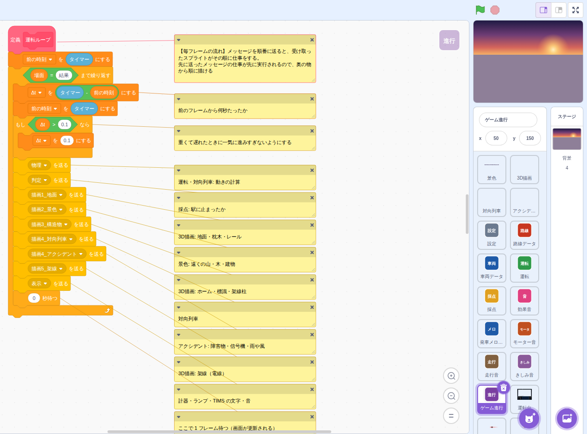

**見る場所:** 「ゲーム進行」スプライトの『運転ループ』。

- 変数「Δt」に、前のフレームから何秒たったかを入れます（重くて 0.1 秒より長くなったら 0.1 にする）。動きの計算は、この「Δt」をかけて進めます。
- 変数「場面」が「結果」になるまで、メッセージを [2-4 の図](#2-4-くわしい図-1-フレームの順番) の順に送りつづけます。

メッセージ「物理」を受け取ると、「運転」スプライトは『1フレーム進める』を動かします。

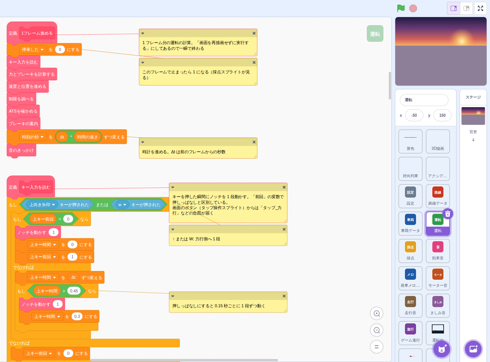

| 順番 | 定義（「運転」スプライト） | すること |
|---|---|---|
| 1 | 『キー入力を読む』 | ↑・W で力行側、↓・S でブレーキ側へ 1 段。スペースで非常ブレーキ、H で警笛 |
| 2 | 『力とブレーキを計算する』 | ノッチから加速と減速を計算。坂・カーブ・空気のていこうも入れる |
| 3 | 『速度と位置を進める』 | 変数「速度」と変数「位置」（路線の始めから何 m か）を進める。止まった瞬間に変数「停車した」を 1 にする |
| 4 | 『制限を調べる』 | 今の制限速度（変数「現在の制限」）と、次の制限（変数「予告の速度」「予告の距離」） |
| 5 | 『ATSを確かめる』 | 制限より速すぎたらベルや非常ブレーキ |
| 6 | 『ブレーキの案内』 | 「そろそろブレーキ！」の案内 |
| 7 | （変数「時刻の秒」を「Δt × 時間の速さ」ずつ変える） | ゲームの時計を進める |
| 8 | 『音のきっかけ』 | 25m ごとにメッセージ「ジョイント」（タタン） |

- 変数「ノッチ」は、5〜1 が P5〜P1（力行）、0 が N、−1〜−8 が B1〜B8、−9 が EB（非常）です。
- 画面のボタンをおすと、「タップ操作」からメッセージ「タップ_力行」「タップ_ブレーキ」「タップ_非常」がとどき、「運転」の『ノッチを動かす (　)』や『非常ブレーキをかける』が動きます。キーをおしたときと同じです。
- 変数「ドア」が「開」のあいだは、ノッチを入れても動きません（『速度と位置を進める』）。

メッセージ「表示」を受け取ると、「ゲーム進行」の『表示を更新する』が、TIMS（運転台のまん中の画面）に出す文字を作ります。
変数「次の駅」「あと」「時刻」「定刻」「制限」「予告」「勾配」は、**表示のためだけの変数** です。ここを書きかえても電車の動きは変わりません。

### 3-6. 発車（「採点」の『発車する (　)』）

発車の流れは、「採点」スプライトの『発車する (　)』にあります。

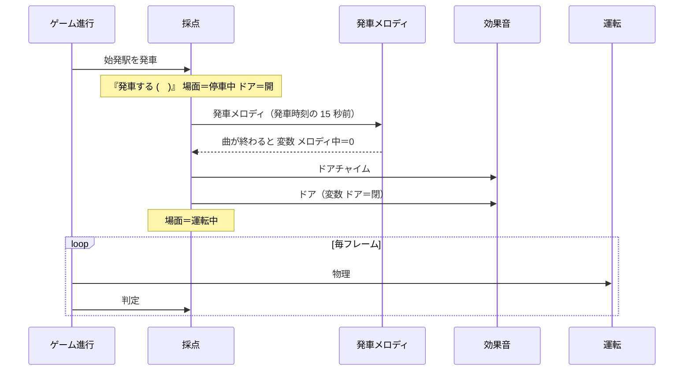

1. 変数「場面」を「停車中」、変数「ドア」を「開」にする。
2. 発車時刻の「発車メロディの開始」秒前（「設定」で 15 秒）まで待つ。
3. メッセージ「発車メロディ」を送る。「発車メロディ」スプライトが、変数「発車する駅」の名前で曲を選んで、終わるまで鳴らし、変数「メロディ中」を 0 にする。
4. メッセージ「ドアチャイム」→ 2.2 秒待つ → 変数「ドア」を「閉」にしてメッセージ「ドア」。
5. 変数「場面」を「運転中」にする。ここから運転できます。

### 3-7. 停車と採点（「採点」の『駅の判定』『採点する』）

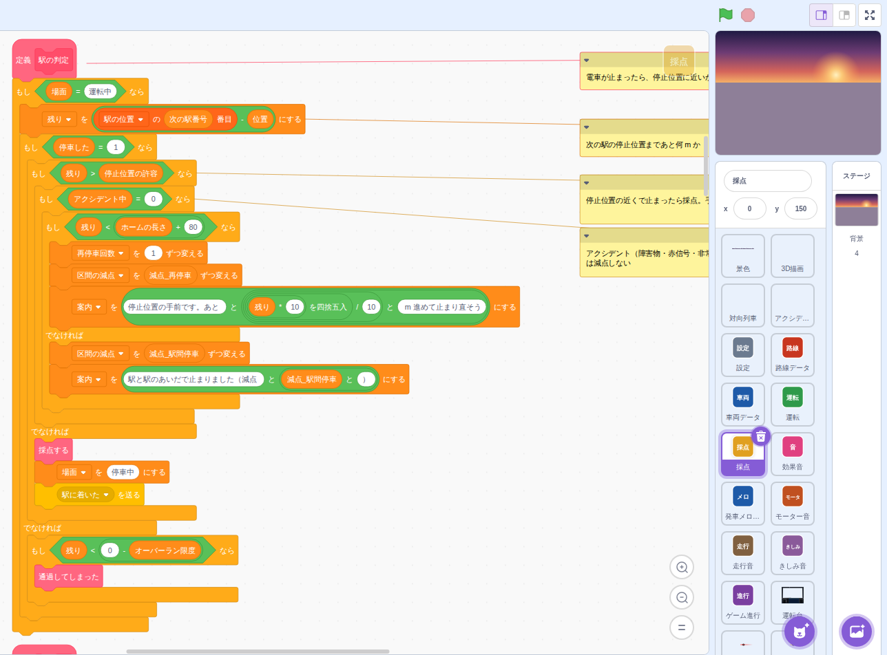

メッセージ「判定」を受け取ると、「採点」は毎フレーム『駅の判定』と『通過駅の案内』を動かします。

**見る場所:** 「採点」スプライトの『駅の判定』。

- 変数「残り」に、次の停車駅の停止位置まであと何 m かを入れます。
- 「運転」が変数「停車した」を 1 にしたら（止まったら）、次のどれかになります。
  - 停止位置の手前「停止位置の許容」（3m）より遠い → 止まり直し（「再停車」で点が引かれる）。もっと遠い駅と駅のあいだなら「駅間停車」。
  - それより近い → 『採点する』 → 変数「場面」を「停車中」 → メッセージ「駅に着いた」。
- 止まらずに「オーバーラン限度」（50m）より行き過ぎた → 『通過してしまった』（その駅は運転操作の点だけ）。

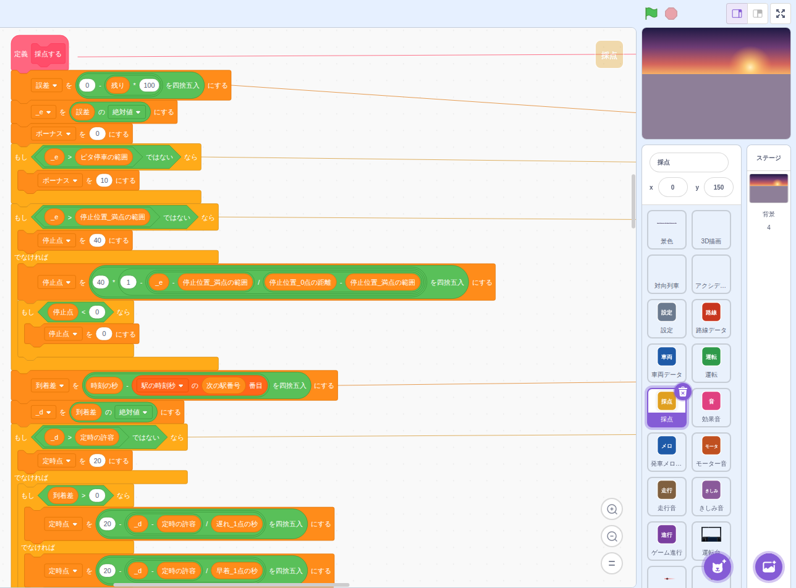

『採点する』は、1 駅 100 点（＋ピタ停車 10 点）を、上から順に計算します。

| 点 | 変数 | 決め方 | きびしさの変数（「設定」） |
|---|---|---|---|
| 停止位置 40 点 | 停止点 | 停止位置とのずれ（変数「誤差」cm） | ピタ停車の範囲・停止位置_満点の範囲・停止位置_0点の距離 |
| 時刻 20 点 | 定時点 | 定刻とのずれ（変数「到着差」秒） | 定時の許容・遅れ_1点の秒・早着_1点の秒 |
| 停車の衝動 20 点 | 衝動点 | 止まった瞬間の減速（変数「停止時の減速度」） | 衝動_満点の減速度・衝動_0点の減速度 |
| 運転操作 20 点 | 運転点 | 20 から 変数「区間の減点」を引く | 減点_ATS警報・減点_ATS非常・減点_非常ブレーキ・減点_再停車・減点_駅間停車 |
| ピタ停車 ＋10 点 | ボーナス | ずれが「ピタ停車の範囲」以内 | ピタ停車の範囲 |

- 合計は変数「駅の得点」。変数「合計点」に足し、変数「採点した駅数」を 1 ふやします。
- 内わけはリスト「採点」（停車中にステージに出る）、結果画面用の 1 行はリスト「成績」に入ります。

メッセージ「駅に着いた」を受け取ると、「採点」は次のように動きます（同じ「採点」スプライトが送って、自分で受け取っています）。

1. 変数「ドア」を「開」にして、リスト「採点」を 4.5 秒見せる。
2. 終点なら、変数「場面」を「結果」にする → 『運転ループ』が終わって結果画面へ。
3. 終点でなければ、『次の停車駅へ』（通過駅はとばす）→『区間をリセット』→『発車する (　)』。

### 3-8. 結果（『結果画面』）

**見る場所:** 「ゲーム進行」スプライトの『結果画面』。

- 変数「平均」＝ 変数「合計点」÷ 変数「採点した駅数」（四捨五入）。
- 「ランクS」「ランクA」「ランクB」「ランクC」（「設定」の変数）とくらべて、変数「ランク」を S〜D にする。
- 変数「総合評価」とリスト「成績」をステージに出し、Enter キーかクリックを待って、タイトルにもどります。

### 3-9. ほかのスプライトも毎フレーム動いている

| スプライト | 受け取るメッセージ | すること | 見る場所 |
|---|---|---|---|
| アクシデント | 物理・描画4_アクシデント | 予定の場所に来たらトラブルを起こす。止まる所があるときは変数「臨時停止位置」に入れる（TIMS と「運転」のブレーキ案内がそこを見る） | 『アクシデントを進める』『アクシデントを始める (　)』 |
| 対向列車 | 物理・描画4_対向列車 | 一定の時間ごとに、出すかどうかをくじ引き。出たら近づいてきて、すれ違う | 『対向列車を動かす』『対向列車を出す』 |
| 景色 | 物理・描画2_景色 | 遠景・沿線の木や建物や店・空港の建物・飛行機 | 『景色を描く』『沿線物を描く』『飛行機を動かす』 |
| 3D描画 | 描画1_地面・描画3_構造物・描画5_架線 | 地面を横線でぬる。ホーム・駅名標・停止位置目標・制限標識・架線柱・架線 | 『地面を描く』『構造物を描く』『架線を描く』 |

---

## 4. 大事なブロックと「どこを見るか」

### 4-1. 知りたいこと → 見る場所

| 知りたいこと | 見る場所 |
|---|---|
| ゲームの順番 | 「ゲーム進行」の「緑の旗が押されたとき」 |
| 毎フレーム何がどの順で動くか | 「ゲーム進行」の『運転ループ』 |
| TIMS に出る文字の作り方 | 「ゲーム進行」の『表示を更新する』 |
| キーの割り当て | 「運転」の『キー入力を読む』 |
| 加速とブレーキの計算 | 「運転」の『力とブレーキを計算する』、数字は「車両データ」の『T25000系』 |
| 制限速度の決まり方 | 「運転」の『制限を調べる』、区間は「路線データ」の『制限を追加 (　) m から (　) m まで (　) km/h』 |
| ATS | 「運転」の『ATSを確かめる』、余裕は「設定」の「ATS警報の余裕」「ATS非常の余裕」 |
| 止まったかどうか | 「採点」の『駅の判定』 |
| 点数の付け方 | 「採点」の『採点する』 |
| ドア・発車メロディ・発車の順番 | 「採点」の『発車する (　)』 |
| 駅ごとの発車メロディ | 「発車メロディ」の「設定を読み込むを受け取ったとき」 |
| ランク | 「ゲーム進行」の『結果画面』、点は「設定」の「ランクS」〜「ランクC」 |
| 駅・時刻表・カーブ・坂・店 | 「路線データ」の『路線1 信町本線』など |
| アクシデントの起き方 | 「アクシデント」の『予定を立てる』『アクシデントを始める (　)』 |
| ボタンの場所 | 「タップ操作」の「運転画面を表示を受け取ったとき」の『ボタンを作る (　) x (　) y (　)』 |
| 地面や線路のかき方 | 「3D描画」の『地面を描く』（くわしい人向け） |

### 4-2. このゲームでよく出てくるブロック

| ブロック | 何をするか | どこで大事か |
|---|---|---|
| 「○○を送って待つ」 | メッセージを送って、受け取った全員が終わるまで待つ | 準備のメッセージ（[2-3](#2-3-くわしい図-準備のメッセージ)）。待たないと、データができる前に運転が始まってしまう |
| 「○○を送る」 | メッセージを送って、すぐ次へ進む | 『運転ループ』の毎フレームのメッセージ、効果音 |
| 「(変数) を (　) にする」 | 箱に数字や文字を入れる | 「設定」「車両データ」の数字は、ほとんどこのブロック |
| 「(変数) を (　) ずつ変える」 | 箱の数を足す（マイナスなら引く） | 変数「合計点」「区間の減点」「時刻の秒」など |
| 「(リスト) の (　) 番目」 | リストの何番目かを取り出す | リスト「駅名」「駅の位置」「駅の時刻秒」を、変数「次の駅番号」の番目で見る |
| 「(　) を (リスト) に追加する」 | リストの最後に足す | 「路線データ」の『駅を追加 …』の中など |
| 「もし (場面) = (運転中) なら」 | 場面によって仕事をするか決める | 「採点」『駅の判定』、「アクシデント」など |
| 「コスチュームを (　) にする」 | 絵を切りかえる | 名前でえらぶ所が多い（[5-12](#5-12-こわれやすい所名前でつながっている所)） |
| ペンの「スタンプ」「ペンを下ろす」 | 絵をはる・線を引く | 「3D描画」「景色」「対向列車」「アクシデント」 |
| 「クローンを作る」「クローンされたとき」 | 自分のコピーを作る | 「速度の数字」（3 けた）、「タップ操作」（4 つのボタン）、「番号ボタン」 |

---

## 5. 改造してみよう（例）

**どの改造も、次の 3 つの順番で進めます。**

1. 控えを取る（「ファイル」→「コンピューターに保存する」）。
2. 1 か所だけ変える。
3. 緑の旗をおして、たしかめる。うまくいったら、また保存する。

一度にたくさん変えると、こわれたときにどこが悪いのかわからなくなります。

### 5-1. 駅名を変える

例: 田原海岸線の「紅葉滝」を「もみじ滝」にする。

1. **「路線データ」** を開き、『路線3 田原海岸線』の中の『駅を追加 (紅葉滝) 停止位置 (23400) m 時刻 (10:32:30) (停車)』の「紅葉滝」を「もみじ滝」に書きかえる。
   これで TIMS・案内・成績の駅名が変わります。
2. **「発車メロディ」** を開き、「設定を読み込むを受け取ったとき」の『駅 (紅葉滝) の発車メロディは (CLEX203)』の「紅葉滝」も「もみじ滝」にする。
   わすれると、表にない駅として、変数「いつもの発車メロディ」の曲（CLEX202）が鳴ります。
3. **「3D描画」** の「コスチューム」タブで、コスチューム「紅葉滝」の名前を「もみじ滝」にし、絵の中の文字も書きかえる。
   ホームの駅名標は、駅名と **同じ名前のコスチューム** が使われます。無いと、無地のコスチューム「駅名標」になります。
4. 緑の旗をおし、路線 3 を選んで、TIMS の「次の駅」と駅名標をたしかめる。

- 「高田」「信早ヶ丘」は 2 つの路線にあります。両方の路線の『駅を追加』を書きかえます。
- 路線を選ぶメニューの文字（リスト「路線一覧」）にも駅名が入っています。「路線データ」の「設定を読み込むを受け取ったとき」の「(　) を (路線一覧) に追加する」も書きかえます（「紅葉滝」は入っていません）。

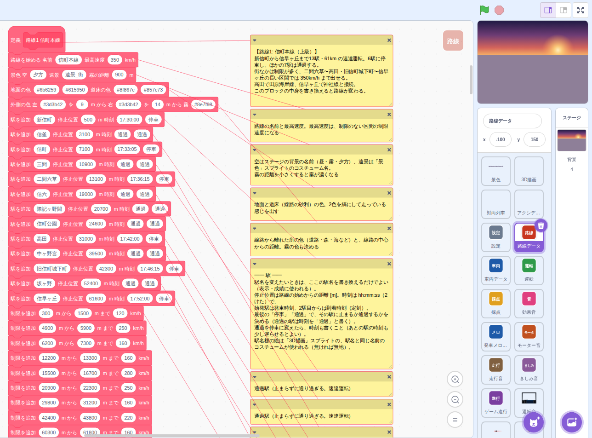

### 5-2. 時刻表や、止まる駅を変える

- 時刻は『駅を追加』の 3 つめのあな。**hh:mm:ss**（2 けたずつ）で書きます。始発駅は発車時刻、2 駅目からは到着時刻です。
- 最後のあなを「停車」か「通過」にします。「通過」を「停車」に変えたら、時刻のあなにも時刻を書きます（「通過」と書いてあるところ）。
- 時刻表は、最高速度で走って少し余裕があるように作ってあります。速さを下げる改造をしたら、時刻もおそくしないと、毎回「遅れ」になります。

### 5-3. 最高速度を変える

電車の最高速度と、路線の最高速度の 2 つがあります。

| 変えたいもの | 見る場所 | 初めの数 |
|---|---|---|
| 電車がそれ以上加速しない速さ | 「車両データ」の『T25000系』の「最高速度 を (350) にする」 | 350 |
| 路線の制限速度（制限の区間がない所） | 「路線データ」の『路線を始める 名前 (信町本線) 最高速度 (350) km/h』など | 信町本線・田原海岸線 350、神社線 260 |

- 速度計の目もりは 400km/h までです（「速度計の針」の「表示を受け取ったとき」で、0〜400 を針の向きにしている）。400 より速くすると、針が目もりの外に出ます。
- 速くしたら、時刻表とカーブの制限（『制限を追加』）も見直します。

### 5-4. 加速やブレーキの強さを変える

**見る場所:** 「車両データ」の『T25000系』。

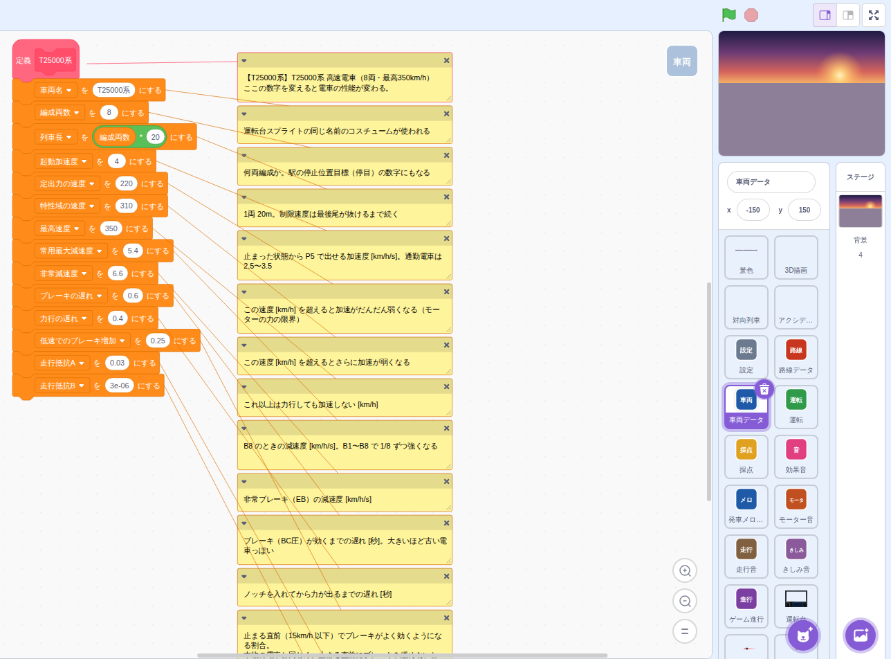

| 変数 | 初めの数 | 大きくすると |
|---|---|---|
| 起動加速度 | 4 | 走り出しが速くなる（km/h/s ＝ 1 秒に何 km/h 速くなるか） |
| 常用最大減速度 | 5.4 | B8 のブレーキが強くなる |
| 非常減速度 | 6.6 | 非常ブレーキが強くなる |
| ブレーキの遅れ | 0.6 | ブレーキが効くまでに時間がかかる |
| 低速でのブレーキ増加 | 0.25 | 止まる直前に「ガクン」となりやすい |

### 5-5. 採点のきびしさやランクを変える

**見る場所:** 「設定」の「設定を読み込むを受け取ったとき」のうち、コメントが「■ 採点のきびしさ」のスクリプト。

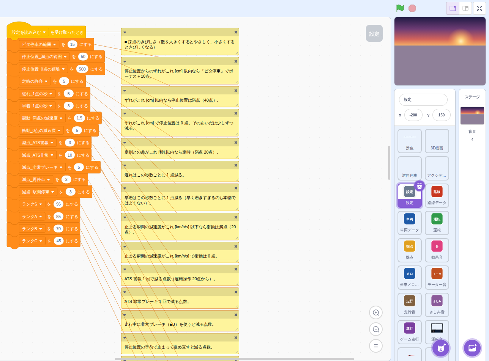

- 例: ピタ停車を出やすくしたい → 「ピタ停車の範囲 を (15) にする」を 30 にする。
- 例: 遅れにやさしくしたい → 「定時の許容」を 5 から 10 にする。
- 例: S ランクを取りやすくしたい → 「ランクS」を 96 から 90 にする。
- 点の付け方そのもの（40 点・20 点の配分など）を変えたいときは、「採点」の『採点する』を書きかえます。数字の 40・20・10 がブロックの中に書いてあります。
- 変えたら、**緑の旗をおし直す** のをわすれずに。

### 5-6. 対向列車の出やすさを変える

**見る場所:** 「設定」の、コメントが「■ 対向列車」のスクリプト。

- 「対向列車_出現率」（30）… くじで出る確率 %。0 で出ない、100 で毎回。
- 「対向列車_抽選間隔」（40）… 何秒ごとにくじを引くか。小さくするとよく来る。
- 「対向列車_最低速度」「対向列車_最高速度」「対向列車_最少両数」「対向列車_最多両数」も同じ所にあります。
- 色は、リスト「対向列車_車体色」と「対向列車_帯色」に **同じ順番で 1 組ずつ** 足します。

### 5-7. アクシデントの起きやすさを変える

**見る場所:** 「設定」の、コメントが「■ アクシデント（ときどき起きるトラブル）」のスクリプト。

- 「アクシデント_起きやすさ」（40）… 1 回の運転で 2 回くじを引き、それぞれこの確率 % で起きる。0 で起きない。
- 「アクシデント_障害物」「アクシデント_天気」「アクシデント_信号」「アクシデント_車両」… 1 で起こす、0 で起こさない。
- 路線ごとに起きる種類は、「路線データ」の各路線の『起きるアクシデント (　)』。書ける種類は 倒木・落石・動物・踏切の車・強風・大雨・信号故障・モーター不調・非常通報 です（「アクシデント」の「設定を読み込むを受け取ったとき」にある表と同じ名前にする）。

### 5-8. 看板の店名を変える

看板の店名は、ブロックではなく **絵（コスチューム）の中の文字** です。

1. **「景色」** の「コスチューム」タブを開き、「店_喫茶ひだまり」のような「店_」で始まるコスチュームを選ぶ。
2. 「テキスト」の道具で、看板の文字を書きかえる。
3. コスチュームの名前も「店_新しい店名」にする。
4. **「路線データ」** で、その店を使っている『沿線物を追加 (左) 側に (店_喫茶ひだまり)』の名前を、同じ「店_新しい店名」に書きかえる。
5. 緑の旗でたしかめる。

- 新しい店を足すときは、コスチュームを右クリック →「複製」で作ると、大きさがそろいます（20 ピクセル ＝ 1m、回転の中心は根元）。
- コスチュームの名前と『沿線物を追加』の名前が 1 文字でもちがうと、正しい絵が出ません。

### 5-9. 駅ごとの発車メロディを変える

**見る場所:** 「発車メロディ」の「設定を読み込むを受け取ったとき」。

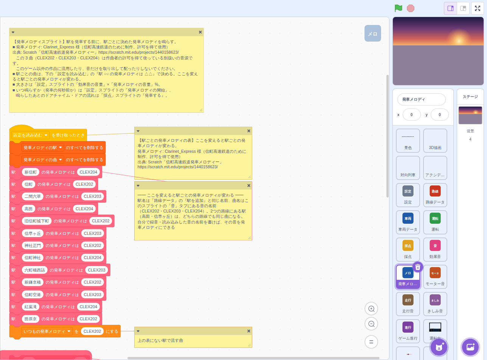

- 例: 高田の曲を CLEX202 にする → 『駅 (高田) の発車メロディは (CLEX204)』の CLEX204 を CLEX202 にする。
- 曲の名前は、「発車メロディ」スプライトの「音」タブにある音の名前と同じにします。
- 自分で録音・読みこんだ音を使うときは、「発車メロディ」の「音」タブに入れて、その名前を書きます。
  長い曲にしたら、「設定」の「発車メロディの開始」（今は 15 秒）と「停車時間」（今は 25 秒）も長くします（曲の長さ＋4 秒くらい）。
- この 3 曲は、作曲者の Clarinet_Express 様の許可をもらって使っている曲です。**このゲームのほかの作品に使ったり、音だけを取り出して配ったりしないでください。**

### 5-10. 停車時間・音量・重さを変える

すべて「設定」スプライトにあります。コメントの「■」の見出しで場所がわかります。

| やりたいこと | 変数（見出し） |
|---|---|
| 駅に止まる時間 | 停車時間（■ 運転のルール） |
| 発車メロディを鳴らし始める時 | 発車メロディの開始（■ 運転のルール） |
| ATS をやさしく | ATS警報の余裕・ATS非常の余裕（■ 運転のルール） |
| 音の大きさ | 効果音の音量・発車メロディの音量・モーター音の音量・走行音の音量・きしみ音の音量（■ 音） |
| 重いとき軽くする | 行の間隔を 3、枕木を描く距離を 0、沿線物を描く距離を 200、最大描画距離を 800（■ 描画の細かさ） |
| 画面のボタンを出さない | 画面のボタン を 0（■ タップ操作（画面のボタン）） |
| カーブの曲がって見える強さ | 見た目のカーブの強さ（■ 見え方（カメラと画面）） |
| 飛行機の出やすさ | 飛行機_出現率・飛行機_抽選間隔（■ 空港と飛行機） |

### 5-11. 路線や車両を増やす

大まかな手順は、それぞれのスプライトのいちばん上のコメントに書いてあります。
ただし Scratch 3.0 では、ピンクの「定義」ブロックそのものを右クリックしても「複製」は出ません。次のようにします。

**路線を増やす（「路線データ」）**

1. ブロックパレットの「ブロック定義」→「ブロックを作る」で、新しいブロック（例:「路線5 ○○線」。4 番はエアポート特快なので、新しい路線は 5 番から）を作る。
   作るときに「画面を再描画せずに実行する」にチェックを入れる（ほかの路線の定義と同じにする）。
2. 『路線3 田原海岸線』の定義の **すぐ下の 1 つめのブロック**（『路線を始める 名前 (田原海岸線) 最高速度 (350) km/h』）を右クリック →「複製」。下につながったブロックが全部コピーされるので、新しい「定義 路線5 ○○線」の下にくっつける。
3. 中の駅名・時刻・制限などを書きかえる。
4. 「設定を読み込むを受け取ったとき」で、リスト「路線一覧」に追加するブロックを 1 つ足す（メニューに出る説明。5 番目なら路線番号 5）。
5. 定義『路線を読む (番号)』の中に、「もし (番号) = (5) なら」と、その中に新しいブロック『路線5 ○○線』を足す。

**種別つきの列車（運行）を増やす（「路線データ」）**

エアポート特快のように、種別（快速・普通など）と行き先を決めて、路線をつないで走る列車です。

1. 新しい種別なら、「設定を読み込むを受け取ったとき」に『種別を追加 (快速) 両数 (10)』を 1 つ足す（両数が列車の長さになる）。
2. 「ブロックを作る」で新しいブロック（例:「運行6 快速」）を作り、『運行4 エアポート特快』のすぐ下の『運行を始める 種別 (エアポート特快) 行き先 (田原京)』を右クリック →「複製」してくっつける。
3. 『運行を始める』の種別と行き先、『区間を足す 路線 (　) (　) から (　) まで』（路線の番号と、どの駅からどの駅まで）、『停車 (　) 時刻 (　)』（止まる駅と時刻。書かない駅は通過）を書きかえる。
4. 路線一覧に 1 行足して、『路線を読む (番号)』に「もし (番号) = (6) なら 運行6 快速」を足す。

くわしくは README の「種別とエアポート特快」にあります。

**車両を増やす（「車両データ」）**

1. 「ブロックを作る」で新しいブロック（例:「T30000系」）を作る。
2. 『T25000系』の定義のすぐ下の「車両名 を (T25000系) にする」を右クリック →「複製」して、新しい定義の下にくっつけ、数字を書きかえる。
3. 「設定を読み込むを受け取ったとき」で、リスト「車両一覧」に 1 行足す。
4. 「車両を読み込むを受け取ったとき」に「もし (車両番号) = (2) なら」と新しいブロックを足す。

車両が 2 つになると、車両を選ぶ画面が自動で出ます。運転台の絵は「運転台」の、車両名と同じ名前のコスチュームです（無いときは「T25000系」の絵のまま）。

### 5-12. こわれやすい所（名前でつながっている所）

Scratch の中には、**名前（文字）でつながっている所** があります。片方だけ変えると、もう片方が見つからなくなります。

| 名前 | どことどこがつながっているか |
|---|---|
| メッセージの名前（「物理」など） | 送るスプライトと受け取るスプライト。**メッセージの名前は変えないでください。** 変えるなら、送るブロックと受け取るブロックを全部、新しい名前にえらび直す必要があります |
| 変数「場面」の文字（運転中・停車中・結果 など） | 「ゲーム進行」「採点」「運転」「アクシデント」「対向列車」の「もし」 |
| 変数「ドア」の文字（開・閉） | 「運転」「採点」「戸閉表示灯」 |
| 駅名 | 「路線データ」の『駅を追加』、運行の『区間を足す』『停車』、「発車メロディ」の表、「3D描画」のコスチューム、リスト「路線一覧」の文字 |
| 種別の名前（エアポート特快 など） | 「路線データ」の『種別を追加 (　) 両数 (　)』と、運行の『運行を始める 種別 (　) 行き先 (　)』 |
| 路線の番号（路線一覧の順番） | リスト「路線一覧」の順番、『路線を読む (番号)』の「もし」、運行の『区間を足す 路線 (　)』 |
| 店や木の名前（「店_信町書店」など） | 「路線データ」の『沿線物を追加』と、「景色」のコスチューム |
| 遠景の名前（遠景_街・遠景_山・遠景_海） | 「路線データ」の『景色 空 (　) 遠景 (　) 霧の距離 (　) m』と、「景色」のコスチューム |
| 空の名前（夕方・昼・霧） | 同じ『景色 …』と、ステージの背景 |
| 曲の名前（CLEX202 など） | 「発車メロディ」の表と「音」タブ |
| 車両名（T25000系） | 「車両データ」の『T25000系』の中と、「運転台」のコスチューム |
| ノッチの名前（P5〜EB） | リスト「ノッチの名前」と「ノッチ表示」のコスチューム |
| 停止位置目標（停目8 など） | 変数「編成両数」と「3D描画」のコスチューム「停目2」〜「停目10」（2 きざみ） |
| 制限標識（制限60 など） | 『制限を追加』の速度と、「3D描画」のコスチューム「制限15」〜「制限130」（5 きざみ） |
| アクシデントの種類（倒木 など） | 「路線データ」の『起きるアクシデント (　)』と、「アクシデント」の表 |

**変数やリストの名前を変えるとき** は、ブロックパレットで右クリック →「変数名を変更」を使えば、使っているブロックが全部いっしょに変わります。
ただし、このゲームの変数は 25 このスプライトで分け合って使っているので、**名前は変えないほうが安全** です。

---

## 6. うまく動かないとき

### 6-1. 調べ方の基本

1. **何をしたら起きたか** をメモする（どの路線で、どの駅の近くで、何をおしたか）。
2. 下の表で、**最初に開くスプライト** を見つける。
3. ブロックパレットの「変数」で、あやしい変数の **チェックボックスを入れて**、ステージに値を出す。緑の旗で動かして、値がどう変わるかを見る。
4. 改造のあとでおかしくなったなら、**最後に変えた所を元にもどす**。わからなければ控えを開き直す。
5. 「設定」の数字を変えたら、緑の旗をおし直したかをたしかめる。

### 6-2. 症状ごとの調べ方

| 症状 | 最初に開くスプライト | 見る所・ステージに出す変数 |
|---|---|---|
| 音がまったく出ない | 効果音 | ブラウザは、ページを 1 回クリックするまで音を出しません。緑の旗やタイトルを **クリック** して始める。パソコンやタブの音量もたしかめる。それでも鳴らないとき（とくに Mac で、音の出口〔スピーカー・イヤホン〕を切りかえたあと）は、**ページを再読み込みして、`.sb3` を開き直す** |
| 一部の音だけ出ない | その音のスプライト | 「設定」の「○○の音量」が 0 になっていないか。「効果音」なら、送られたメッセージの名前と「○○を受け取ったとき」の名前が同じか |
| 発車メロディがちがう曲・鳴らない | 発車メロディ | 『駅 (　) の発車メロディは (　)』の駅名が『駅を追加』と同じか、曲名が「音」タブと同じか。変数「発車する駅」「メロディ中」 |
| 発車しない・ドアがしまらない | 採点 | 『発車する (　)』。変数「時刻の秒」が進んでいるか、「メロディ中」が 0 にもどるか、「ドア」 |
| ノッチを入れても動かない | 運転 | 変数「ドア」が「閉」か、「ATS状態」が 2（非常）のままでないか（止まって 3 秒で 0 にもどる）、「ノッチ」、「場面」が「運転中」か。戸閉表示灯が光っているか |
| 止まっても採点されない | 採点 | 『駅の判定』。変数「場面」（運転中か）、「停車した」、「採点: 残り」（停止位置まであと何 m か）、「停止位置の許容」。手前すぎると止まり直しの案内が出る |
| 点数がおかしい | 採点 | 『採点する』。「設定」の採点のきびしさの数字。リスト「採点」の内わけ |
| 終点で結果画面にならない | 採点 | 「駅に着いたを受け取ったとき」。終点（リスト「駅名」の最後）で、変数「場面」を「結果」にしているか |
| すぐ ATS が鳴る | 運転 | 『ATSを確かめる』。変数「速度」「現在の制限」。「路線データ」の『制限を追加』の速度 |
| 路線のメニューに出ない・選んでも始まらない | 路線データ | 「設定を読み込むを受け取ったとき」のリスト「路線一覧」と、『路線を読む (番号)』の「もし (番号) = (　) なら」 |
| 運行（エアポート特快など）の駅や区間がおかしい・止まる駅がちがう | 路線データ | 『区間を足す』の路線の番号と駅名（その路線にある駅名か、つなぐ駅が同じか）、『停車』の駅名。リスト「駅名」「駅の位置」「駅の種別」 |
| 運行で景色が切り替わらない | 路線データ | リスト「景色の切り替え位置」「景色の切り替え路線」と変数「景色の番号」（このスプライトのみ）、「景色を切り替える手前」 |
| 画面がまっ暗・地面がかかれない | 3D描画 | 「描画の準備を受け取ったとき」。「路線データ」の『地面の色 …』『外側の色 …』の色が「#」と 6 けたで書いてあるか |
| 景色がずれる・線路が変に曲がる | 3D描画 | 『横ずれ表を作る』。「設定」の「見た目のカーブの強さ」「焦点距離」「地平線Y」。「路線データ」の『カーブを追加』 |
| 駅名標が無地 | 3D描画 | 駅名と同じ名前のコスチュームがあるか |
| 店や木が出ない・ちがう絵が出る | 景色 | 『沿線物を追加』の名前と、「景色」のコスチュームの名前が同じか |
| 対向列車やアクシデントが多すぎる・来ない | 設定 | 「対向列車_出現率」「アクシデント_起きやすさ」など |
| 画面のボタンが出ない | タップ操作 | 「設定」の「画面のボタン」が 1 か |
| 重くてカクカクする | 設定 | 「■ 描画の細かさ」（[5-10](#5-10-停車時間音量重さを変える)）。TurboWarp で開くとなめらかになる |

---

## 7. さくいん

数はこのページを書いたときの `train-driver-3d.sb3` のものです。
スプライト 25 こ（＋ステージ）、メッセージ 44 こ、定義 135 こ、すべてのスプライト用の変数 179 こ・リスト 31 こ、スクリプト 239 こ、コメント 758 まい。

### 7-1. メッセージのさくいん

「待つ」は「送って待つ」で送られるメッセージです。

| メッセージ | 送るスプライト | 受け取るスプライト | いつ |
|---|---|---|---|
| 設定を読み込む | ゲーム進行（待つ） | 景色・アクシデント・設定・路線データ・車両データ・発車メロディ | 緑の旗のすぐあと |
| タイトルを表示 | ゲーム進行 | 画面 | タイトル画面 |
| 路線メニューを表示 | ゲーム進行 | 画面・番号ボタン | 路線を選ぶとき |
| 車両メニューを表示 | ゲーム進行 | 画面・番号ボタン | 車両を選ぶとき（車両が 2 つ以上） |
| メニューを閉じる | ゲーム進行 | 番号ボタン | 選び終わったとき |
| 決定音 | ゲーム進行 | 効果音 | タイトル・メニュー・結果で決めたとき |
| 画面を消す | ゲーム進行 | 画面 | 運転を始めるとき |
| 路線を読み込む | ゲーム進行（待つ） | 路線データ | 運転を始めるとき |
| 車両を読み込む | ゲーム進行（待つ） | 車両データ | 運転を始めるとき |
| 描画の準備 | ゲーム進行（待つ） | 景色・3D描画 | 路線を読み込んだあと |
| 運転の準備 | ゲーム進行（待つ） | 景色・対向列車・アクシデント・運転・採点 | 運転を始める直前 |
| 運転画面を表示 | ゲーム進行 | モーター音・走行音・きしみ音・運転台・速度計の針・BC圧計の針・ノッチ表示・速度の数字・ATS表示灯・戸閉表示灯・タップ操作 | 運転が始まるとき |
| 運転画面を隠す | ゲーム進行 | （運転画面を表示 と同じ 11 こ） | タイトル・結果の画面 |
| 始発駅を発車 | ゲーム進行 | 採点 | 運転画面が出たあと 1 回 |
| 物理 | ゲーム進行 | 景色・対向列車・アクシデント・運転・路線データ | 毎フレーム 1 番目 |
| 判定 | ゲーム進行 | 採点 | 毎フレーム 2 番目 |
| 描画1_地面 | ゲーム進行 | 3D描画 | 毎フレーム 3 番目 |
| 描画2_景色 | ゲーム進行 | 景色 | 毎フレーム 4 番目 |
| 描画3_構造物 | ゲーム進行 | 3D描画 | 毎フレーム 5 番目 |
| 描画4_対向列車 | ゲーム進行 | 対向列車 | 毎フレーム 6 番目 |
| 描画4_アクシデント | ゲーム進行 | アクシデント | 毎フレーム 7 番目 |
| 描画5_架線 | ゲーム進行 | 3D描画 | 毎フレーム 8 番目 |
| 表示 | ゲーム進行 | モーター音・走行音・きしみ音・ゲーム進行・速度計の針・BC圧計の針・ノッチ表示・速度の数字・ATS表示灯・戸閉表示灯 | 毎フレーム 9 番目（最後） |
| 結果を表示 | ゲーム進行 | 画面 | 結果画面 |
| 結果音 | ゲーム進行 | 効果音 | 結果画面 |
| 駅に着いた | 採点 | 採点 | 停止位置に止まって採点したとき |
| 発車メロディ | 採点 | 発車メロディ | 発車時刻の「発車メロディの開始」秒前 |
| ドアチャイム | 採点 | 効果音 | 発車メロディが終わったあと |
| ドア | 採点 | 効果音 | ドアが開く・しまるとき |
| 採点音 | 採点・アクシデント | 効果音 | 採点したとき・アクシデントでうまく対応したとき |
| ピタ停車音 | 採点 | 効果音 | ピタ停車したとき |
| ATSベル | 運転・アクシデント | 効果音 | ATS が働いたとき・赤信号を越えたとき |
| 警笛 | 運転・タップ操作 | 効果音 | H キー・警笛ボタン |
| ブレーキ緩め | 運転 | 効果音 | ブレーキをゆるめたとき |
| ジョイント | 運転 | 走行音 | 25m 走るごと |
| タップ_力行 | タップ操作 | 運転 | ▲力行ボタン |
| タップ_ブレーキ | タップ操作 | 運転 | ▼ブレーキボタン |
| タップ_非常 | タップ操作 | 運転 | 非常ボタン |
| すれ違い | 対向列車 | 効果音 | 対向列車とすれ違うとき |
| 遠くの警笛 | 対向列車 | 効果音 | 対向列車が近づいたとき |
| 警報音 | アクシデント | 効果音 | アクシデントが起きたとき |
| 衝突音 | アクシデント | 効果音 | 障害物に当たったとき |
| 標識を作り直す | アクシデント | 3D描画 | 強風・大雨で制限の区間がふえたとき |
| 景色が変わった | 路線データ | 3D描画 | 運行（エアポート特快など）で、路線をつなぐ駅に着くところで次の路線の景色になったとき |

### 7-2. すべてのスプライト用の変数のさくいん

「書く」は、その変数に値を入れる（「にする」「ずつ変える」）スプライト、「読む」は値を使うスプライトです。
**数字を変えたいときは「書く」スプライトを開きます。**
「読む」が「（ステージに表示）」の変数は、TIMS や結果画面に出すための変数です。

変数 179 こ の表を開く

| 変数 | 書く | 読む |
|---|---|---|
| 空港の向き | 景色 | 景色・3D描画 |
| 空港の始め | 景色 | 景色・3D描画 |
| 空港の番号 | 景色 | 景色・3D描画 |
| 空港の終わり | 景色 | 景色・3D描画 |
| ATS状態 | アクシデント・運転 | アクシデント・運転・効果音・ATS表示灯 |
| アクシデントの減点 | アクシデント・採点 | 採点 |
| アクシデント中 | アクシデント | 運転・採点 |
| アクシデント名 | アクシデント | アクシデント・ゲーム進行 |
| 力行の弱まり | アクシデント | 運転 |
| 区間の減点 | アクシデント・運転・採点 | 採点 |
| 合計点 | アクシデント・採点・ゲーム進行 | ゲーム進行 |
| 案内 | アクシデント・運転・採点・発車メロディ | （ステージに表示） |
| 臨時停止位置 | アクシデント | アクシデント・運転・ゲーム進行 |
| 遅れ免除 | アクシデント・採点 | 採点 |
| ATS警報の余裕 | 設定 | 運転 |
| ATS非常の余裕 | 設定 | 運転 |
| きしみが鳴る半径 | 設定 | きしみ音 |
| きしみ音の音量 | 設定 | きしみ音 |
| アクシデント_予告の余裕 | 設定 | アクシデント |
| アクシデント_作業時間 | 設定 | アクシデント |
| アクシデント_信号 | 設定 | アクシデント |
| アクシデント_加点 | 設定 | アクシデント |
| アクシデント_天気 | 設定 | アクシデント |
| アクシデント_減点 | 設定 | アクシデント |
| アクシデント_起きやすさ | 設定 | アクシデント |
| アクシデント_車両 | 設定 | アクシデント |
| アクシデント_障害物 | 設定 | アクシデント |
| オーバーラン限度 | 設定 | 採点 |
| ピタ停車の範囲 | 設定 | 採点 |
| ブレーキ案内の減速度 | 設定 | 運転 |
| ホームの幅 | 設定 | 3D描画 |
| ホームの端 | 設定 | 3D描画 |
| ホームの長さ | 設定 | 車両データ |
| 駅のホームの長さ | 車両データ | 3D描画・採点 |
| ホームの高さ | 設定 | 3D描画 |
| ボタン_連続になるまで | 設定 | タップ操作 |
| ボタン_連続の間隔 | 設定 | タップ操作 |
| モーター不調の力 | 設定 | アクシデント |
| モーター音の音量 | 設定 | モーター音 |
| ランクA | 設定 | ゲーム進行 |
| ランクB | 設定 | ゲーム進行 |
| ランクC | 設定 | ゲーム進行 |
| ランクS | 設定 | ゲーム進行 |
| 停止位置_0点の距離 | 設定 | 採点 |
| 停止位置_満点の範囲 | 設定 | 採点 |
| 停止位置の許容 | 設定 | 採点 |
| 停車時間 | 設定 | 採点 |
| 効果音の音量 | 設定 | 効果音・発車メロディ |
| 地平線Y | 設定 | 景色・3D描画・対向列車・アクシデント |
| 定時の許容 | 設定 | 採点 |
| 対向列車_出現率 | 設定 | 対向列車 |
| 対向列車_抽選間隔 | 設定 | 対向列車 |
| 対向列車_最低速度 | 設定 | 対向列車 |
| 対向列車_最多両数 | 設定 | 対向列車 |
| 対向列車_最少両数 | 設定 | 対向列車 |
| 対向列車_最高速度 | 設定 | 対向列車 |
| 早着_1点の秒 | 設定 | 採点 |
| 時間の速さ | 設定 | 運転 |
| 最大描画距離 | 設定 | 景色・3D描画・対向列車・アクシデント |
| 枕木の間隔 | 設定 | 3D描画 |
| 枕木を描く最高速度 | 設定 | 3D描画 |
| 枕木を描く距離 | 設定 | 3D描画 |
| 架線の高さ | 設定 | 3D描画・対向列車 |
| 架線柱の間隔 | 設定 | 3D描画 |
| 架線柱を描く距離 | 設定 | 3D描画 |
| 沿線物を描く距離 | 設定 | 景色 |
| 減点_ATS警報 | 設定 | 運転 |
| 減点_ATS非常 | 設定 | 運転 |
| 減点_再停車 | 設定 | 採点 |
| 減点_非常ブレーキ | 設定 | 運転 |
| 減点_駅間停車 | 設定 | 採点 |
| 滑走路の横 | 設定 | 景色・3D描画 |
| 焦点距離 | 設定 | 景色・3D描画・対向列車・アクシデント |
| 画面のボタン | 設定 | タップ操作 |
| 発車メロディの開始 | 設定 | 採点 |
| 発車メロディの音量 | 設定 | 発車メロディ |
| 目の高さ | 設定 | 景色・3D描画・対向列車・アクシデント |
| 線路の間隔 | 設定 | 3D描画・対向列車・アクシデント |
| 縞の長さ | 設定 | 3D描画 |
| 縞を描く距離 | 設定 | 3D描画 |
| 色_エプロン | 設定 | 3D描画 |
| 色_ホーム | 設定 | 3D描画 |
| 色_ホームの側面 | 設定 | 3D描画 |
| 色_レール | 設定 | 3D描画 |
| 色_枕木 | 設定 | 3D描画 |
| 色_架線 | 設定 | 3D描画 |
| 色_架線柱 | 設定 | 3D描画 |
| 色_滑走路 | 設定 | 3D描画 |
| 色_点字ブロック | 設定 | 3D描画 |
| 色_空港の芝生 | 設定 | 3D描画 |
| 行の間隔 | 設定 | 3D描画 |
| 衝動_0点の減速度 | 設定 | 採点 |
| 衝動_満点の減速度 | 設定 | 採点 |
| 見た目のカーブの強さ | 設定 | 3D描画・運転 |
| 見た目のカーブの最小半径 | 設定 | 3D描画 |
| 規制の速度_大雨 | 設定 | アクシデント |
| 規制の速度_強風 | 設定 | アクシデント |
| 規制の長さ | 設定 | アクシデント |
| 走行音の音量 | 設定 | 走行音 |
| 軌間 | 設定 | 3D描画 |
| 遅れ_1点の秒 | 設定 | 採点 |
| 運転台の上端Y | 設定 | 3D描画 |
| 運転席の横位置 | 設定 | 景色・3D描画・対向列車・アクシデント |
| 飛行機_出現率 | 設定 | 景色 |
| 飛行機_抽選間隔 | 設定 | 景色 |
| 飛行機_最初は着陸 | 設定 | 景色 |
| 飛行機_見える範囲 | 設定 | 景色 |
| 飛行機_速さ | 設定 | 景色 |
| 右外側の距離 | 路線データ | 景色・3D描画 |
| 左外側の距離 | 路線データ | 景色・3D描画 |
| 沿線物の間隔 | 路線データ | 景色 |
| 空 | 路線データ | ゲーム進行 |
| 終点の位置 | 路線データ | 路線データ |
| 色_右外側 | 路線データ | 3D描画 |
| 色_地面1 | 路線データ | 3D描画 |
| 色_地面2 | 路線データ | 3D描画 |
| 色_左外側 | 路線データ | 3D描画 |
| 色_道床1 | 路線データ | 3D描画 |
| 色_道床2 | 路線データ | 3D描画 |
| 色_霧 | 路線データ | 3D描画・対向列車 |
| 路線の最高速度 | 路線データ | 運転 |
| 路線名 | 路線データ | ゲーム進行 |
| 種別名 | 路線データ | 路線データ |
| 行き先 | 路線データ | 路線データ |
| 種別の編成両数 | 路線データ | 車両データ |
| 列車 | 路線データ | （ステージに表示） |
| 遠景 | 路線データ | 景色 |
| 霧の距離 | 路線データ | 景色・3D描画・対向列車・アクシデント |
| ブレーキの遅れ | 車両データ | 運転 |
| 低速でのブレーキ増加 | 車両データ | 運転 |
| 列車長 | 車両データ | アクシデント・運転・車両データ |
| 力行の遅れ | 車両データ | 運転 |
| 定出力の速度 | 車両データ | 運転 |
| 常用最大減速度 | 車両データ | 運転 |
| 最高速度 | 車両データ | 運転 |
| 特性域の速度 | 車両データ | 運転 |
| 編成両数 | 車両データ | 3D描画・車両データ |
| 走行抵抗A | 車両データ | 運転 |
| 走行抵抗B | 車両データ | 運転 |
| 起動加速度 | 車両データ | 運転 |
| 車両名 | 車両データ | 運転台 |
| 非常減速度 | 車両データ | 運転 |
| ATS警報回数 | 運転・採点 | 採点 |
| ATS非常回数 | 運転・採点 | 採点 |
| BC圧 | 運転 | BC圧計の針 |
| ドア | 運転・採点 | 運転・戸閉表示灯 |
| ノッチ | 運転 | 運転 |
| ノッチ名 | 運転 | ノッチ表示 |
| ブレーキ率 | 運転 | 運転・モーター音 |
| 予告の距離 | 運転 | 運転・ゲーム進行 |
| 予告の速度 | 運転 | 運転・ゲーム進行 |
| 位置 | 運転 | 景色・3D描画・対向列車・アクシデント・運転・採点・きしみ音・ゲーム進行 |
| 停止時の減速度 | 運転 | 採点 |
| 停車した | 運転 | 採点 |
| 力行率 | 運転 | 運転・モーター音 |
| 必要減速度 | 運転 | 運転 |
| 方位 | 運転 | 景色 |
| 時刻の秒 | 運転・採点 | 採点・ゲーム進行 |
| 次の駅番号 | 運転・採点 | アクシデント・運転・採点・ゲーム進行 |
| 現在の制限 | 運転 | 運転・ゲーム進行 |
| 速度 | 運転 | 景色・3D描画・アクシデント・運転・モーター音・走行音・きしみ音・速度計の針・速度の数字 |
| 非常ブレーキ回数 | 運転・採点 | 採点 |
| メロディ中 | 採点・発車メロディ | 採点 |
| 再停車回数 | 採点 | 採点 |
| 場面 | 採点・ゲーム進行 | 対向列車・アクシデント・運転・採点・ゲーム進行 |
| 採点した駅数 | 採点・ゲーム進行 | ゲーム進行 |
| 発車する駅 | 採点 | 発車メロディ |
| Δt | ゲーム進行 | 景色・対向列車・アクシデント・運転・きしみ音・ゲーム進行 |
| あと | ゲーム進行 | （ステージに表示） |
| タップで選んだ番号 | ゲーム進行・番号ボタン | ゲーム進行 |
| 予告 | ゲーム進行 | （ステージに表示） |
| 制限 | ゲーム進行 | （ステージに表示） |
| 勾配 | ゲーム進行 | （ステージに表示） |
| 定刻 | ゲーム進行 | （ステージに表示） |
| 時刻 | ゲーム進行 | （ステージに表示） |
| 次の駅 | ゲーム進行 | （ステージに表示） |
| 総合評価 | ゲーム進行 | （ステージに表示） |
| 路線番号 | ゲーム進行 | 路線データ・ゲーム進行 |
| 車両番号 | ゲーム進行 | 車両データ・ゲーム進行 |

### 7-3. すべてのスプライト用のリストのさくいん

リスト 31 こ の表を開く

| リスト | 書く | 読む |
|---|---|---|
| 横ずれ表 | 3D描画 | 景色・3D描画・対向列車・アクシデント |
| 制限の終了 | アクシデント・路線データ | 3D描画・運転 |
| 制限の速度 | アクシデント・路線データ | 3D描画・運転 |
| 制限の開始 | アクシデント・路線データ | 3D描画・運転 |
| 成績 | アクシデント・採点・ゲーム進行 | （ステージに表示） |
| 対向列車_帯色 | 設定 | 対向列車 |
| 対向列車_車体色 | 設定 | 対向列車 |
| アクシデントの種類 | 路線データ | アクシデント |
| カーブの曲率 | 路線データ | 路線データ |
| カーブの終了 | 路線データ | 路線データ |
| カーブの開始 | 路線データ | 路線データ |
| 勾配の値 | 路線データ | 路線データ |
| 勾配の終了 | 路線データ | 路線データ |
| 勾配の開始 | 路線データ | 路線データ |
| 勾配表 | 路線データ | 運転・ゲーム進行 |
| 曲率表 | 路線データ | 3D描画・運転・きしみ音 |
| 沿線物_右 | 路線データ | 景色 |
| 沿線物_左 | 路線データ | 景色 |
| 空港の側 | 路線データ | 景色 |
| 空港の終了 | 路線データ | 景色 |
| 空港の開始 | 路線データ | 景色 |
| 路線一覧 | 路線データ | ゲーム進行・番号ボタン |
| 駅の位置 | 路線データ | 3D描画・アクシデント・路線データ・運転・採点・ゲーム進行 |
| 駅の時刻 | 路線データ・採点 | 路線データ・ゲーム進行 |
| 駅の時刻秒 | 路線データ・採点 | 運転・採点 |
| 駅の種別 | 路線データ | 3D描画・アクシデント・路線データ・運転・採点 |
| 駅名 | 路線データ | 3D描画・アクシデント・運転・採点・ゲーム進行 |
| 車両一覧 | 車両データ | ゲーム進行・番号ボタン |
| 採点 | 採点 | （ステージに表示） |
| 16進数 | （はじめから中身が入っている） | 3D描画・対向列車 |
| ノッチの名前 | （はじめから中身が入っている） | 運転 |

### 7-4. 「このスプライトのみ」の変数とリスト

「_」で始まるものは、計算のとちゅうで使うメモです。ふつうは見なくて大丈夫です。

スプライトごとの表を開く

| スプライト | 変数 | リスト |
|---|---|---|
| 景色 | _n・_k・_h・_z・名前・横・半幅・_i・_bx・画面x・画面y・倍率・計算したX・_pj・飛行機の有無・飛行機の動き・飛行機の前後・飛行機の横・飛行機の高さ・飛行機の速さ・飛行機の会社・飛行機_接地点・飛行機_タイマー・飛行機_最初の着陸済 | 物の名前・物の半幅・空港の物_名前・空港の物_前後・空港の物_横・航空会社 |
| 3D描画 | 行の数・HF・_d・_z・_s・_X・_cx・_y・_st・_x1・_x2・_i・_j・_k・_n・_f・_tz・_ts・_a・_b・_dX・比・枕木の色・レールの色・架線の色・端・外・向き・zs・ze・_o・_w・_e1・_e2・画面x・画面y・倍率・計算したX・_pj・_値・_桁・混ぜた色 | 行z・行y・行s・行j・行f・行中心x・行tz・行ts・行tj・行tf・地面色表・道床色表・左外側色表・右外側色表・ホーム色表・ホーム側面色表・点字色表・レール太さ・標識の位置・標識の名前・線z・線s・線j・線f・線x・空港芝生色表・エプロン色表・滑走路色表・色R・色G・色B |
| 対向列車 | 有無・先頭位置・列車の速さ・両数・長さ・抽選タイマー・警笛済・通過音済・zf・zr・_z・_end・_i・_c・_s・_xl・_xr・_w・_t・_y・_f・体の色・帯の色・窓の色・床下の色・灯の色・行先の色・画面x・画面y・倍率・計算したX・_pj・_値・_桁・混ぜた色 | 標本x・標本s・色R・色G・色B |
| アクシデント | 種類・分類・段階・タイマー・案内タイマー・止まる所・障害物の位置・特発の位置・信号の位置・信号の色・規制の始め・規制の終わり・規制の速度・守れなかった・期限・絵・効果・点滅・_i・_k・_a・_v・_p・_e・_r・_x・_y・_n・_ok・_c・_候補・画面x・画面y・倍率・計算したX・_pj | 予定の位置・予定の種類・停車駅の位置・種類の名前・種類の分類・種類の表示名・種類の絵 |
| 路線データ | _i・_a・_b・_c・_m・_r・秒・_駅0・_制限0・_カーブ0・_勾配0・_空港0・_事故0・_始め・_終わり・ずらし・下の端・区間の最高速度・景色の番号・緩和曲線の長さ・景色を切り替える手前・読み込み方 | 種別の名前・種別の両数・区間の始め・区間の終わり・区間の速度・景色の切り替え位置・景色の切り替え路線 |
| 運転 | 上キー前回・下キー前回・上キー時間・下キー時間・警笛キー前回・力行目標・ブレーキ目標・加速度・前の速度・ジョイント番号・力行加速度・ブレーキ減速度・抵抗・勾配加速度・曲率・_i・割合・ATS復帰の時間・前のノッチ・_c・_d・_a・案内の段階 | ― |
| 採点 | 残り・誤差・到着差・停止点・定時点・衝動点・運転点・ボーナス・駅の得点・誤差の文字・時間の文字・運転の文字・発車時刻・_e・_d・通過を調べた駅・メロディの開始時刻・_免除・_i・_h・_m・_s・_時刻 | ― |
| 発車メロディ | 曲・いつもの発車メロディ・_i | 発車メロディの駅・発車メロディの曲 |
| モーター音 | _音量 | ― |
| 走行音 | _音量 | ― |
| きしみ音 | _音量・_目標・_k・ゆらぎ・ゆらぎの時間 | ― |
| ゲーム進行 | 前の時刻・_i・平均・ランク・時の文字・分の文字・秒の文字・2けた・_g・_r | ― |
| 速度の数字 | 桁・_v | ― |
| タップ操作 | 役割・押した時刻 | ― |
| 番号ボタン | 番号・ボタンの数 | ― |

### 7-5. 定義のさくいん

スプライトリストの順にならべています。説明は、Scratch の「定義」ブロックについているコメントの 1 行目です。

定義 135 こ の表を開く

| スプライト | 定義 | 説明（コメントの 1 行目） |
|---|---|---|
| 景色 | 『位置を計算 前に (　) m 横 (　) m 高さ (　) m』 | 【3D の基本】前方 z m、線路の中心から横 m（右が＋）、高さ m の点を画面の座標にする。 |
| 景色 | 『景色を描く』 | 遠景 → 空港の建物 → 飛行機 → 沿線物（だいたい奥の物から順に描く） |
| 景色 | 『遠景を貼る』 | 遠くの山や街を地平線に貼る |
| 景色 | 『沿線物を描く』 | 線路の左右に木や建物を並べる |
| 景色 | 『沿線物を1つ置く 番号 (　) 側 (　)』 | 番号の場所に木や建物を 1 つ置く（側 −1 = 左、1 = 右） |
| 景色 | 『空港に置く (　) 空港の始めから (　) m 横 (　) m』 | 空港の中に建物や駐機中の飛行機を 1 つ置く |
| 景色 | 『空港を調べる』 | 近くに空港があるか調べて、「空港の番号」（無ければ 0）・始め・終わり・向き（右 1、左 −1）を決める。 |
| 景色 | 『飛行機を動かす』 | 【飛行機】滑走路は線路と平行（設定の「滑走路の横」）。 |
| 景色 | 『着陸する飛行機を出す』 | 着陸する飛行機を出す |
| 景色 | 『離陸する飛行機を出す』 | 離陸する飛行機を、電車の前の方の滑走路に出す |
| 景色 | 『飛行機の会社を決める』 | 滑走路の上に置いて、航空会社をでたらめに選ぶ |
| 景色 | 『飛行機を描く』 | 飛んでいる（走っている）飛行機を 1 機描く。大型の旅客機（翼幅 60m） |
| 景色 | 『空港の建物を描く』 | 空港の建物と駐機中の飛行機を描く（並びは「設定を読み込む」の『空港に置く』） |
| 3D描画 | 『位置を計算 前に (　) m 横 (　) m 高さ (　) m』 | 【3D の基本】前方 z m、線路の中心から横 m（右が＋）、高さ m の点を画面の座標にする。 |
| 3D描画 | 『色を追加 (　)』 | "#5a8a3c" のような色の文字を、赤・緑・青（0〜255）に分けてリスト「色R」「色G」「色B」の最後に足す。 |
| 3D描画 | 『霧の色を混ぜる 色番号 (　) 霧の濃さ (　)』 | 色番号の色に、霧の色（7番）を「霧の濃さ」（0〜1）だけ混ぜて「混ぜた色」に入れる。 |
| 3D描画 | 『描画の準備をする』 | 色・行・架線の点・標識の表を作る |
| 3D描画 | 『色を読み込む』 | 路線と設定の色（#rrggbb）を、計算できる赤・緑・青の数にする。順番が色番号になる: |
| 3D描画 | 『行を作る』 | 【地面の行の表】画面の下から地平線に向かって「行の間隔」ピクセルごとに、 |
| 3D描画 | 『架線の点を作る』 | 架線（電線）を折れ線で描くための点の距離の表 |
| 3D描画 | 『標識を作る』 | 速度制限の始めと終わりに立てる標識の表を作る |
| 3D描画 | 『地面を描く』 | 地面・空港の灯り・枕木・レールを描く |
| 3D描画 | 『横ずれ表を作る』 | 【カーブ】前方 0m, 10m, 20m … で線路の中心がどれだけ横にずれるかを計算する。 |
| 3D描画 | 『地面と道床を描く』 | 行ごとに、地面（縞）・左右の外側（道路・森・海など）・道床（2本の線路の砂利）を横線で描く |
| 3D描画 | 『空港の地面を描く』 | 【空港の地面】この行（前方「行z」m、道のり「_w」m）に、空港の芝生・エプロン・誘導路・滑走路を重ねる。 |
| 3D描画 | 『空港の帯 (　) m から (　) m』 | この行に、線路から「近い」m 〜「遠い」m の帯を 1 本描く（色は先に決めておく） |
| 3D描画 | 『空港の灯りを描く』 | 滑走路の両側の灯り（誘導灯）を点で描く。700m 先まで |
| 3D描画 | 『枕木を描く』 | 近くの枕木を 1 本ずつ描く（自分の線路と右の線路）。設定の「枕木を描く距離」を 0 にすると描かない。 |
| 3D描画 | 『レールを描く』 | 自分の線路の 2 本と、右の線路（対向列車が走る）の 2 本 |
| 3D描画 | 『レールを1本描く 横 (　)』 | 線路の中心から「横」m の位置のレールを、地面の行に沿って描く |
| 3D描画 | 『構造物を描く』 | ホーム・駅名標・停止位置目標・制限標識・架線柱 |
| 3D描画 | 『ホームを描く』 | 見える範囲にある駅のホームを描く |
| 3D描画 | 『ホームを1つ描く 端 (　) 外 (　)』 | ホームを 1 つ描く。「端」は線路側の端、「外」は反対側の端の、線路の中心からの距離 [m] |
| 3D描画 | 『駅名標を立てる (　) 前に (　) m』 | ホームの真ん中あたりに駅名標を立てる |
| 3D描画 | 『立てて貼る (　) 前に (　) m 横 (　) m 高さ (　) m 半幅 (　) m』 | 名前のコスチュームを 3D の中に立てる |
| 3D描画 | 『今のコスチュームで貼る 前に (　) m 横 (　) m 高さ (　) m 半幅 (　) m』 | 今のコスチュームを、前方 z m・横・高さの所にスタンプする |
| 3D描画 | 『標識を描く』 | 速度制限標識と制限解除標識を立てる（線路の左側） |
| 3D描画 | 『架線柱を描く』 | 門型の架線柱（左右の柱と、上の梁） |
| 3D描画 | 『架線を描く』 | 自分の線路と右の線路の上の架線 |
| 3D描画 | 『架線を1本描く 横 (　) 高さ (　)』 | 架線 1 本を折れ線で描く |
| 対向列車 | 『位置を計算 前に (　) m 横 (　) m 高さ (　) m』 | 【3D の基本】前方 z m、線路の中心から横 m（右が＋）、高さ m の点を画面の座標にする。 |
| 対向列車 | 『色を追加 (　)』 | "#5a8a3c" のような色の文字を、赤・緑・青（0〜255）に分けてリスト「色R」「色G」「色B」の最後に足す。 |
| 対向列車 | 『霧の色を混ぜる 色番号 (　) 霧の濃さ (　)』 | 色番号の色に、霧の色（6番）を「霧の濃さ」（0〜1）だけ混ぜて「混ぜた色」に入れる。 |
| 対向列車 | 『対向列車を動かす』 | 対向列車を動かす。いないときは一定時間ごとに出すかどうか抽選する |
| 対向列車 | 『対向列車を出す』 | 対向列車の両数・速さ・色を決めて、遠くに出す |
| 対向列車 | 『対向列車を描く』 | 見えているときだけ描く。色は先頭までの距離で霧をかける |
| 対向列車 | 『側面を描く』 | こちら側を向いた側面（線路の中心から 1.45m）を、奥から手前への帯で描く |
| 対向列車 | 『側面の帯 高さ (　) m 太さ (　) m 色 (　)』 | 高さ（真ん中）と太さ [m] の帯を、側面に沿って描く |
| 対向列車 | 『継ぎ目を描く』 | 車両と車両の継ぎ目（20m ごと） |
| 対向列車 | 『正面を描く』 | 正面（こちらを向いた面）を、横線を重ねて描く |
| 対向列車 | 『正面の帯 (　) から (　) 高さ (　) m 太さ (　) m 色 (　)』 | 正面に横の帯を 1 本描く |
| 対向列車 | 『前照灯 (　)』 | 前照灯の点 |
| 対向列車 | 『パンタグラフを描く』 | 先頭車の屋根の上のパンタグラフ（架線から電気をもらう装置） |
| アクシデント | 『位置を計算 前に (　) m 横 (　) m 高さ (　) m』 | 【3D の基本】前方 z m、線路の中心から横 m（右が＋）、高さ m の点を画面の座標にする。 |
| アクシデント | 『種類 (　) 分類 (　) 名前 (　) 絵 (　)』 | 種類を 1 つ表に足す |
| アクシデント | 『何もない状態にする』 | アクシデントが何も起きていない状態にする |
| アクシデント | 『予定を立てる』 | この運転で起きるアクシデントの場所と種類を決める（0〜2 件） |
| アクシデント | 『種類を選ぶ』 | 路線データの「アクシデントの種類」から、設定でオンになっている種類をでたらめに 1 つ選んで「_k」に入れる（無ければ空） |
| アクシデント | 『使える種類か調べる (　)』 | その種類の分類が、設定でオン（1）になっていれば「_ok」を 1 にする |
| アクシデント | 『アクシデントを進める』 | アクシデントが起きていないときは予定の場所を待ち、起きているときは種類ごとに進める |
| アクシデント | 『アクシデントを始める (　)』 | アクシデントを 1 つ起こす。警報を鳴らし、種類ごとに障害物・信号・規制などを置く |
| アクシデント | 『止まる所へ向かう』 | 障害物・赤信号の手前で止まれるかを見る。止まれたら加点して作業（作業時間）、越えたら当たったことにする |
| アクシデント | 『当たった』 | 障害物に当たった・赤信号を越えた: 非常ブレーキをかけて減点。止まって安全を確認したら再開 |
| アクシデント | 『規制を見る』 | 強風・大雨: 規制区間を最後尾が抜けたら、守れたか（ATS が鳴らなかったか）で加点・減点する |
| アクシデント | 『モーター不調を見る』 | モーター不調: 加速が弱いまま次の停車駅まで走れば加点（ほかのアクシデントの半分） |
| アクシデント | 『非常通報を見る』 | 非常通報: 期限（速さから決まる秒数）のうちに止まれば加点。止まらなければ非常ブレーキで減点。止まったら確認して再開 |
| アクシデント | 『アクシデントを終える』 | アクシデントが終わった（信号機は通り過ぎるまで描く。遅れ免除は次の駅の採点まで残る） |
| アクシデント | 『アクシデントを描く』 | 信号機・特発・障害物（踏切）と、雨や風を描く |
| アクシデント | 『貼る (　) 前に (　) m 横 (　) m』 | コスチュームを前方 z m・横の所に立ててスタンプする（20px = 1m の絵） |
| アクシデント | 『光る点 前に (　) m 横 (　) m 高さ (　) m』 | 信号や特発の光を、遠くからでも見える大きさの点で描く（色は先に決めておく） |
| アクシデント | 『雨や風を描く』 | 雨や強風の線を、毎フレームでたらめな場所に描く（窓の外の天気） |
| 路線データ | 『種別を追加 (　) 両数 (　)』 | 種別の表に 1 行足す（「種別の名前」「種別の両数」のリストに同じ順番で入る） |
| 路線データ | 『路線を読む (　)』 | 番号（路線一覧の順番）の路線か運行の定義を呼ぶ。路線や運行を増やしたら、ここに「もし」を足す。 |
| 路線データ | 『路線1 信町本線』 | 【路線1: 信町本線（上級）】 |
| 路線データ | 『路線2 神社線』 | 【路線2: 神社線（中級）】 |
| 路線データ | 『路線3 田原海岸線』 | 【路線3: 田原海岸線（初級）】 |
| 路線データ | 『運行4 エアポート特快』 | 【運行4: エアポート特快 田原京行（上級・10両・5駅停車）】 |
| 路線データ | 『運行をリセット』 | ━━ ここから下は、運行（種別つきの列車）で使う部品（ふつうは変えなくてよい）━━ |
| 路線データ | 『運行を始める 種別 (　) 行き先 (　)』 | 運行を始める。種別と行き先を決めて、路線のデータを空にする |
| 路線データ | 『区間を足す 路線 (　) (　) から (　) まで』 | 【区間を足す】番号の路線の、始めの駅から終わりの駅までを、いままでの区間のうしろにつなぐ。 |
| 路線データ | 『停車 (　) 時刻 (　)』 | その駅に止まるようにして、時刻（始発駅は発車時刻、ほかは到着時刻）を決める |
| 路線データ | 『運行の仕上げ』 | 路線や運行を読み込んだあとの仕上げ（行き先の表示・区間ごとの最高速度・最初の景色） |
| 路線データ | 『景色を読み込む (　)』 | 番号の路線の景色（空・遠景・霧・色・沿線物）だけを読み込む |
| 路線データ | 『景色の切り替えを調べる』 | 運行で路線をつないだとき、つなぐ駅に着くところで、次の路線の景色（空・遠景・色・沿線物）に切り替える |
| 路線データ | 『路線を始める 名前 (　) 最高速度 (　) km/h』 | ━━ ここから下は、上の路線のブロックで使う部品（ふつうは変えなくてよい）━━ |
| 路線データ | 『景色 空 (　) 遠景 (　) 霧の距離 (　) m』 | 空（背景の名前）・遠景（景色スプライトのコスチューム名）・霧の距離を決める |
| 路線データ | 『地面の色 (　) (　) 道床の色 (　) (　)』 | 地面と道床の色（#rrggbb） |
| 路線データ | 『外側の色 左 (　) を (　) m から 右 (　) を (　) m から 霧 (　)』 | 線路から離れた所の色と距離、霧の色 |
| 路線データ | 『駅を追加 (　) 停止位置 (　) m 時刻 (　) (　)』 | 駅を1つ足す。上から順に、始発駅・2番目の駅…となる。「通過」と書いた駅には止まらない |
| 路線データ | 『制限を追加 (　) m から (　) m まで (　) km/h』 | 速度制限の区間を1つ足す |
| 路線データ | 『カーブを追加 (　) m から 長さ (　) m 半径 (　) m (　)』 | カーブを1つ足す |
| 路線データ | 『勾配を追加 (　) m から 長さ (　) m (　) ‰』 | 坂を1つ足す（＋上り、−下り） |
| 路線データ | 『沿線物の間隔を (　) m にする』 | 木や建物を置く間隔 [m] |
| 路線データ | 『沿線物を追加 (　) 側に (　)』 | 線路の左か右に置く物を足す。名前は「景色」スプライトのコスチューム名。 |
| 路線データ | 『起きるアクシデント (　)』 | この路線で起きるアクシデントの種類を 1 つ足す（同じ種類を何回も足すと起きやすくなる） |
| 路線データ | 『空港を置く (　) m から (　) m まで (　) 側』 | 空港を1つ足す（線路の右か左） |
| 路線データ | 『表を作る』 | カーブと坂のデータから、10m ごとの「曲率表」「勾配表」を作る。 |
| 路線データ | 『時刻を秒にする (　)』 | hh:mm:ss の文字を、1日の始めからの秒にして「秒」に入れる |
| 車両データ | 『T25000系』 | 【T25000系】T25000系 高速電車（8両・最高350km/h） |
| 運転 | 『運転の準備をする』 | 運転を始める前に、電車の状態を始発駅に止まっている状態にする |
| 運転 | 『1フレーム進める』 | 1 フレーム分の運転の計算。「画面を再描画せずに実行する」にしてあるので一瞬で終わる |
| 運転 | 『キー入力を読む』 | キーを押した瞬間にノッチを 1 段動かす。「前回」の変数で押しっぱなしと区別している。 |
| 運転 | 『非常ブレーキをかける』 | ノッチを EB（非常）にする。スペースキーと「非常」ボタンで使う |
| 運転 | 『ノッチを動かす (　)』 | ノッチを 1 段動かす（向き 1 = 力行側、−1 = ブレーキ側） |
| 運転 | 『ノッチ名を決める』 | ノッチの数を "P3" や "B5" のような表示用の名前にする |
| 運転 | 『非常ブレーキを数える』 | 走っているときに EB を使ったら減点（止まっているときと、障害物などのアクシデントのときは減点しない）。 |
| 運転 | 『力とブレーキを計算する』 | ノッチから力行の加速度とブレーキの減速度、坂と抵抗を計算する（単位 km/h/s） |
| 運転 | 『速度と位置を進める』 | 加速度で速度を、速度で位置を進める |
| 運転 | 『制限を調べる』 | いまの制限速度と、次に来る制限（予告）を調べる |
| 運転 | 『ATSを確かめる』 | 【ATS（自動列車停止装置）】 |
| 運転 | 『ブレーキの案内』 | 【ブレーキの目安】350km/h からは止まるまでに 4km 以上かかる。 |
| 運転 | 『音のきっかけ』 | 走った距離に合わせて音を鳴らす合図を出す |
| 採点 | 『次の停車駅へ』 | 「次の駅」を、次に止まる駅にする |
| 採点 | 『通過駅の案内』 | 通過駅を通り過ぎたら「○○ 通過」と案内する |
| 採点 | 『駅の判定』 | 電車が止まったら、停止位置に近いかどうかを調べる |
| 採点 | 『採点する』 | 停止位置・時刻・衝動・運転操作の 4 つで採点し、リスト「採点」と「成績」に書く。 |
| 採点 | 『通過してしまった』 | 停止位置をオーバーラン限度以上行き過ぎたら停車失敗。運転操作の点だけで次の駅へ |
| 採点 | 『区間をリセット』 | 駅を出るときに、駅と駅のあいだの減点を 0 に戻す |
| 採点 | 『時刻表をずらす (　)』 | 今の駅から終点までの時刻表を「秒」だけ遅らせる（アクシデントで遅れたとき） |
| 採点 | 『秒を時刻の文字にする (　)』 | 1日の始めからの秒を "hh:mm:ss" の文字にして「_時刻」に入れる |
| 採点 | 『発車する (　)』 | 発車の流れ（発車メロディ → ドアチャイム → ドアが閉まる → 出発進行）。 |
| 発車メロディ | 『駅 (　) の発車メロディは (　)』 | 表に 1 行足す（同じ順番で「発車メロディの駅」「発車メロディの曲」のリストに入る） |
| ゲーム進行 | 『最初の準備』 | 表示を全部隠して、設定を読み込む |
| ゲーム進行 | 『タイトル画面』 | タイトルを出して、Enter キーかクリック（タップ）を待つ |
| ゲーム進行 | 『路線を選ぶ』 | 路線一覧を見せて、数字キーか番号ボタンで路線を選ぶ |
| ゲーム進行 | 『車両を選ぶ』 | 車両が 2 つ以上あるときだけ選ぶ画面を出す |
| ゲーム進行 | 『運転を始める』 | 選んだ路線と車両を読み込んで、運転の準備をする |
| ゲーム進行 | 『運転ループ』 | 【毎フレームの流れ】メッセージを順番に送ると、受け取ったスプライトがその順に仕事をする。 |
| ゲーム進行 | 『結果画面』 | 成績を見せて、Enter キーかクリック（タップ）でタイトルに戻る |
| ゲーム進行 | 『表示を出す』 | TIMS（運転台の画面）の表示を出す |
| ゲーム進行 | 『表示を隠す』 | TIMS の表示を隠す |
| ゲーム進行 | 『表示を更新する』 | 変数の値から、TIMS に出す文字を作る |
| ゲーム進行 | 『時刻の文字にする (　)』 | 秒を "hh:mm:ss" の文字にして _r に入れる |
| ゲーム進行 | 『2けたにする (　)』 | 5 → "05" のように 2 けたにする |
| タップ操作 | 『ボタンを作る (　) x (　) y (　)』 | 役割のボタンを 1 つ作る（クローンは役割・コスチューム・位置を受け継ぐ） |

